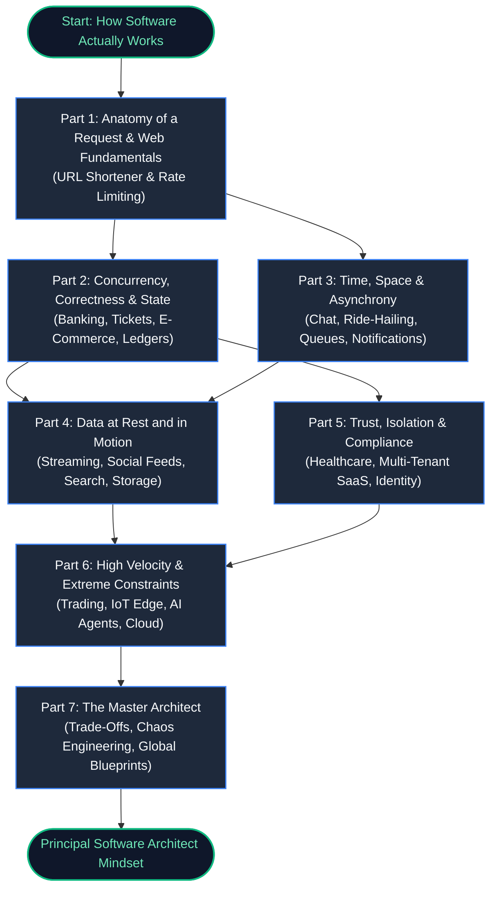

# The Anatomy of Software Systems
## From First Principles to Resilient Architecture

> **Master Roadmap & Architectural Blueprint**
> *A domain-driven masterclass taking engineers from understanding how software works to thinking and designing like Principal Software Architects.*

---

---

## 1. Book Identity & Core Value
- **Title**: *The Anatomy of Software Systems*
- **Subtitle**: *From First Principles to Resilient Architecture: A Domain-Driven Masterclass*
- **Target Reader**: Engineers, full-stack/backend developers, and tech leads ready to transition into Principal Architecture and Systems Design.
- **The Guiding Narrative**: *"What happens when the code does exactly what it was programmed to do—and the system still destroys the business?"*

---

## 2. The 3-Layer Pedagogical Architecture

```mermaid
graph LR
    subgraph L1 ["Layer A: Common Fundamentals"]
        F1["Networking & HTTP"]
        F2["Browser & State"]
        F3["Concurrency & Locks"]
        F4["Queues & Caching"]
    end
    subgraph L2 ["Layer B: Domain Invariants"]
        D1["Banking: Exact Balances"]
        D2["Booking: No Overselling"]
        D3["Healthcare: Zero Leakage"]
        D4["Trading: Sub-ms Latency"]
    end
    subgraph L3 ["Layer C: Complete Systems"]
        S1["URL Shortener Platform"]
        S2["Flash Sale Checkout"]
        S3["Realtime Ride Dispatch"]
        S4["Autonomous Agent Pipeline"]
    end
    L1 --> L2 --> L3
```

---

## 3. Modular Parts Overview

| Part | Focus & Domains | Case Studies & Core Patterns | Details Link |
|---|---|---|---|
| **Part 1** | Request Anatomy, Browser, HTTP, DNS | URL Shortener, Distributed Rate Limiter | [Part 1 Roadmap](file:///Users/lspl487/Desktop/software-book/roadmap/01-part-1-request-anatomy.md) |
| **Part 2** | Concurrency, Invariants, ACID, Ledgers | Banking, Tickets, E-Commerce, Audit Logs | [Part 2 Roadmap](file:///Users/lspl487/Desktop/software-book/roadmap/02-part-2-concurrency-correctness.md) |
| **Part 3** | Event-Driven, Queues, Geospatial | Chat, Ride-Hailing, Notifications, Search | [Part 3 Roadmap](file:///Users/lspl487/Desktop/software-book/roadmap/03-part-3-time-space-asynchrony.md) |
| **Part 4** | Media, Streaming, Feeds, Object Store | Video CDN, Social Feeds, Gaming Engine | [Part 4 Roadmap](file:///Users/lspl487/Desktop/software-book/roadmap/04-part-4-media-search-edge.md) |
| **Part 5** | Multi-Tenancy, Zero-Trust, Audits | Healthcare EHR, Enterprise SaaS, Gov Identity | [Part 5 Roadmap](file:///Users/lspl487/Desktop/software-book/roadmap/05-part-5-trust-multitenancy.md) |
| **Part 6** | Extreme Constraints, IoT, AI Agents | Trading Order Book, Edge Telemetry, AI Sandbox | [Part 6 Roadmap](file:///Users/lspl487/Desktop/software-book/roadmap/06-part-6-extreme-constraints.md) |
| **Part 7** | Synthesis, Chaos Drills, Trade-Offs | Planetary-Scale Omnichannel Blueprint | [Part 7 Roadmap](file:///Users/lspl487/Desktop/software-book/roadmap/07-part-7-synthesis-architecture.md) |

- **Cross-Domain Reference**: [Cross-Domain Matrix](file:///Users/lspl487/Desktop/software-book/roadmap/08-cross-domain-matrix.md)
