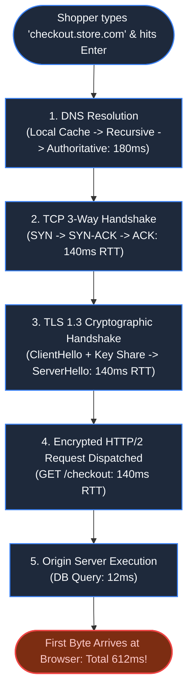
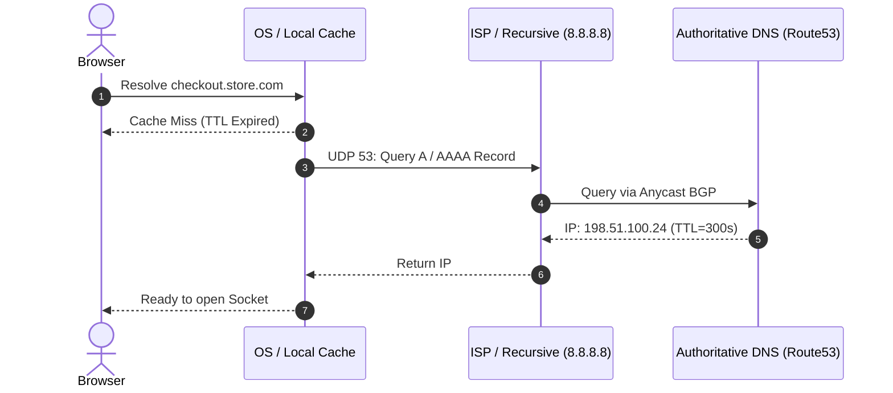
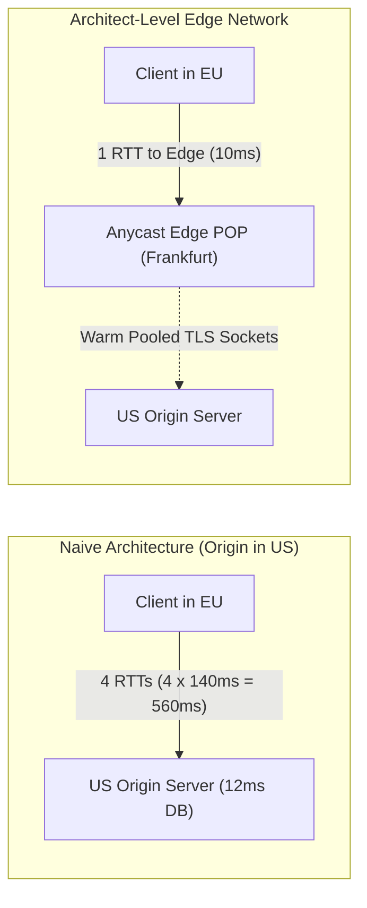

# Chapter 1: The Anatomy of a Single Keystroke

> *"Code execution speed is an illusion; round-trip physics is the hard floor of software architecture."*

---

## 1. The Mystery: The 12-Millisecond Illusion

At 00:01 UTC, a European luxury retailer launched an exclusive sneaker drop. Monitoring dashboards showed the backend database responding in a blazing **12 milliseconds (p99)**.

Yet, analytics sounded an alarm: **38% of mobile shoppers in Berlin and London abandoned checkout before the page even began to render.**



The server team claimed innocence: *"Our code runs in 12ms."*
They were measuring **server processing time**, completely blind to the **physics of the wire**. Before a single application byte was processed, the browser had to pay four consecutive network round-trips across the Atlantic.

---

## 2. Step 1: Resolving Identity (The DNS Waterfall)

When the user enters a domain, the operating system knows nothing about IP addresses. It initiates a recursive resolution chain:



### Architectural Pitfalls:
- **Excessively Short TTLs**: Setting TTL to 30s to enable quick failover forces mobile users to execute full multi-hop DNS resolutions on every interaction.
- **Unoptimized Anycast**: Without BGP Anycast, a European user might query an authoritative nameserver physically situated in Virginia, USA, wasting 180ms.

---

## 3. Step 2 & 3: Negotiating the Wire (TCP & TLS 1.3)

Once the IP is known, the client kernel opens a TCP socket:

1. **TCP Handshake (1 RTT)**:
   - `Client -> SYN`
   - `Server -> SYN-ACK`
   - `Client -> ACK`
2. **TLS 1.3 Cryptographic Exchange (1 RTT)**:
   - In TLS 1.2, negotiation required 2 full round trips (Key Exchange + Cipher Suite negotiation).
   - TLS 1.3 combines key agreement into the `ClientHello` using Diffie-Hellman ephemeral keys, reducing connection setup to a single round-trip:

```
Round Trip 1:  [SYN]                --->  [SYN-ACK]
Round Trip 2:  [ClientHello + Keys] --->  [ServerHello + Cert + Finished]
Round Trip 3:  [HTTP GET /checkout] --->  [HTTP 200 OK + Payload]
```

If your origin server is in North America and your user is in Germany (70ms one-way latency), **3 round trips = 420ms of pure transmission physics before any code executes.**

---

## 4. The Architectural Evolution: Eliminating Round Trips



### The Production Fixes:
1. **Edge SSL Termination**: Terminate TCP and TLS at an Anycast Point of Presence (POP) within 10ms of the user. The expensive handshakes terminate locally in Europe.
2. **Persistent Origin Connection Pools**: The Edge maintains pre-warmed, persistent TCP/TLS tunnels back to the origin, amortizing handshake costs to zero.
3. **HTTP/3 over QUIC (UDP)**: Eliminates head-of-line blocking at the transport layer and enables **0-RTT connection resumption**, allowing encryption keys and HTTP requests to ride in the very first UDP packet.

---

## 5. Architect-Level Trade-Offs

| Decision | Low Latency Benefit | Operational & Security Cost |
|---|---|---|
| **Edge SSL Termination** | Slashes 300ms+ off mobile handshakes | Decrypts traffic at the CDN edge; requires trust in third-party edge nodes. |
| **Long DNS TTL (86400s)** | Eliminates DNS latency for repeat visits | Impedes instant disaster failover if an IP address is blocked or corrupted. |
| **HTTP/3 QUIC (UDP)** | 0-RTT handshakes and no transport head-of-line blocking | Certain enterprise firewalls drop UDP port 443, requiring automatic TCP/2 fallback. |

---

## 6. Mental-Model Summary

```
Physical Distance × Speed of Light × Protocol Round Trips = Unforgiving Latency Floor.
No backend database optimization can recover time lost during socket negotiation.
```

- **Rule 1**: Move TLS termination physically closer to the user via Anycast Edge nodes.
- **Rule 2**: Never analyze API speed using server-side logs alone; measure **Time to First Byte (TTFB)** at the client edge.

---

## 7. The Next Failure Mode

*The network handshakes are now down from 600ms to 24ms. The HTTP response arrives at the customer's phone instantly.*

*Yet when the shopper attempts to tap "Confirm Order", the button is completely unresponsive. The browser is frozen. Why?*

👉 **Next: [Chapter 2 — The Browser Execution Cycle & Rendering Cost](file:///Users/lspl487/Desktop/software-book/book/part-01-request-anatomy/chapter-02-browser-execution-cycle.md)**
