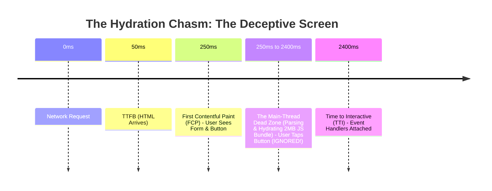
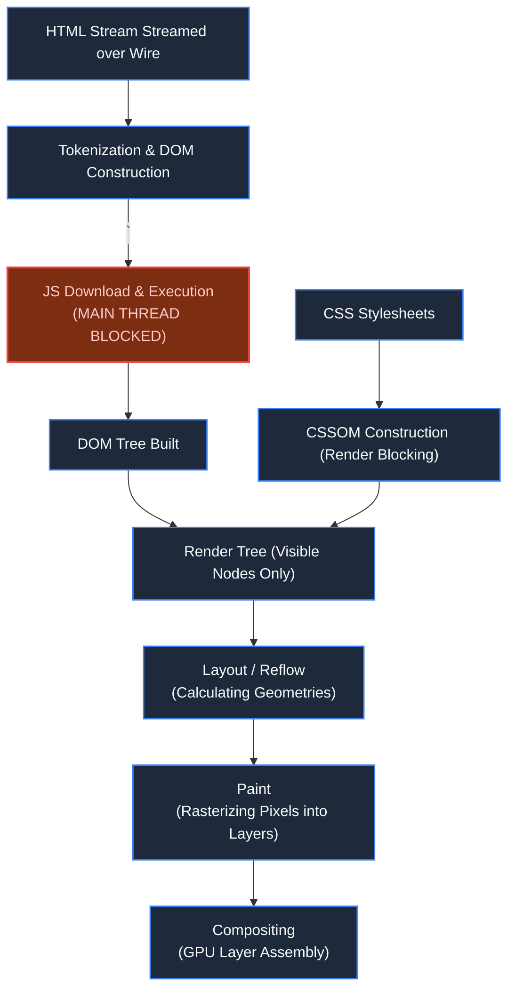
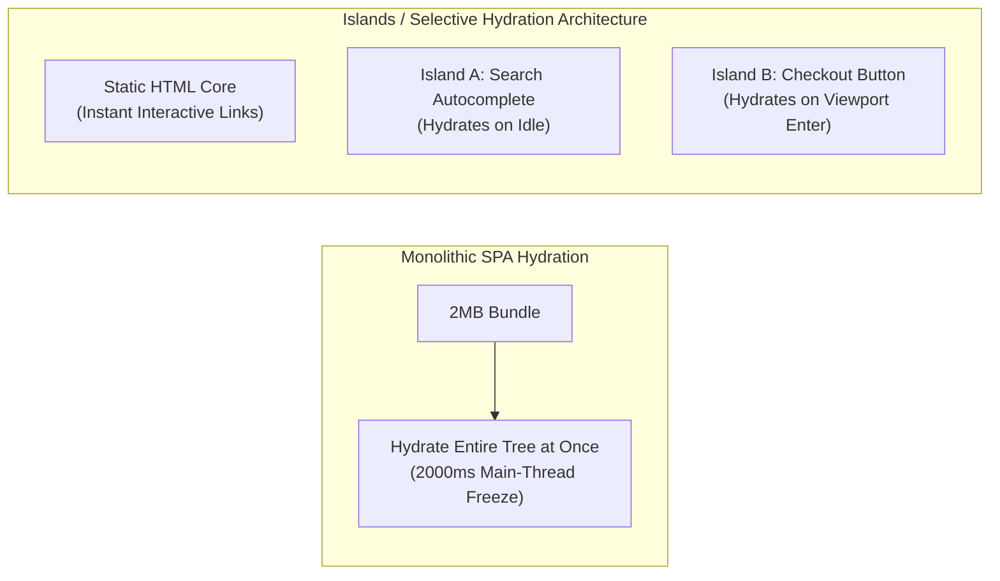

# Chapter 2: The Browser Execution Cycle & Rendering Cost

> *"Pixels on a screen are meaningless if the main thread is dead."*

---

## 1. The Mystery: The Uncanny Valley of Hydration

With Anycast Edge SSL in place, Time to First Byte (TTFB) dropped to 28ms. The checkout page appeared on screen in under 400ms.

Yet, mobile conversion plummeted. Customer support was inundated with complaints:
*"I tapped 'Pay Now' ten times, but the button was completely dead. When it finally responded, it submitted 10 orders!"*



The screen looked finished, but the browser was trapped in the **Uncanny Valley of Hydration**: visual completeness with zero interactivity.

---

## 2. The Critical Rendering Path & The Monolithic Thread

Browsers do not execute code in parallel by default. A single thread coordinates user clicks, HTML parsing, JavaScript execution, layout calculation, and pixel painting.



### Why the Main Thread Freezes:
1. **Render-Blocking CSS**: The browser refuses to render any pixels until all `<link rel="stylesheet">` files are downloaded and parsed into the CSSOM.
2. **Parser-Blocking JS**: When the HTML parser encounters a synchronous `<script>` tag, it halts DOM construction completely until the script downloads and executes.
3. **The Hydration Tax**: In standard Server-Side Rendered (SSR) Single-Page Applications (SPAs), the server renders HTML, but the client must reconstruct the entire virtual DOM tree in memory and attach event listeners to every single element.

---

## 3. Layout Thrashing: The Microscopic CPU Killer

A common frontend bug that turns a 60 FPS experience into an unresponsive slide show is **Forced Synchronous Layout** (Layout Thrashing).

```javascript
// BAD: Forces browser to recalculate layout on every iteration
for (let i = 0; i < elements.length; i++) {
  elements[i].style.width = elements[i].offsetWidth + 10 + 'px'; 
  // Reading offsetWidth invalidates styles and forces immediate recalculation!
}

// GOOD: Batch all reads, then batch all writes
const widths = elements.map(el => el.offsetWidth);
elements.forEach((el, i) => {
  el.style.width = widths[i] + 10 + 'px';
});
```

When code alternates between reading layout geometry and writing styles in a loop, the browser is forced to re-run the entire Layout algorithm dozens of times per frame.

---

## 4. The Architectural Evolution: Islands & Progressive Interactivity



### The Production Fixes:
1. **Streaming SSR with Selective Hydration**: Stream HTML chunks via HTTP chunked transfer encoding (`Transfer-Encoding: chunked`). The browser paints top-level content while scripts hydrate independent interactive widgets asynchronously.
2. **Islands Architecture**: Render 90% of the page as pure, zero-JS HTML. Only isolate dynamic widgets (e.g., the Cart and Payment button) into isolated "islands" that load minuscule micro-bundles.
3. **Offloading Work to Web Workers**: Move non-DOM computation (data parsing, encryption, analytics event buffering) off the main thread into background Web Workers using `Comlink` or `Partytown`.

---

## 5. Architect-Level Trade-Offs

| Architecture Pattern | Interactivity (TTI) | SEO & Initial Paint | Complexity Cost |
|---|---|---|---|
| **Client-Side Rendering (CSR)** | Poor on mobile (blank screen during bundle fetch) | Terrible without prerendering | Simplest backend; static S3 hosting. |
| **Traditional SSR** | Fast FCP, but suffers deep Hydration Chasm | Excellent SEO | Node.js/Edge server infrastructure required. |
| **Islands / Partial Hydration** | Near-instant; zero main-thread freezing | Excellent SEO & fast FCP | Requires component boundary isolation and strict state boundaries. |

---

## 6. Mental-Model Summary

```
Downloading JavaScript is cheap; parsing and compiling it on a mobile CPU is expensive.
Never measure page speed by when pixels appear; measure by Time to Interactive (TTI) and Interaction to Next Paint (INP).
```

- **Rule 1**: Break monolithic client bundles into decoupled islands of interactivity.
- **Rule 2**: Avoid synchronous layout thrashing by strictly separating DOM reads from DOM writes.

---

## 7. The Next Failure Mode

*The browser is now blazing fast. A customer fills out the shipping details, clicks 'Place Order', and a POST request shoots back across the wire.*

*100,000 customers do this simultaneously. The requests reach the cloud load balancer. Within 3 seconds, every request returns `502 Bad Gateway`.*

*The backend servers didn't run out of CPU. What exhausted them?*

👉 **Next: [Chapter 3 — When the Request Meets the Backend](/book/part-01-request-anatomy/chapter-03-request-meets-backend.md)**
