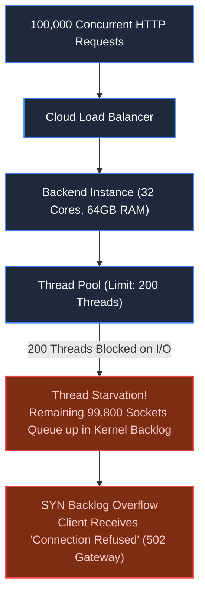
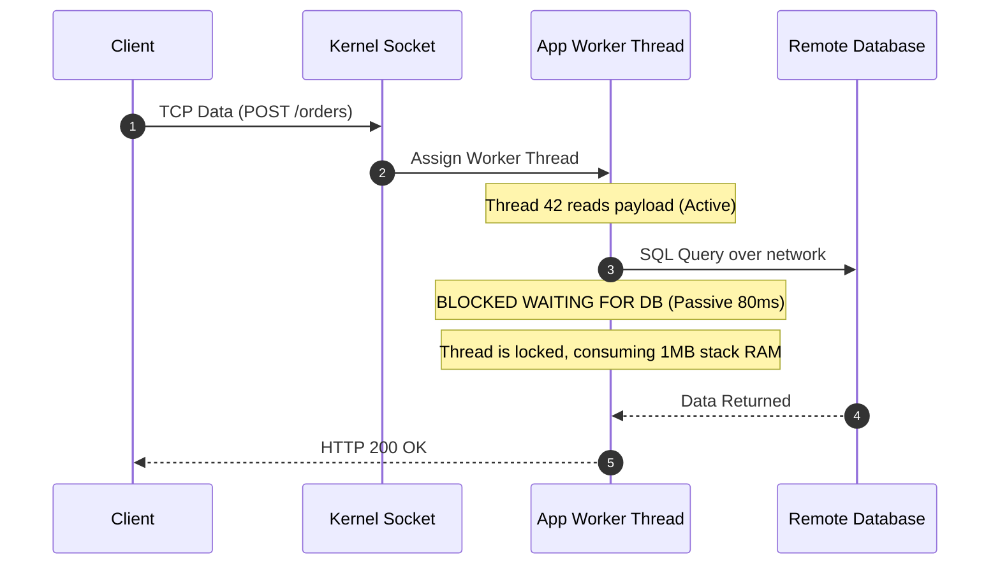
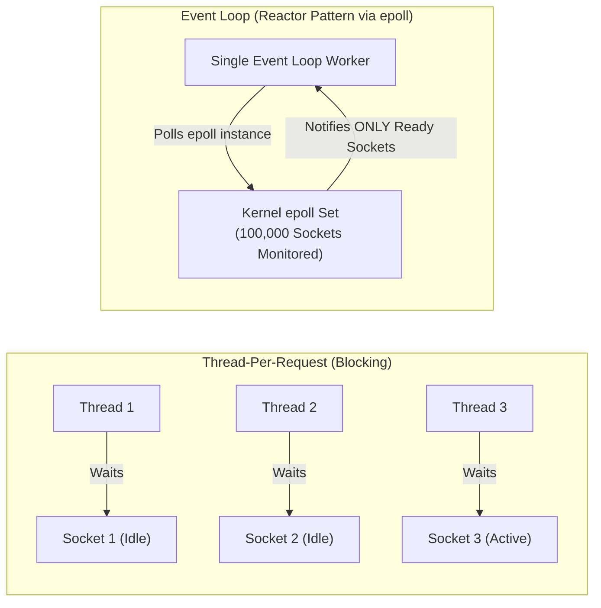

# Chapter 3: When the Request Meets the Backend

> *"An idle thread is not free; it is a locked kernel resource waiting in line."*

---

## 1. The Mystery: The 15% CPU Collapse

At 10:00 AM, a flash sale broadcast sent 100,000 concurrent shoppers to a retail platform. The backend fleet consisted of 50 high-spec cloud instances (32 vCPUs, 64GB RAM each).

Within 45 seconds, the entire site was throwing `502 Bad Gateway` errors.

The operations team pulled up server metrics in disbelief:
- **CPU Utilization: 14%**
- **Memory Usage: 18%**
- **Disk I/O: 3%**



The servers weren't running out of computational power. They had choked on their own **concurrency model**.

---

## 2. The Trap: Thread-Per-Request Architecture

In traditional application servers (standard Spring/Tomcat, Ruby on Rails, Django prefork), each incoming socket connection is assigned a dedicated operating system thread:

$$\text{Active Requests} = \text{Active Threads}$$



### The Breaking Points:
1. **Thread Memory Footprint**: An OS thread allocates a stack of 512KB to 1MB. Spawning 10,000 threads consumes 10GB of RAM purely for execution stacks, even if zero CPU work is occurring.
2. **Context Switching Tax**: When 5,000 threads compete for 32 CPU cores, the Linux kernel spends more CPU cycles saving and restoring CPU registers (`Context Switching`) than executing business code.
3. **The Kernel Backlog Queue**: The OS listens on a socket with two queues:
   - `SYN Backlog`: Half-open handshakes.
   - `Listen Backlog` (`somaxconn`): Fully negotiated connections waiting for the application to call `accept()`.
   When application threads are blocked, this backlog fills up, and the OS silently discards incoming SYN packets.

---

## 3. The Paradigm Shift: Non-Blocking Event Loops (epoll)

Modern high-performance ingress systems (Nginx, Envoy, Node.js, Netty, Go netpoll) reject the thread-per-request model. They leverage OS-level event notification mechanisms: **`epoll`** (Linux) and **`kqueue`** (BSD/macOS).



Instead of 100,000 threads waiting for data, a handful of worker threads (typically one per CPU core) register thousands of file descriptors into an `epoll` kernel structure.

When a client transmits a byte, the network interface card (NIC) fires an interrupt, and `epoll_wait()` notifies the worker thread to read the available data. **Zero threads sit idle waiting on network I/O.**

---

## 4. The Edge Shield: Reverse Proxy Buffering

Putting application workers directly on the open internet exposes them to the **Slowloris Attack** (slow mobile networks transmitting 1 byte every 10 seconds, locking up backend worker threads).

```mermaid
flowchart LR
    Clients["Slow Mobile Clients\n(3G/4G, High Latency)"] -->|Slow HTTP Streams| Nginx["Reverse Proxy (Nginx / Envoy)\n(epoll-driven, buffers entire payload)"]
    Nginx -->|Fast Local Pipe (HTTP/1.1 or gRPC)| Backend["App Service Worker\n(Receives fully buffered request, executes in 2ms)"]
```

### Production Ingress Rules:
1. **Request Buffering**: The reverse proxy absorbs slow client uploads in memory or temporary disk before handing the complete request to the backend worker.
2. **Connection Keep-Alive Pooling**: Reuse persistent TCP connections between the reverse proxy and backend instances, eliminating continuous handshake churn.
3. **Kernel Socket Tuning**: Increase system limits:
   ```bash
   sysctl -w net.core.somaxconn=65535
   sysctl -w net.ipv4.tcp_max_syn_backlog=65535
   ulimit -n 1048576 # Increase max file descriptors
   ```

---

## 5. Architect-Level Trade-Offs

| Concurrency Model | Max Concurrent Sockets | Developer Complexity | Ideal Workload |
|---|---|---|---|
| **Thread-Per-Request** | Low (~500 per node) | Low (linear, imperative code) | Internal enterprise apps with low concurrency. |
| **Event-Driven (Node / Netty)** | Extreme (100,000+ per node) | High (callback hell, async state tracking) | High I/O, streaming APIs, chat, proxies. |
| **Virtual Threads (Go / Java Loom)** | High (Millions of virtual threads) | Low (writes like synchronous code; runtime maps to OS workers) | High-concurrency backend services with complex business logic. |

---

## 6. Mental-Model Summary

```
CPU cores are engines; threads are drivers; sockets are packages.
If you hire a driver to sit in a parked car waiting for a package to arrive, your fleet will go bankrupt.
Use event notifications (epoll) to drive only when a package is ready.
```

- **Rule 1**: Buffer slow client traffic at the reverse proxy (Envoy/Nginx) before touching application workers.
- **Rule 2**: Tune kernel connection backlogs (`somaxconn`) to prevent silent connection dropouts during traffic bursts.

---

## 7. The Next Failure Mode

*The reverse proxy and non-blocking event loop now effortlessly absorb 100,000 concurrent sockets.*

*The request passes into the application worker and fires a standard query:*
```sql
SELECT * FROM orders WHERE user_id = 'user_8829' ORDER BY created_at DESC;
```

*In local development with 1,000 rows, this query returned in 0.3ms.*
*In production with 50,000,000 rows, database disk I/O hits 100%, and queries take 38 seconds. The database stops responding.*

*Why did a simple query bring the cluster to its knees?*

👉 **Next: [Chapter 4 — Database Indexing & The Illusion of Speed](/book/part-01-request-anatomy/chapter-04-database-indexing-mechanics.md)**
