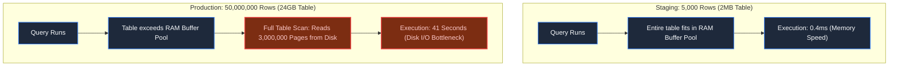
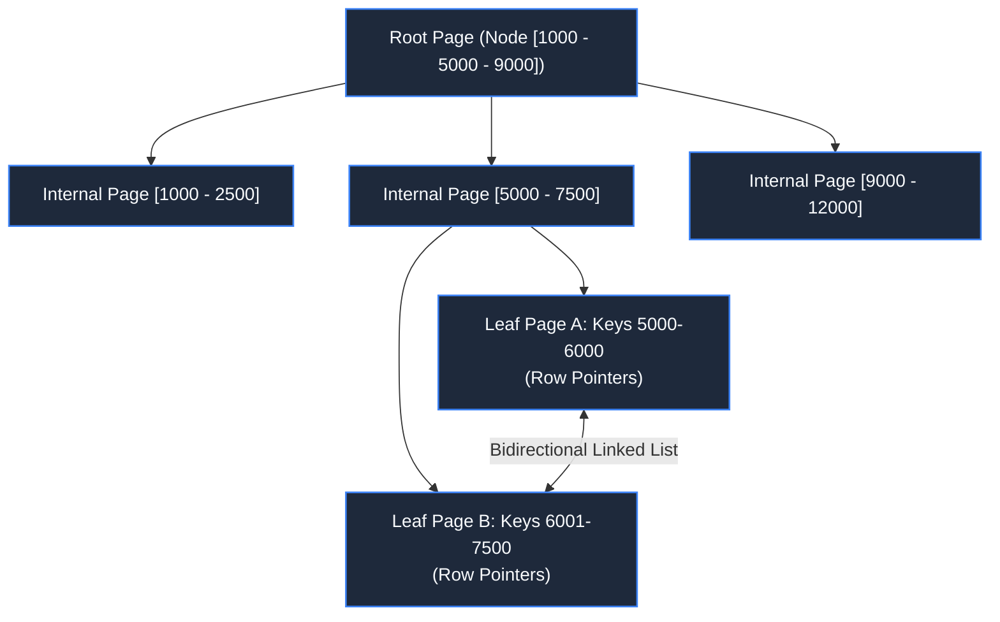
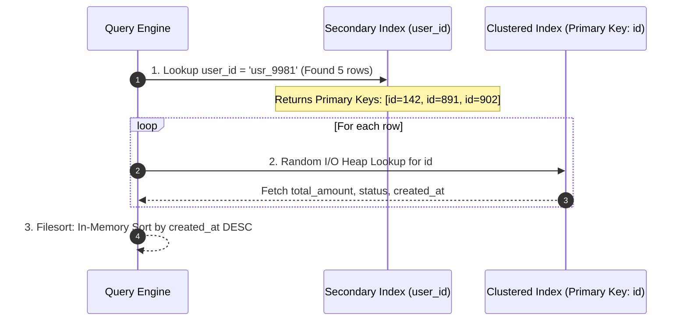
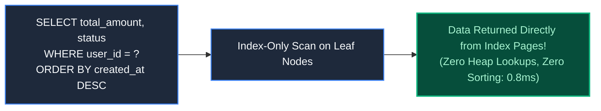

# Chapter 4: Database Indexing & The Illusion of Speed

> *"An index is not magic; it is a pre-sorted telephone directory purchased with slower writes."*

---

## 1. The Mystery: The Staging Mirage

In staging with 5,000 test orders, this query executed in a breathtaking **0.4 milliseconds**:

```sql
SELECT id, total_amount, status 
FROM orders 
WHERE user_id = 'usr_9981' 
ORDER BY created_at DESC;
```

When shipped to production with 50,000,000 records (24GB table), the query took **41 seconds**. Disk I/O slammed to 100%, and database connections piled up until the primary node rebooted.



Why did the exact same query become 100,000x slower? Staging suffered from the **RAM Mirage**: small datasets live entirely in memory cache, masking the catastrophe of full table scans.

---

## 2. Storage Physics: The Page Unit & B+ Trees

Relational databases (PostgreSQL, MySQL InnoDB) do not read single rows from disk; they read and write in **Pages** (typically 8KB or 16KB).

Without an index, finding `user_id = 'usr_9981'` forces the database engine to perform a **Sequential Scan**: reading every single 16KB page from disk into memory, examining all 50 million rows one by one.

### The B+ Tree Anatomy:
A B+ Tree organizes keys in a balanced hierarchy where every leaf node is linked horizontally:



With a branching factor (fanout) of 100, a B+ Tree indexes **100,000,000 rows in just 4 levels**. Traversing from root to leaf requires only **4 page reads** (microseconds) instead of 3,000,000.

---

## 3. Clustered vs Secondary Indexes & The Double Lookup Penalty

In MySQL InnoDB:
- **Clustered Index**: The primary key *is* the table. The leaf nodes contain the actual row data.
- **Secondary Index**: Leaf nodes do *not* contain table data; they contain the secondary key plus the corresponding Primary Key value.



If a user has 10,000 orders, the engine executes 10,000 random page jumps into the clustered index, followed by an expensive CPU `Filesort`.

---

## 4. The Architectural Cure: Composite & Covering Indexes

To eliminate the secondary lookup and the CPU sort, create a **Composite Covering Index**:

```sql
CREATE INDEX idx_orders_user_created_covering 
ON orders (user_id, created_at DESC) 
INCLUDE (total_amount, status); -- In PostgreSQL, or compound in MySQL
```



Because the index keys are already pre-sorted by `(user_id, created_at DESC)` and include `total_amount` and `status`, the database performs an **Index-Only Scan**. It never touches the primary table.

---

## 5. Architect-Level Trade-Offs

| Storage Engine Pattern | Read Latency | Write Throughput | Best Used For |
|---|---|---|---|
| **B+ Tree (Postgres, InnoDB)** | Ultra-fast random reads ($O(\log N)$) | Slower random writes (in-place page splits) | OLTP, relational records, financial ledgers. |
| **LSM-Tree (RocksDB, Cassandra)**| Slower reads (must check MemTable, SSTables, Bloom filters) | Blazing append-only writes (sequential disk I/O) | High-volume time-series, IoT telemetry, clickstreams. |

> **The Write Penalty**: Adding 6 indexes to a table means every single `INSERT` statement must write to 7 separate B-Trees on disk, destroying write throughput.

---

## 6. Mental-Model Summary

```
Table scans test whether you have enough RAM; indexes test whether you understand query plans.
Never deploy a query without inspecting its 'EXPLAIN ANALYZE' output.
```

- **Rule 1**: Verify that high-traffic queries execute **Index-Only Scans** or narrow range scans.
- **Rule 2**: Order composite index columns by **Equality first, Range/Sort second** `(status = 'ACTIVE' ORDER BY created_at)`.

---

## 7. The Next Failure Mode

*The covering index reduced order query latency from 41 seconds to 0.8 milliseconds.*

*Everything ran smoothly until a marketing campaign directed 500,000 concurrent users to the homepage.*

*Even at 0.8ms per query, 500,000 requests per second saturated the database CPU connections. The team added an in-memory Redis cache to offload the database.*

*At midnight, the cache key expired. The resulting outage was worse than the original crash.*

*What is a Cache Stampede, and how do architects neutralize it?*

👉 **Next: [Chapter 5 — Caching Tiers & The Cache Stampede](file:///Users/lspl487/Desktop/software-book/book/part-01-request-anatomy/chapter-05-caching-tiers-and-stampedes.md)**
