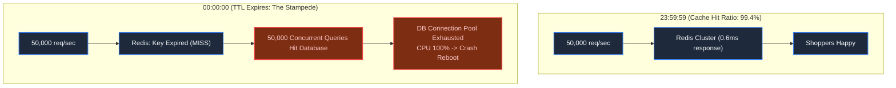
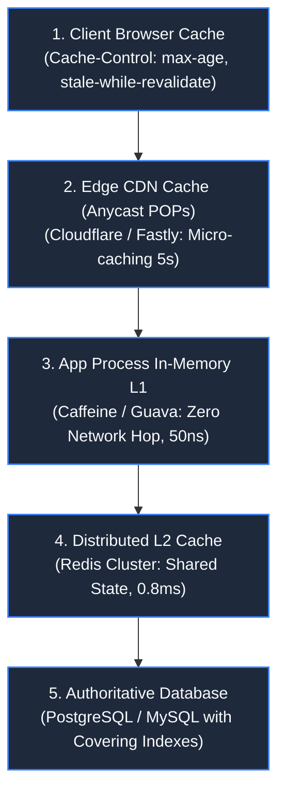
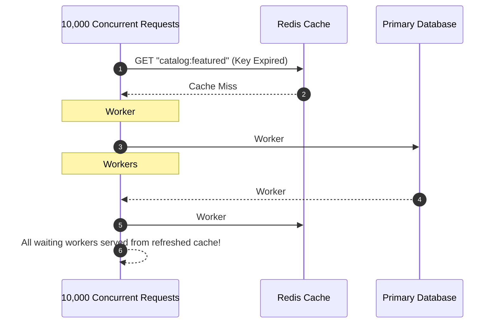

# Chapter 5: Caching Tiers & The Cache Stampede

> *"A cache is an accelerator, not a shield; if your database collapses when the cache empties, you built a house of cards."*

---

## 1. The Mystery: The Midnight Cliff

To protect the database during a multi-day festival sale, engineers cached the hot homepage catalog in Redis with a 24-hour TTL:

```javascript
await redis.set("catalog:featured", JSON.stringify(data), "EX", 86400);
```

For 23 hours and 59 minutes, the system was untouchable: Redis absorbed 99.4% of traffic, and the database rested at 4% CPU.

Then midnight struck.



At 00:00:00, the key vanished. Over the next 500 milliseconds, **25,000 concurrent requests experienced a cache miss simultaneously**. Every single request bypassed Redis and slammed the primary database with an expensive 8-table SQL join.

The database connection pool choked, thread queues overflowed, and the cluster crashed. This is the **Cache Stampede** (also known as the *Thundering Herd* or *Dogpiling*).

---

## 2. Multi-Tier Caching Topology

A resilient architecture never relies on a single Redis instance. It deploys a defense-in-depth cache hierarchy:



If an item expires in Redis, L1 in-process caches and CDN edge micro-caches prevent requests from synchronously falling through to the primary database.

---

## 3. Neutralizing the Stampede: Mutexes & Probabilistic Refresh

Three battle-tested architectural patterns eliminate the Thundering Herd:

### Pattern A: Distributed Mutex (Singleflight)
Only the *first* thread that discovers a cache miss is allowed to query the database. All other incoming requests block and wait for the leader, or receive stale data:



### Pattern B: Probabilistic Early Expiration (XFetch Algorithm)
Instead of waiting for the key to die, worker threads evaluate a probabilistic formula on every read:

$$\Delta - \beta \times \delta \times \ln(\text{random}()) \le 0$$

Where:
- $\Delta$ = Time until expiration.
- $\delta$ = Time required to compute the database query.
- $\beta$ = Aggressiveness factor ($> 0$).

As the key nears expiration under heavy traffic, the probability that *one* background request triggers a pre-emptive refresh approaches 100%. **The key never actually expires for users.**

### Pattern C: HTTP `stale-while-revalidate`
Instruct clients and CDNs to serve stale data immediately while revalidating in the background:
```http
Cache-Control: public, max-age=60, stale-while-revalidate=600
```
Users experience a 2ms response time, while edge servers refresh content asynchronously.

---

## 4. Architect-Level Trade-Offs

| Caching Pattern | Read Latency | Consistency Guarantee | Disaster Risk |
|---|---|---|---|
| **Cache-Aside (Lazy)** | Fast on hits; slow on miss | Eventual (risk of serving stale data if DB updates) | Vulnerable to Cache Stampede without Singleflight. |
| **Write-Through** | Fast reads | High consistency (Cache & DB updated together) | Higher write latency; caches data that may never be read. |
| **Write-Behind (Write-Back)** | Ultra-fast writes (memory speed) | Eventual; writes queued for batch DB sync | Data loss if Redis crashes before flushing to disk. |
| **Refresh-Ahead** | Instant (keys never expire) | High for predictable access patterns | Wasted compute refreshing keys nobody is reading. |

---

## 5. Mental-Model Summary

```
If a million users ask for the exact same data at the same moment, 
it is a failure of architecture if more than one request touches the database.
```

- **Rule 1**: Add jitter to cache TTLs (`TTL = base_ttl + rand(0, 300)`) to prevent simultaneous batch expirations.
- **Rule 2**: Use **Singleflight / Distributed Locks** or **XFetch** on hot read keys.

---

## 6. The Milestone Awaits

We have traced the foundational anatomy of software end-to-end:
1. **Network Physics & Handshakes** ([Chapter 1](file:///Users/lspl487/Desktop/software-book/book/part-01-request-anatomy/chapter-01-anatomy-of-a-keystroke.md))
2. **Browser Rendering & Hydration** ([Chapter 2](file:///Users/lspl487/Desktop/software-book/book/part-01-request-anatomy/chapter-02-browser-execution-cycle.md))
3. **Ingress & Event Loops** ([Chapter 3](file:///Users/lspl487/Desktop/software-book/book/part-01-request-anatomy/chapter-03-request-meets-backend.md))
4. **Database Indexing & Disk I/O** ([Chapter 4](file:///Users/lspl487/Desktop/software-book/book/part-01-request-anatomy/chapter-04-database-indexing-mechanics.md))
5. **Multi-Tier Caching & Invalidation** ([Chapter 5](file:///Users/lspl487/Desktop/software-book/book/part-01-request-anatomy/chapter-05-caching-tiers-and-stampedes.md))

Now, we integrate these five building blocks into our first complete, production-grade system design.

👉 **Next: [Chapter 6 — Complete Case Study: Designing a Planetary URL Shortener](file:///Users/lspl487/Desktop/software-book/book/part-01-request-anatomy/chapter-06-case-study-planetary-url-shortener.md)**
