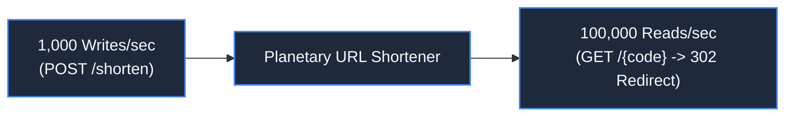
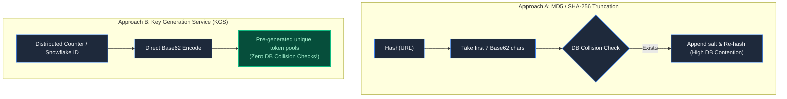

# Chapter 6: Case Study: Designing a Planetary URL Shortener

> *"A URL shortener looks like a junior interview toy—until it has to serve 50,000 redirects per second with sub-10ms global latency."*

---

## 1. System Requirements & Capacity Physics



### Quantitative Reality (100:1 Read-Heavy Ratio):
- **Write Throughput**: 1,000 URLs generated/sec $\approx 86.4\text{ million new URLs/day}$.
- **Read Throughput**: 100,000 redirects/sec (Peak: 250,000/sec).
- **Storage Calculation (5 Years)**:
  $$86.4\text{M} \times 365 \times 5 \approx 157.6\text{ billion records}$$
  At 500 bytes per record (Original URL, short code, user ID, created timestamp):
  $$157.6\text{B} \times 500\text{ bytes} \approx 78.8\text{ Terabytes of persistent storage}$$

---

## 2. Short-Code Generation: Hashes vs Key Generation Service (KGS)

How do you map a 500-character URL into a 7-character string?

Using $[a\text{-}z, A\text{-}Z, 0\text{-}9]$ (**Base62**), a 7-character code yields:
$$62^7 \approx 3.52\text{ trillion unique URLs}$$



**The Architect's Choice**: Truncating hashes requires checking the database for collisions on every write. Instead, use a **Key Generation Service (KGS)**: pre-generate sequential 64-bit integers partitioned across worker ranges, converted to Base62. Writes achieve $O(1)$ zero-collision assignment.

---

## 3. The Complete Production Architecture

```mermaid
flowchart TD
    User["Global User / Mobile Browser"] --> Anycast["Anycast Edge POP (Cloudflare / Fastly)"]
    Anycast -->|Edge Cache Hit (85%)| Edge302["Instant HTTP 302 Redirect (<10ms)"]
    
    Anycast -->|Edge Cache Miss| Gateway["API Gateway (Envoy) & Rate Limiter"]
    Gateway --> ReadSrv["Redirect Read Service (Go/Rust epoll)"]
    ReadSrv --> Redis["Redis Cluster (LRU Top 20% URLs)"]
    Redis -->|Cache Miss| DBReplica["PostgreSQL / ScyllaDB Read Replicas"]
    
    Gateway --> WriteSrv["URL Write Service"]
    WriteSrv --> KGSCluster["Key Generation Cluster (Snowflake / Range)"]
    WriteSrv --> MasterDB["Primary Database (B-Tree on short_code)"]
    
    ReadSrv -.->|Async Event| Kafka["Kafka: Click Analytics Stream"]
    Kafka --> Flink["Flink Window Aggregator"] --> AnalyticsDB["ClickHouse OLAP"]

    classDef default fill:#1e293b,stroke:#3b82f6,stroke-width:1.5px,color:#f8fafc;
    classDef edge fill:#064e3b,stroke:#10b981,stroke-width:2px,color:#a7f3d0;
    class Edge302 edge;
```

---

## 4. Critical Engineering Decisions

### Decision 1: HTTP 301 (Permanent) vs HTTP 302/307 (Temporary)
- **HTTP 301**: The browser caches the redirect permanently. Subsequent clicks never touch our servers.
  - *Catastrophe*: We lose all click tracking and analytics. If the destination URL is updated or found to be malware, we cannot revoke it.
- **HTTP 302 / 307**: The browser asks our server on every redirect.
  - *Architectural Standard*: Use **302 Found** (or 307 Temporary Redirect) with a short `Cache-Control: private, max-age=300`. This enables edge caching while preserving analytics and instant revocation.

### Decision 2: Decoupling Click Analytics from the Critical Path
Updating a `click_count` column directly in SQL on every redirect turns a read into a locking write transaction:
```sql
UPDATE urls SET click_count = click_count + 1 WHERE short_code = 'x7K9a'; -- DEADLOCK TRAP!
```
**The Solution**: Emit an asynchronous log event to Kafka. The read service redirects in 2ms. Analytics workers aggregate counts in memory and batch-flush to ClickHouse every 10 seconds.

### Decision 3: Phishing & Malicious Abuse Protection
A public URL shortener is a prime weapon for cybercriminals masking phishing links:
1. Synchronous check: Bloom filters holding hashes of known malicious domains (Google Safe Browsing).
2. Asynchronous scan: Sandboxed background workers follow redirects and inspect target DOMs for credential-harvesting forms, automatically toggling `is_active = false`.

---

## 5. Failure Modes & Mitigations

| Failure Scenario | Cascade Effect | Architectural Defense |
|---|---|---|
| **Viral Tweet (100,000 req/s to one link)** | Cache stampede on single key | Singleflight mutex + Edge CDN micro-caching (5s). |
| **Primary Database Dies** | Cannot create new links | Read service continues 100% uninterrupted via Redis + Read Replicas. |
| **KGS Worker Range Exhaustion** | Write service stalls | Distributed ZooKeeper/etcd ranges; workers pre-fetch 100,000 token blocks. |

---

## 6. Mental-Model Summary

```
A planetary system is not built with bigger servers;
it is built by separating reads from writes, decoupling analytics into async event streams,
and letting edge caches absorb 90% of requests before they touch the origin.
```

---

## 7. The Unresolved Threat

*The URL shortener is operational. But at 02:00 AM, a botnet of 5,000 compromised servers begins hammering the write endpoint with 20,000 URL creations per second, exhausting the KGS token pool and filling the database with spam.*

*IP-based firewalls fail because the botnet rotates across 5,000 residential IPs.*

*How do you build a Distributed Rate Limiter that tracks sliding windows across an entire cluster without introducing race conditions?*

👉 **Next: [Chapter 7 — Standalone System: Distributed Rate Limiter](file:///Users/lspl487/Desktop/software-book/book/part-01-request-anatomy/chapter-07-system-distributed-rate-limiter.md)**
