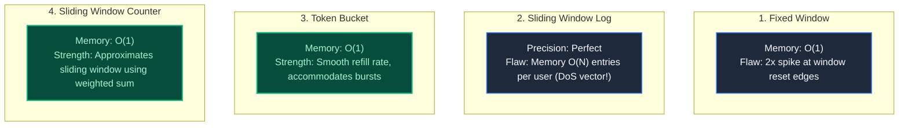
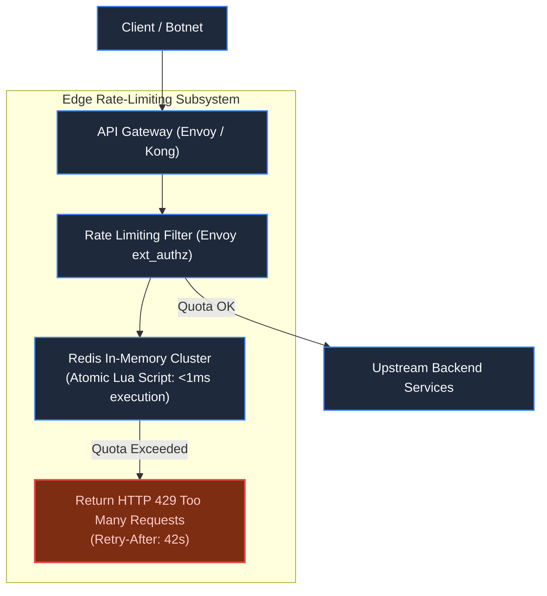

# Chapter 7: Standalone System: The Distributed Rate Limiter

> *"A rate limiter that takes 5ms to evaluate under high load becomes the very Denial of Service it was deployed to stop."*

---

## 1. The Mystery: The 2x Boundary Burst & Cluster Desync

Following the URL Shortener launch, a rogue client scripted 20,000 requests per minute. The team installed an in-memory rate limiter configured for `100 requests / minute`:

```mermaid
timeline
    title The Boundary Burst Trap: 200 Requests in 2 Seconds
    00:58 : 0 Requests Sent
    00:59 : 100 Requests Arrive (Window 1 Quota Expended: ALLOWED)
    01:00 : New Minute Window Resets Counter to 0!
    01:01 : 100 Requests Arrive (Window 2 Quota Expended: ALLOWED)
```

The server allowed **200 requests within a 2-second window** across the boundary!

Worse, behind a 20-node load balancer, a client sending 1,800 requests/minute was never throttled: each node kept a local in-memory counter and only saw 90 requests.

---

## 2. Algorithm Face-Off: Which Rate Limiter to Deploy?



### The Formula: Sliding Window Counter
Instead of storing timestamps, we compute a weighted sum between the previous and current window:

$$\text{Current Count} = (\text{Count}_{\text{prev}} \times (1 - \text{Overlap Ratio})) + \text{Count}_{\text{curr}}$$

Memory is strictly $O(1)$ (two integer counters in Redis), with zero boundary burst vulnerability.

---

## 3. Distributed Concurrency: The Redis Lua Solution

A naive distributed implementation checks Redis, then updates:
```
// DANGEROUS: Classic Read-Modify-Write Race Condition
val count = redis.get(key);
if (count < limit) {
    redis.incr(key); // 50 concurrent requests all read "count = 99"!
}
```

To eliminate race conditions, the rate limiter executes as a **single atomic Lua script** inside Redis:

```lua
-- Atomic Token Bucket in Redis Lua
local key = KEYS[1]
local limit = tonumber(ARGV[1])
local current = tonumber(redis.call('get', key) or "0")

if current + 1 > limit then
    return 0 -- Rejected (HTTP 429)
else
    redis.call("INCRBY", key, 1)
    if current == 0 then
        redis.call("EXPIRE", key, tonumber(ARGV[2]))
    end
    return 1 -- Allowed
end
```

---

## 4. Production Edge Architecture



### Standard Response Headers:
```http
HTTP/1.1 429 Too Many Requests
X-RateLimit-Limit: 100
X-RateLimit-Remaining: 0
X-RateLimit-Reset: 1718002842
Retry-After: 42
Content-Type: application/json

{"error": "rate_limit_exceeded", "retry_after_seconds": 42}
```

---

## 5. Architect-Level Trade-Offs

| Decision | Low Latency Benefit | Disaster Risk |
|---|---|---|
| **Fail-Open (Default)** | If Redis cluster dies, traffic passes through uninterrupted. | A malicious botnet can take down the database during a Redis outage. |
| **Fail-Closed** | Protects downstream databases at all costs if Redis fails. | A minor Redis glitch causes a 100% total outage for legitimate users. |
| **Local Memory Fallback** | Gateway falls back to local in-memory token bucket if Redis latency spikes $>10\text{ms}$. | Slight rate quota overage during failover, but guarantees system survival. |

---

## 6. Part 1 Grand Milestone Recap

We have completed **Part 1: The Anatomy of a Request & Web Fundamentals**:

```
[Keystroke] -> DNS Anycast -> TLS 1.3 -> Ingress epoll -> 
Database B+ Tree -> Multi-Tier Caching -> URL Shortener -> Edge Rate Limiter
```

We now possess the complete foundational mental model of how packets, browsers, sockets, query engines, and caches interact under load.

---

## 7. The Next Battlefield: Concurrency & Invariants

*Your infrastructure is now fast, cached, and rate-limited. But software exists to serve business transactions.*

*At 09:00:00.000, two users click 'Buy Ticket' for the final seat 42A. Both requests pass rate limiting. Both hit the database at the exact same millisecond.*

*Both users receive a booking confirmation email.*

*How does software maintain absolute correctness when multiple actors compete for the same state?*

👉 **Next: [Part 2: Concurrency, Correctness & State — The Battle for Invariants](file:///Users/lspl487/Desktop/software-book/roadmap/02-part-2-concurrency-correctness.md)**
👉 **Next Chapter: [Chapter 8 — The Ghost in the Machine: Race Conditions & Critical Sections](file:///Users/lspl487/Desktop/software-book/book/part-02-concurrency-correctness/chapter-08-race-conditions-critical-sections.md)**
