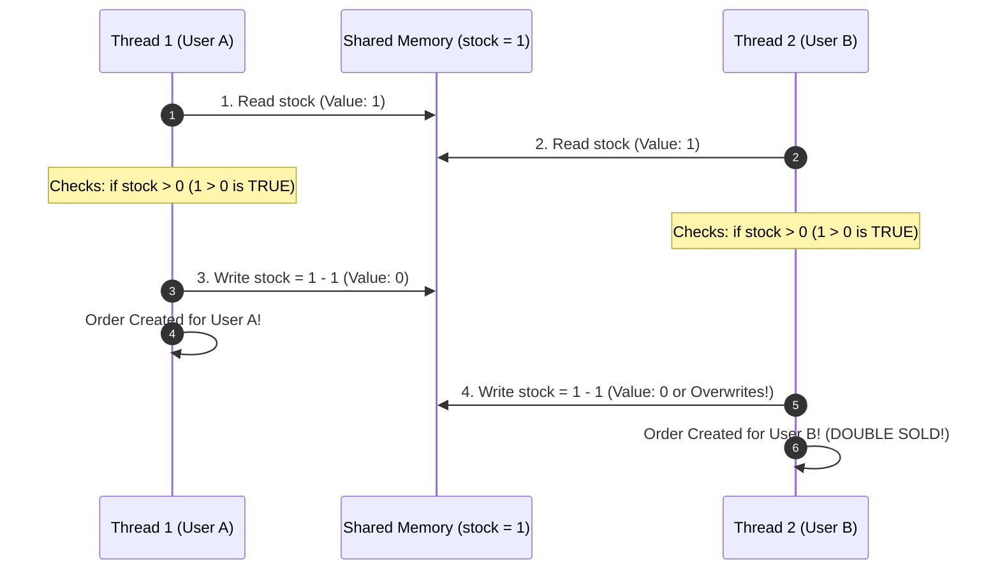
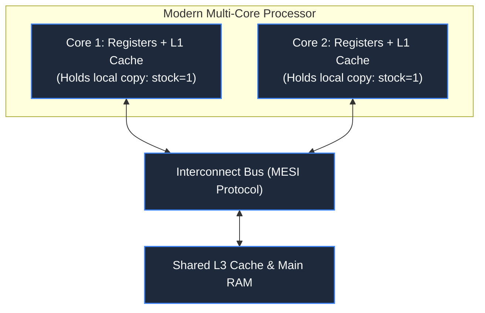
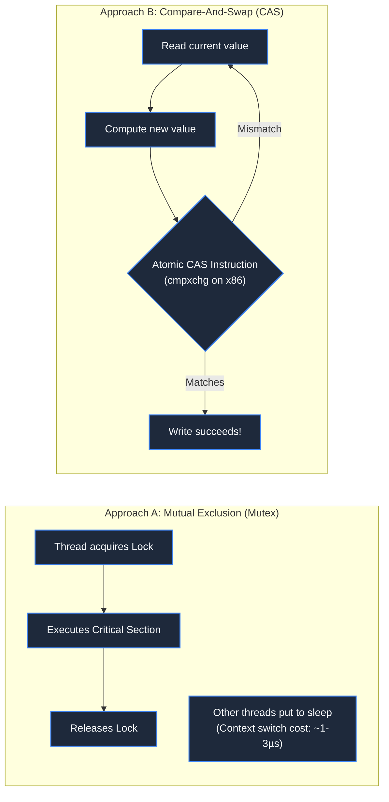
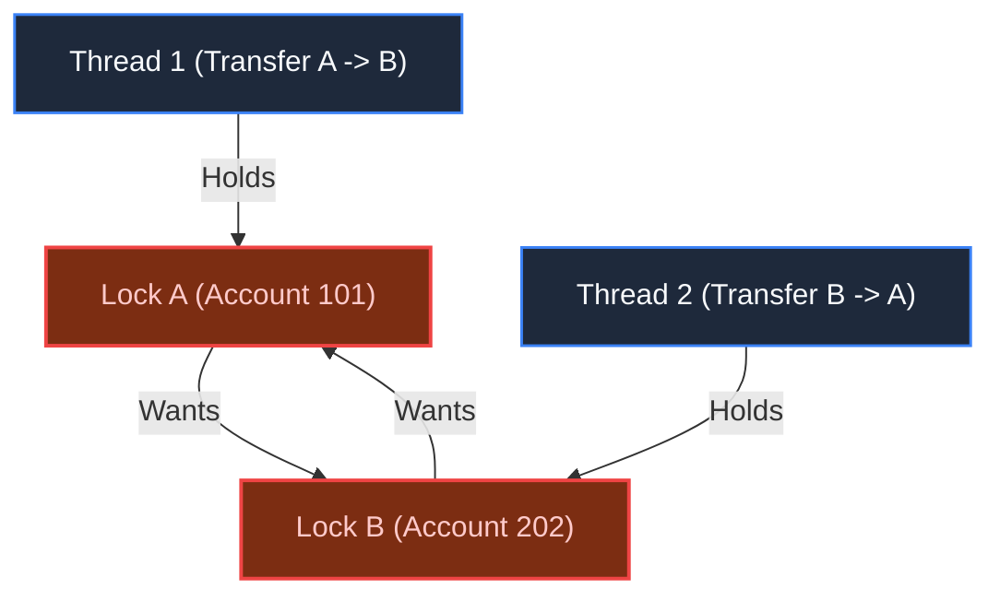

# Chapter 8: The Ghost in the Machine: Race Conditions & Critical Sections

> *"A condition you checked a nanosecond ago is already a rumor in a concurrent system."*

---

## 1. The Mystery: The Negative Inventory Incident

During a promotional product drop, an online store offered 10 limited-edition headphones. The backend code was simple and seemingly foolproof:

```python
def purchase_item(user_id):
    stock = get_inventory()
    if stock > 0:
        # Deduct stock and process payment
        set_inventory(stock - 1)
        create_order(user_id)
        return True
    return False
```

When the sale opened, the database recorded **14 completed orders**. 

When the warehouse team checked physical inventory, the stock column in the database read:
$$\text{stock} = -4$$



The code executed exactly as written. The failure occurred in the gap between **checking** state and **acting** upon it: the classic **Check-Then-Act Hazard** (Time-of-Check to Time-of-Use, or TOCTOU).

---

## 2. Hardware Reality: Registers, Caching & Reordering

Software engineers often imagine memory as a single notebook where changes happen sequentially. Modern multi-core hardware behaves very differently:



### The Three Hardware Hazards:
1. **Instruction Atomicity**: An operation like `stock = stock - 1` is not one CPU instruction. It compiles into three discrete operations:
   - `LOAD stock into Register AX`
   - `SUB AX, 1`
   - `STORE Register AX back to memory address`
   If thread scheduling interrupts the CPU between `LOAD` and `STORE`, updates are lost.
2. **CPU Cache Visibility**: Core 1 writes to its local L1 cache. Unless forced by cache coherency protocols (MESI), Core 2 may continue reading stale values from its own cache.
3. **Instruction Reordering**: Compilers and out-of-order CPUs reorder independent statements to maximize pipeline throughput. Without **Memory Barriers**, statements execute in orders you never wrote.

---

## 3. Software Synchronization: Mutex vs Atomic CAS

To prevent concurrent thread collisions, we protect the **Critical Section** (the code block accessing shared mutable state).



- **Mutex (Locking)**: Only one thread can enter the critical section. Others block and enter the kernel wait queue.
- **Atomic CAS (Lock-Free)**: Supported directly by CPU hardware (`cmpxchg`). It atomically checks: *"If memory still equals expected value $V$, update it to $V'$. If someone else changed it, abort and retry."*

---

## 4. The Curse of Synchronization: Deadlocks

Improper locking introduces a catastrophic failure mode: **Deadlock**, where threads freeze forever waiting on each other.



A deadlock occurs only when all **Four Coffman Conditions** are met simultaneously:
1. **Mutual Exclusion**: Resources cannot be shared.
2. **Hold and Wait**: A thread holds one lock while waiting for another.
3. **No Preemption**: Locks cannot be forcibly confiscated.
4. **Circular Wait**: Thread 1 waits for Thread 2, who waits for Thread 1.

> **The Architectural Rule**: Eliminate Circular Wait by enforcing a **Global Lock Acquisition Order**. Always acquire resource locks sorted by ID (`lock(min(A, B)); lock(max(A, B));`).

---

## 5. Architect-Level Trade-Offs

| Concurrency Primitive | Contention Latency | Scalability Ceiling | Best Use Case |
|---|---|---|---|
| **Pessimistic Mutex** | High under heavy contention (threads sleep) | Single OS process only | Complex critical sections updating multiple variables. |
| **Atomic CAS / Atomics** | Zero thread sleeping; CPU burns in spin loops | Single OS process only | Single-variable counters, metrics, lock-free ring buffers. |
| **Database Transaction** | Network hop + disk write (1-10ms) | Scale bounded by DB primary | Distributed business invariants (balances, inventory). |
| **Distributed Lock (Redis)** | Network hop (0.5-2ms) | High throughput; risk of split-brain on partition | Coordinating async background workers across servers. |

---

## 6. Mental-Model Summary

```
Local locks (Mutexes and CAS) protect threads inside a single operating system process.
They are completely blind to concurrent requests arriving across multiple cloud servers.
```

- **Rule 1**: Never use in-memory locks to protect business invariants in multi-node architectures.
- **Rule 2**: When locking multiple resources, always sort resource IDs to guarantee a deterministic lock order.

---

## 7. The Next Battlefield

*In-memory locks protect single processes. But modern systems run 50 microservice instances behind an AWS load balancer.*

*When 100,000 sports fans compete for 15,000 stadium seats, requests hit 50 different machines. In-memory mutexes are powerless.*

*How do you build a reservation engine that prevents double-booking, manages expiring seat holds, and survives network drops without locking up the database?*

👉 **Next: [Chapter 9 — The Last Seat: Ticket Booking Architecture](file:///Users/lspl487/Desktop/software-book/book/part-02-concurrency-correctness/chapter-09-ticket-booking-architecture.md)**
