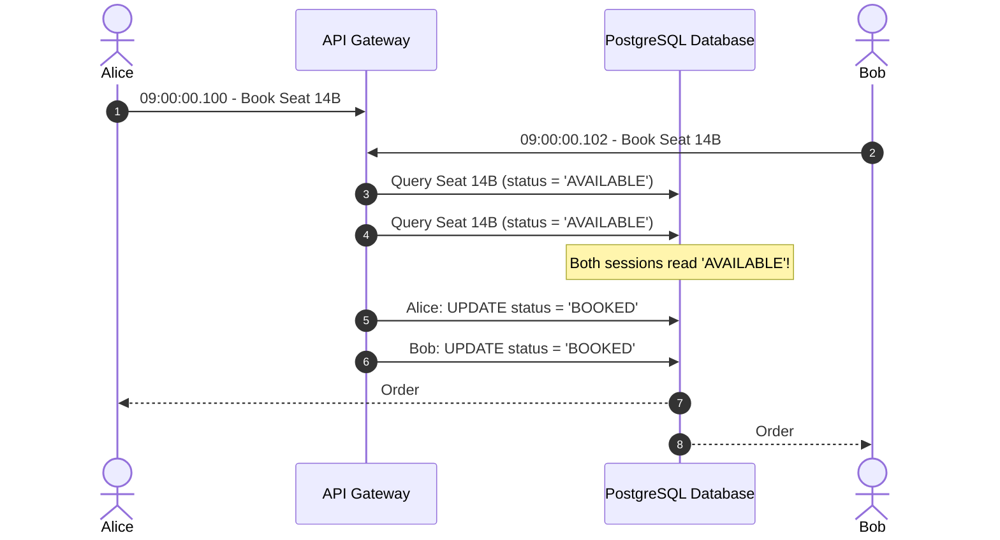
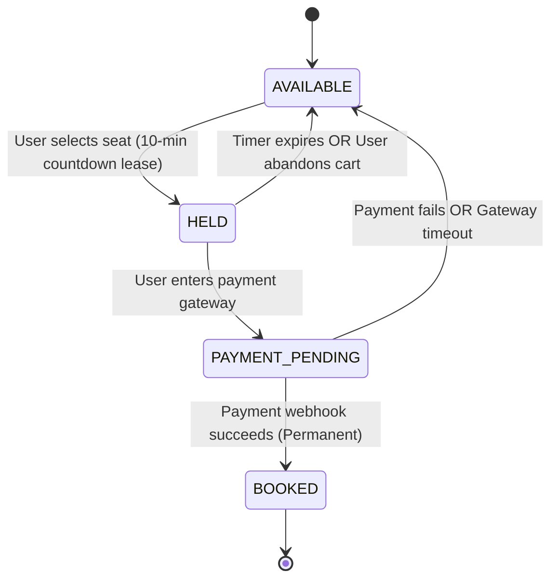
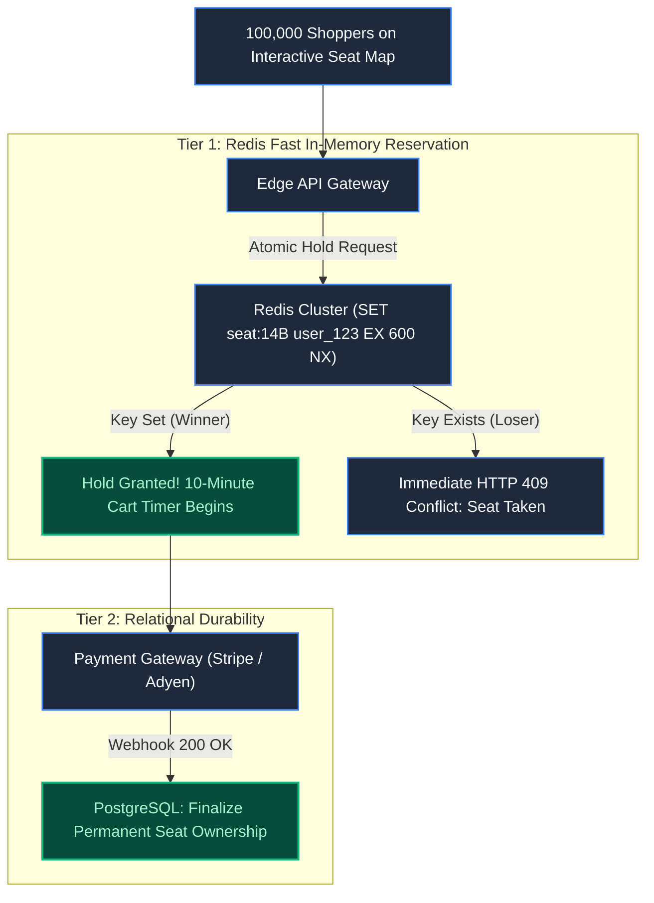

# Chapter 9: The Last Seat: Ticket Booking Architecture

> *"Displaying availability is not the same as reserving a resource. What the screen shows is already history."*

---

## 1. The Mystery: The Duplicate Turnstile Alarm

On concert night at an 80,000-seat stadium, two fans approached Turnstile 4. Both presented identical digital tickets for **Section VIP, Row 1, Seat 14B**. 

Fan A scanned their barcode: the gate beeped green and admitted them.
Ten seconds later, Fan B scanned their barcode: a red light flashed and an alarm sounded: **"Ticket Already Admitted."**



Both users had valid receipts, charged credit cards, and confirmation emails. 

Why did this happen? The backend read availability and wrote the confirmation across separate, uncoordinated transactions, violating the core invariant: **A physical seat can have exactly one owner.**

---

## 2. The Ticket Lifecycle State Machine

A ticket reservation is not a simple binary state (available vs sold). It requires a state machine with expiring temporal holds:



---

## 3. Database Strategies: Pessimistic vs Optimistic Locking

### Strategy A: Pessimistic Row Locking (`SELECT FOR UPDATE`)
Locks the database row immediately upon reading:

```sql
BEGIN;
SELECT id, status FROM seats WHERE id = 'seat_14B' FOR UPDATE;
-- Database places an exclusive write lock on seat_14B.
-- All other concurrent queries for seat_14B are suspended.
UPDATE seats SET status = 'HELD', user_id = 'usr_alice' WHERE id = 'seat_14B';
COMMIT;
```
- **The Catastrophe under Flash Crowds**: If 50,000 fans rush the same 100 VIP seats, 49,900 database connections block and wait on locks. Database connection pools are exhausted in seconds, causing total site outage.

### Strategy B: Optimistic Locking with Atomic Compare
Never hold a lock while waiting:

```sql
UPDATE seats 
SET status = 'HELD', user_id = 'usr_alice', version = version + 1 
WHERE id = 'seat_14B' AND status = 'AVAILABLE' AND version = 4;
```
If another transaction claimed the seat a microsecond earlier, `status = 'AVAILABLE'` is false, and the query returns **0 rows affected**. The application immediately knows the seat was taken and prompts the user to select another seat—**with zero database blocking**.

---

## 4. The Two-Tier Architecture: Redis Leases + DB Durability

Handling 100,000 concurrent seat selections in PostgreSQL will degrade disk I/O. Production ticketing platforms (e.g., Ticketmaster) deploy a **Two-Tier Reservation Pipeline**:



### The Atomic Hold Command:
```bash
SET seat:stadium_1:14B "user_alice" EX 600 NX
```
- `EX 600`: The hold expires automatically in 600 seconds (10 minutes) if the user closes their laptop or abandons payment.
- `NX`: Set **only if Not Exists**. If another fan claimed the seat a nanosecond earlier, Redis returns `nil` in under 0.5ms.

Only the single winner of the Redis key is allowed to proceed to the payment gateway. The relational database is never touched until actual money changes hands.

---

## 5. Architect-Level Trade-Offs

| Mechanism | Max Concurrency | Implementation Cost | Risk Profile |
|---|---|---|---|
| **Pessimistic Locking (`FOR UPDATE`)** | Low (< 500 req/s per seat pool) | Low (pure SQL) | Connection pool starvation; database deadlocks under flash crowds. |
| **Optimistic Locking (`version`)** | High (~5,000 req/s) | Medium | High abort rate under hot-spot contention; burns DB CPU on failed updates. |
| **Two-Tier Redis Leases + RDBMS** | Massive (100,000+ req/s) | High (requires distributed state cleanup) | If Redis crashes without replication, held seats might be temporarily orphaned. |

---

## 6. Mental-Model Summary

```
Never make the primary relational database arbitrate high-velocity contention.
Use in-memory atomic leases (Redis NX) for temporal holds, 
and reserve the database exclusively for permanent financial settlement.
```

---

## 7. The Next Battlefield

*The seat is held in Redis. The user enters their credit card details to pay the $450 ticket fee.*

*During the transfer, the payment gateway times out after 10 seconds. The browser displays 'Network Error'.*

*The user panics and clicks 'Submit Payment' again.*

*The seat is booked—but when the customer opens their mobile banking app, $900 has been deducted from their checking account.*

*How do financial architectures guarantee that money is neither created nor destroyed, and that retrying a failed request never results in double spending?*

👉 **Next: [Chapter 10 — Where Did the Money Go? Double-Entry Ledgers & Banking Correctness](/book/part-02-concurrency-correctness/chapter-10-banking-ledgers-correctness.md)**
