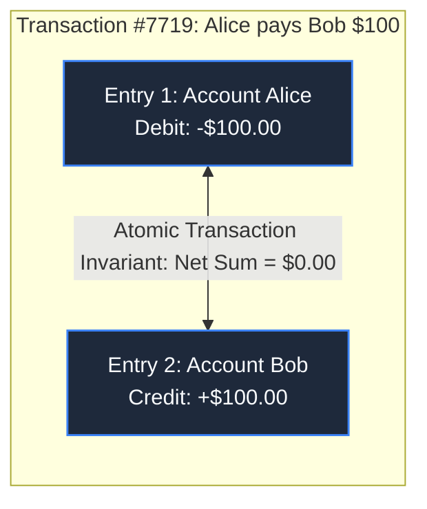
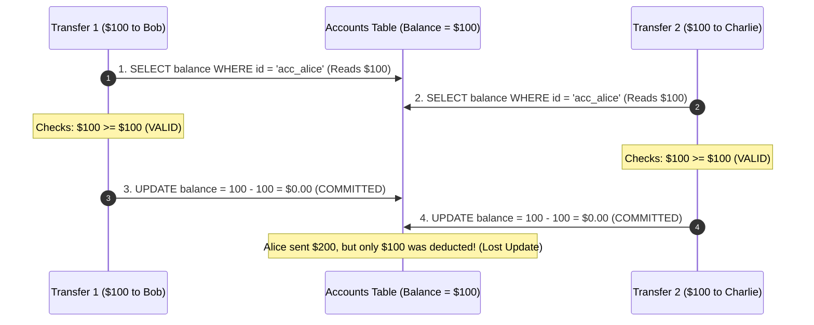

# Chapter 10: Where Did the Money Go? Banking Ledgers & Correctness

> *"Balances do not exist in nature; only transactions exist. A balance is merely a cached calculation of history."*

---

## 1. The Mystery: The $10,000 Overnight Discrepancy

A fast-growing fintech startup stored user accounts in a standard SQL table:

```sql
CREATE TABLE accounts (
    id VARCHAR(36) PRIMARY KEY,
    user_id VARCHAR(36),
    balance NUMERIC(12, 2) NOT NULL DEFAULT 0.00
);
```

When a user transferred $100, the application ran:
```sql
UPDATE accounts SET balance = balance - 100 WHERE id = 'acc_alice';
UPDATE accounts SET balance = balance + 100 WHERE id = 'acc_bob';
```

At midnight, the finance team ran their daily reconciliation audit:
$$\sum \text{All User Balances} \ne \text{Total Cash in Bank Vault}$$

There was a **$10,000 shortfall**. Money had vanished. 

When engineers searched the database to identify which user received the phantom cash, they were paralyzed: the `balance` column had simply been overwritten in place. **There was zero forensic record of how the numbers came to be.**

```mermaid
flowchart TD
    subgraph AntiPattern ["The Mutable Balance Anti-Pattern"]
        M1["Original State: $500"] -->|UPDATE balance = 400| M2["Overwritten: $400"]
        M2 -->|UPDATE balance = 300| M3["Overwritten: $300"]
        M3 -.->|History Completely Erased!| Lost["Zero Auditability: Discrepancies Cannot Be Traced"]
    end
    subgraph DoubleEntry ["The Immutable Double-Entry Ledger"]
        D1["Entry 1: Credit +$500"] --> D2["Entry 2: Debit -$100 (Payment)"]
        D2 --> D3["Entry 3: Debit -$100 (Transfer)"]
        D3 ==> Current["Balance = Σ(Entries) = $300\n(Cryptographically & Mathematically Auditable)"]
    end

    classDef default fill:#1e293b,stroke:#3b82f6,stroke-width:1.5px,color:#f8fafc;
    classDef alert fill:#7c2d12,stroke:#ef4444,stroke-width:2px,color:#fecaca;
    class Lost alert;
```



---

## 2. Double-Entry Bookkeeping: The Invariant of Conservation

In financial architecture, money can neither be created nor destroyed—it can only be transferred between accounts. Every transaction must consist of at least two balanced entries:

$$\sum \text{Debits} - \sum \text{Credits} = 0$$



### The Ledger Schema:
```sql
CREATE TABLE ledger_entries (
    id UUID PRIMARY KEY DEFAULT gen_random_uuid(),
    transaction_id UUID NOT NULL,
    account_id UUID NOT NULL REFERENCES accounts(id),
    amount NUMERIC(18, 4) NOT NULL, -- Negative for Debit, Positive for Credit
    currency VARCHAR(3) NOT NULL,
    created_at TIMESTAMPTZ NOT NULL DEFAULT NOW()
);
-- HARD INVARIANT: Once inserted, rows are NEVER updated or deleted.
```

If an erroneous payment occurs, you **never delete the row**. You issue a new compensating transaction (a reversal entry).

---

## 3. Database Isolation Levels & The Lost Update

Why did the initial system lose money? It ran under PostgreSQL's default isolation level: **Read Committed**.



### The Four Isolation Levels:
1. **Read Uncommitted**: Can read uncommitted dirty data (forbidden in banking).
2. **Read Committed**: Only reads committed data, but allows **Non-Repeatable Reads** and **Lost Updates**.
3. **Repeatable Read**: Guarantees a transaction reads a consistent snapshot of the database at transaction start.
4. **Serializable**: The highest level. Simulates purely sequential execution. Any concurrent write conflict triggers a serialization failure (`SQLSTATE 40001`), forcing the application to retry.

---

## 4. High-Throughput Performance: Snapshot Checkpoints

If an account balance is the sum of its ledger entries:
```sql
SELECT SUM(amount) FROM ledger_entries WHERE account_id = 'acc_alice';
```
For an active merchant with 5,000,000 entries, computing this query takes 3 seconds.

### The Architectural Solution: Checkpointed Balances


Nightly batch jobs compute authoritative balance snapshots. Real-time balance queries only sum delta records created after the latest snapshot timestamp, achieving sub-millisecond execution.

---

## 5. Architect-Level Trade-Offs

| Ledger Architecture | Audit Durability | Query Throughput | Complexity Cost |
|---|---|---|---|
| **Mutable Single Balance** | Zero (impossible to reconstruct errors) | Ultra-fast writes | High risk of lost updates and undetectable fraud. |
| **Pure Append-Only Ledger** | 100% mathematical auditability | Slower reads without snapshots | Requires snapshotting infrastructure and strict accounting schemas. |
| **Serializable Transactions** | Eliminates all race conditions | Lower write throughput (aborts on write conflicts) | Application must implement automatic retry loops with exponential jitter. |

---

## 6. Mental-Model Summary

```
In accounting, the past is immutable. You cannot rewrite history to fix a mistake; 
you can only write a new entry that balances it.
```

- **Rule 1**: Never use `UPDATE` on account balances. Every financial event is an append-only ledger entry.
- **Rule 2**: Enforce that the sum of all debits and credits within any transaction equals exactly zero.

---

## 7. The Next Battlefield

*The banking ledger is now immutable and mathematically balanced.*

*Alice initiates a $500 transfer to Bob. The backend creates the pending debit entry and calls the external banking network (SWIFT / Fedwire).*

*The network connection drops midway through the call. The bank receives an HTTP timeout error.*

*Did the transfer succeed on the other end? Did it fail? If Alice retries, will Bob receive $1,000?*

*How do distributed systems survive partial failures and make retries completely safe?*

👉 **Next: [Chapter 11 — The Phantom Order: Idempotency & Partial Failures](/book/part-02-concurrency-correctness/chapter-11-idempotency-partial-failures.md)**
