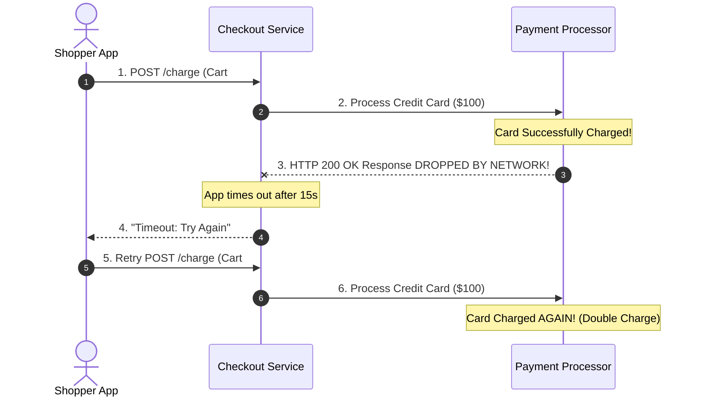
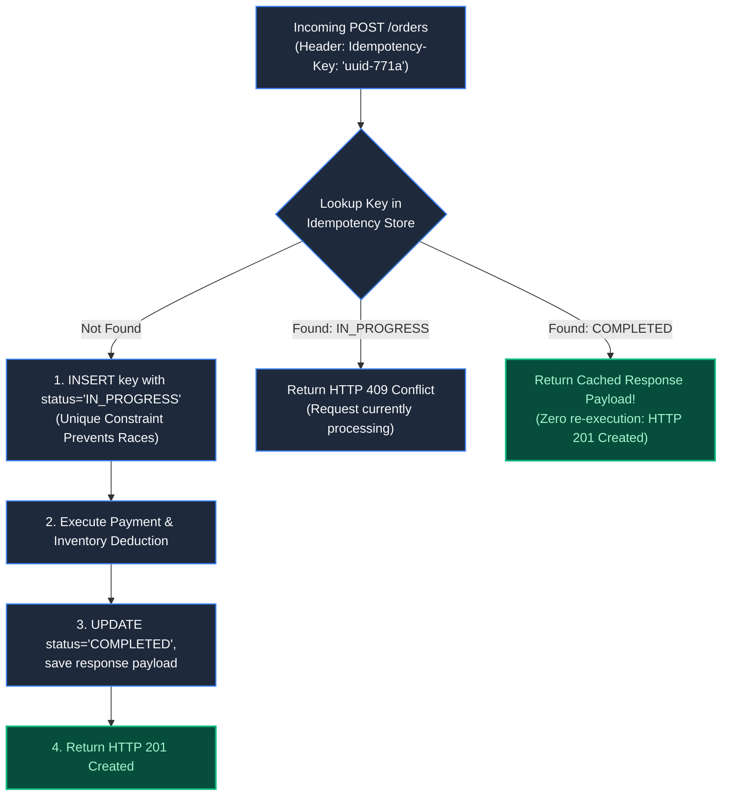
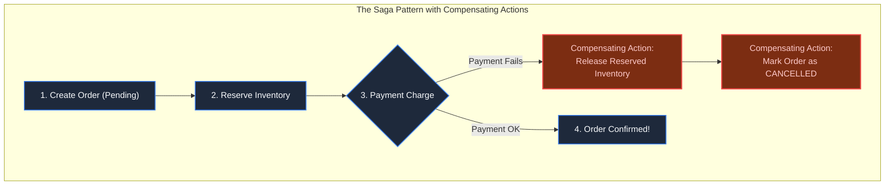
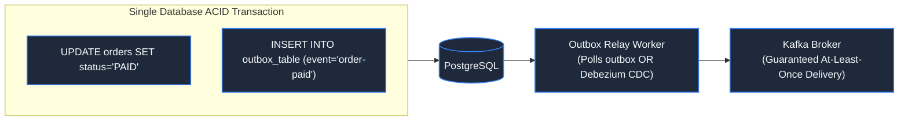

# Chapter 11: The Phantom Order: Idempotency & Partial Failures

> *"A timeout is not proof of failure; it is merely the expiration of your patience."*

---

## 1. The Mystery: The $400 Quadruple Charge

A customer purchased a $100 wireless speaker. They tapped "Confirm Payment".

The mobile spinner rotated for 15 seconds, followed by a generic banner:
`"Connection timed out. Please try again."`

The customer clicked "Confirm Payment" three more times. Each time, the screen timed out. Frustrated, they closed the app.

The next morning, the customer checked their online banking statement:
**Four distinct charges of $100.00 had cleared.** The merchant had captured $400 for a single physical box.



The server team assumed that because their API call timed out, the payment had not happened. This assumption violates the fundamental theorem of distributed systems: **A network timeout represents an Unknown state, never a Failure.**

---

## 2. The Core Principle: Idempotency

In mathematics, an operation is **Idempotent** if applying it multiple times produces the exact same outcome as applying it once:

$$f(f(x)) = f(x)$$



### The Production Idempotency Table:
```sql
CREATE TABLE idempotency_records (
    idempotency_key VARCHAR(128) PRIMARY KEY,
    user_id UUID NOT NULL,
    request_hash VARCHAR(64) NOT NULL, -- SHA-256 of request body
    status VARCHAR(20) NOT NULL,       -- 'IN_PROGRESS', 'COMPLETED'
    response_code INT,
    response_body JSONB,
    created_at TIMESTAMPTZ DEFAULT NOW(),
    expires_at TIMESTAMPTZ DEFAULT NOW() + INTERVAL '24 HOURS'
);
```

When a retry arrives with `idempotency_key = 'uuid-771a'`, the server sees `COMPLETED` and instantly returns the saved response payload. **The payment processor is never touched twice.**

---

## 3. Distributed Transactions: Why 2PC Fails and Sagas Win

In a microservices architecture, an order requires:
1. `Order Service`: Create Order
2. `Inventory Service`: Reserve Stock
3. `Payment Service`: Charge Card



Traditional **Two-Phase Commit (2PC)** locks all databases across the network until everyone confirms readiness. If one service experiences latency, all database locks freeze globally.

Instead, production systems use **Sagas**: a sequence of local transactions. If step 3 fails, the system executes **Compensating Transactions** backward to undo previous steps.

---

## 4. The Bridge: The Transactional Outbox Pattern

A classic distributed bug occurs when updating the database and publishing to a message broker:

```python
# BUGGY: What if the server crashes on line 2?
db.execute("UPDATE orders SET status = 'PAID'")
kafka.publish("order-paid", order_id) # NEVER SENDS!
```

To guarantee that events are never lost, use the **Transactional Outbox Pattern**:



Writing the business update and the outbox event in the **same local transaction** guarantees atomicity. If the app crashes, the outbox record is safe. An asynchronous relay process forwards events to Kafka with at-least-once delivery.

---

## 5. Architect-Level Trade-Offs

| Pattern | Consistency Model | Availability / Throughput | Best Used For |
|---|---|---|---|
| **Two-Phase Commit (2PC)** | Immediate Strong Consistency | Very Poor (locks distributed databases) | Low-volume core banking ledgers within a single datacenter. |
| **Saga Pattern** | Eventual Consistency | Very High (no global locks held) | Cross-service workflows (Orders, Shipping, Booking). |
| **Transactional Outbox** | Eventual Consistency | High (relies on local DB ACID) | Decoupling database state changes from async event streams. |

---

## 6. Mental-Model Summary

```
Every network call can fail in three ways: Success, Failure, or Timeout.
Since a client cannot distinguish a dropped request from a dropped response,
every state-modifying POST request must require an Idempotency Key.
```

- **Rule 1**: Clients must generate a UUID idempotency key before initiating any financial or state-altering request.
- **Rule 2**: Never publish events to message brokers inside an open database transaction without an Outbox table.

---

## 7. The Next Battlefield

*With idempotency keys and sagas, retries from a single customer are completely safe.*

*Now change the scenario: 500,000 different customers with 500,000 distinct idempotency keys all rush to buy the exact same 100 discounted iPhones during a 60-second flash sale.*

*Database row locks on `product_id = 99` turn into a parking lot of 500,000 blocked transactions. The database connection pool explodes.*

*How do you handle massive write contention on a single shared counter?*

👉 **Next: [Chapter 12 — Flash Sales & Inventory Depletion: High-Concurrency Retail](file:///Users/lspl487/Desktop/software-book/book/part-02-concurrency-correctness/chapter-12-flash-sales-inventory-depletion.md)**
