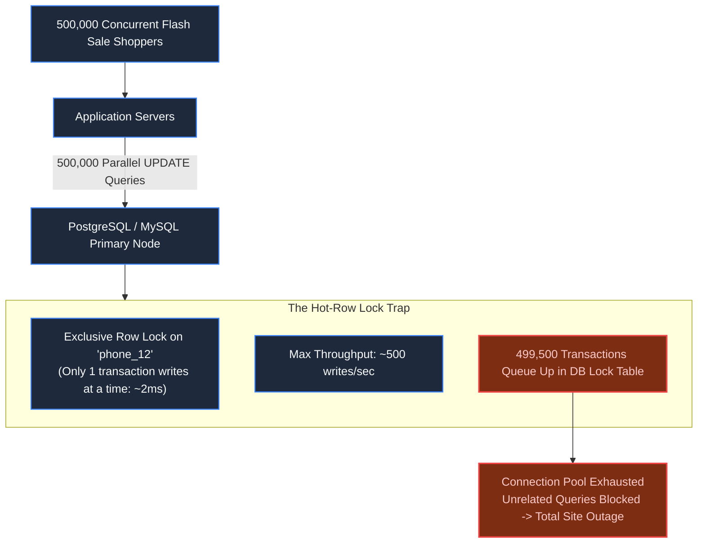

# Chapter 12: Flash Sales & Inventory Depletion

> *"Never let a million people knock on the same database door; filter the crowd in memory before opening the vault."*

---

## 1. The Mystery: The Single-Row Gridlock

At 12:00:00, an e-commerce platform launched a Black Friday flash sale: **500 flagship smartphones discounted by 90%**.

To prevent overselling, the engineering team used an atomic SQL decrement:

```sql
UPDATE inventory 
SET stock = stock - 1 
WHERE product_id = 'phone_12' AND stock > 0;
```

On paper, this query is completely race-condition safe: the database engine guarantees that stock never drops below zero.

Yet, within 10 seconds of launch, the **entire database cluster crashed**. Not only did the flash sale fail, but ordinary shoppers browsing books, shoes, and groceries were met with site-wide `504 Gateway Timeout` errors.



The problem was not algorithm logic; it was **Hot-Row Contention**. The database had to serialize 500,000 transactions on a single 16KB disk page.

---

## 2. In-Memory Pre-Deduction: Rejecting at the Edge

A relational database should never arbitrate a flash sale lottery. If you have 500 items, **499,500 shoppers are going to be disappointed**. 

Your architecture must reject those 499,500 losers in sub-millisecond memory without letting them touch SQL:

```mermaid
flowchart TD
    User["500,000 Flash Requests"] --> Gateway["API Gateway & Rate Limiter"]
    Gateway --> Redis["Redis Cluster (product:12:stock = 500)"]
    
    subgraph EdgeDecision ["Atomic Lua Decrement (<0.5ms)"]
        Redis -->|DECRBY >= 0 (First 500)| Winner["WINNER (500 Requests)\nToken Granted -> Allowed into Checkout"]
        Redis -->|DECRBY < 0 (Remaining 499,500)| Loser["LOSER (499,500 Requests)\nImmediate HTTP 410 'Sold Out'"]
    end
    
    Winner --> AsyncQueue["Kafka Order Queue"]
    AsyncQueue --> DBWorker["DB Worker Pool\n(Smoothly writes 500 orders at 50/sec)"]
    DBWorker --> PostgreSQL[(PostgreSQL Database)]

    classDef default fill:#1e293b,stroke:#3b82f6,stroke-width:1.5px,color:#f8fafc;
    classDef success fill:#064e3b,stroke:#10b981,stroke-width:2px,color:#a7f3d0;
    class Winner,DBWorker success;
```

### The Atomic Redis Lua Script:
```lua
-- Atomic Inventory Decrement
local stock = redis.call('get', KEYS[1])
if not stock or tonumber(stock) <= 0 then
    return 0 -- SOLD OUT (Drop immediately)
end
return redis.call('decr', KEYS[1]) >= 0 and 1 or 0
```

Only the 500 winning requests receive a checkout token. The relational database experiences a calm trickle of 500 writes instead of a half-million connection flood.

---

## 3. High-Scale Relational Writes: Sharded Inventory Counters

What if your business requires authoritative inventory changes to remain strictly inside the database?

You must eliminate the single-row bottleneck by deploying **Sharded Inventory Counters**:

```mermaid
graph TD
    Parent["Inventory Pool for 'phone_12' (Total: 500)"]
    Parent --> S0["Shard 0 (Stock: 50)"]
    Parent --> S1["Shard 1 (Stock: 50)"]
    Parent --> S2["Shard 2 (Stock: 50)"]
    Parent --> S9["Shard 9 (Stock: 50)"]
    
    Req["Incoming User"] -->|hash(user_id) % 10| TargetShard["Target Shard 2"]

    classDef default fill:#1e293b,stroke:#3b82f6,stroke-width:1.5px,color:#f8fafc;
```

Instead of 1 row with 500 items, create 10 distinct rows (`phone_12_shard_0` through `phone_12_shard_9`), each holding 50 items:
```sql
UPDATE inventory_shards 
SET stock = stock - 1 
WHERE product_id = 'phone_12' AND shard_id = :random_shard AND stock > 0;
```
Lock contention is instantly reduced by **10x**. If a shard empties, the application falls back to an adjacent shard.

---

## 4. Virtual Waiting Rooms (Queue-It Architecture)

To protect ingress during ultra-hyped events, insert a **Virtual Waiting Room** before checkout:

1. **Traffic Gatekeeping**: All users arriving before 12:00:00 enter a pre-sale holding room.
2. **Deterministic Randomization**: At 12:00:00, the waiting room assigns randomized queue positions, neutralizing botnet script advantages.
3. **Throttled Egress**: The queue releases users into the checkout service at a calibrated rate (e.g., exactly 200 users per second), matching the exact maximum capacity of downstream payment gateways.

---

## 5. Architect-Level Trade-Offs

| Flash Sale Pattern | Max Throughput | Implementation Complexity | Primary Failure Mode |
|---|---|---|---|
| **Direct DB Atomic Decrement** | ~500 req/s | Lowest | Total database collapse due to hot-row lock starvation. |
| **Sharded DB Counters** | ~5,000 req/s | Medium | Fragmented stock (one shard empty while others have items). |
| **Redis In-Memory Pre-Deduction** | 100,000+ req/s | High | Redis node failure during sale requires reconciliation from WAL. |
| **Virtual Waiting Room** | Millions (Edge buffered)| High (Third-party or edge worker) | User frustration if waiting room experience is opaque. |

---

## 6. Mental-Model Summary

```
Under extreme write contention, the database is a vault with a single narrow door.
Do not let 500,000 people rush the door simultaneously.
Issue tickets in memory, turn away the crowd outside, and let only ticket holders enter.
```

- **Rule 1**: Never execute concurrent updates on a single row under high-concurrency write bursts.
- **Rule 2**: Filter and reject excess demand at the in-memory layer (Redis Lua) before touching persistent disk.

---

## 7. The Next Battlefield

*The e-commerce and banking engines are now resilient, idempotent, and capable of withstanding flash sales.*

*Then an internal audit reveals an alarming discrepancy: an administrator with root access modified historical ledger rows directly via SSH, embezzling $250,000 and wiping database logs.*

*Regulators issue an ultimatum: prove cryptographically that no record in the system has been tampered with—or face immediate shutdown.*

*How do you build a tamper-evident audit logging system that mathematically proves integrity even against rogue database administrators?*

👉 **Next: [Chapter 13 — Standalone System: Tamper-Evident Audit Logging Engine](file:///Users/lspl487/Desktop/software-book/book/part-02-concurrency-correctness/chapter-13-system-tamper-evident-audit-log.md)**
