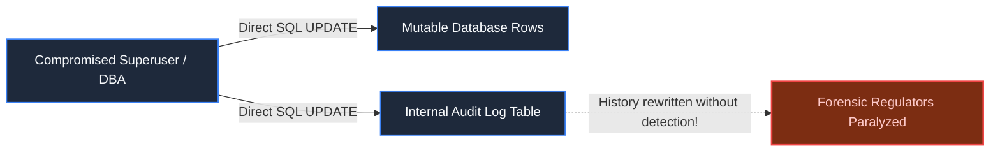
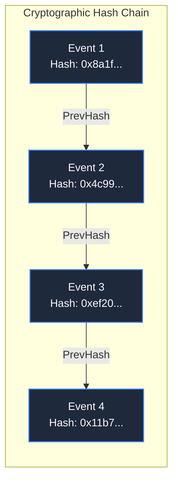
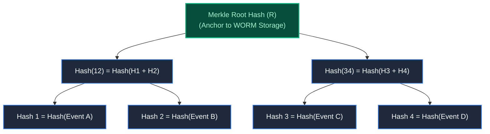
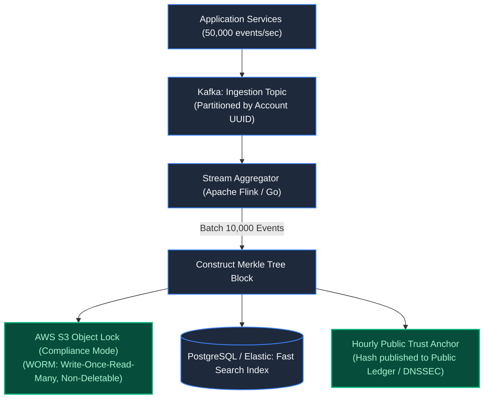

# Chapter 13: Standalone System: Tamper-Evident Audit Logging

> *"Any log that can be altered by a system administrator is not an audit trail; it is a diary."*

---

## 1. The Mystery: The $1.2 Million Phantom Wire

During a federal regulatory audit, forensic accountants identified $1,200,000 in diverted international wire transfers. 

The transactions were traced to a production PostgreSQL database. When questioned, the database administrator (DBA) produced the audit log table: every entry showed the funds were transferred to legitimate vendor accounts.

Then the auditors dug deeper:
- The DBA had superuser (`postgres`) access.
- Two weeks prior, someone ran direct `UPDATE` statements on the historical transaction rows, modified the audit table to match, and ran `VACUUM FULL` to purge dead database tuples.



The system possessed **logging**, but lacked **integrity**. Traditional database rows and text log files can be modified or backdated by anyone with privileged root access.

---

## 2. Cryptographic Hash Chaining: The Mathematical Seal

To make history impossible to alter silently, every audit event is linked into a **Cryptographic Hash Chain**:

$$\text{Hash}_n = \text{SHA-256}(\text{Data}_n \,||\, \text{Timestamp}_n \,||\, \text{Hash}_{n-1})$$



If an attacker alters a single byte in `Event 2`:
1. The hash of `Event 2` changes.
2. `Event 3` incorporates `Hash(Event 2)`, so its hash breaks.
3. Every subsequent hash in the entire database breaks like a fallen line of dominoes.

---

## 3. Merkle Trees: Proof of Existence at Scale

Verifying a linear hash chain across 100,000,000 rows requires recomputing 100,000,000 SHA-256 hashes ($O(N)$ CPU cost). 

Production systems use **Merkle Trees (Cryptographic Hash Trees)**:



### The $O(\log N)$ Audit Proof:
To prove to an auditor that `Event A` was recorded in the database without revealing the contents of events B, C, and D, you only provide:
- `Hash 2`
- `Hash 34`
The auditor computes:
$$\text{Calculated Root} = \text{SHA-256}(\text{SHA-256}(\text{Hash}(\text{Event A}) + \text{Hash 2}) + \text{Hash 34})$$
If `Calculated Root == Root`, mathematical proof of integrity is established in **microseconds**.

---

## 4. Production High-Throughput Ingestion Pipeline



### The WORM Storage Guarantee:
The aggregated blocks are shipped directly to **S3 Object Lock in Compliance Mode**:
- Not even the AWS Root Account credentials or a compromised DBA can overwrite or delete an object until the retention period (e.g., 7 years) expires.
- Hourly Merkle Root hashes are anchored externally, preventing retroactive substitution of entire historical blocks.

---

## 5. Architect-Level Trade-Offs

| Audit Mechanism | Verification Speed | Tamper Immunity | Storage / Compute Overhead |
|---|---|---|---|
| **SQL Trigger to Audit Table** | $O(1)$ query | Zero (vulnerable to DB superusers) | Negligible; high DB write overhead. |
| **Linear Hash Chain** | Slow ($O(N)$ verification) | High (tampering detected immediately) | Minimal storage; linear verification CPU. |
| **Merkle Tree on WORM S3** | Ultra-fast ($O(\log N)$ proof) | Absolute (hardware-enforced immutability) | Requires batching stream pipeline; external anchoring. |

---

## 6. Mental-Model Summary

```
Trust is not an architectural property; cryptographic verification is.
Immutable append-only structures turn security from an administrative policy 
into a mathematical certainty.
```

- **Rule 1**: Hash-chain every historical event at ingestion time (`PrevHash`).
- **Rule 2**: Store audit archives in hardware-enforced WORM (Write Once, Read Many) storage to neutralize rogue administrator threats.

---

## 7. The Next Battlefield

*The financial transactions and audit logs are now bulletproof.*

*Behind the scenes, the system relies on dozens of asynchronous background tasks: calculating monthly interest, generating PDF invoices, sending SMS alerts, and syncing third-party ledgers.*

*A worker node processing a batch of 5,000 invoices suffers a kernel panic and crashes mid-execution.*

*Some invoices were sent twice. Some were never generated. The queue stalls.*

*How do you design a Distributed Job Queue that guarantees at-least-once execution, handles visibility timeouts, isolates poison-pill tasks, and scales to millions of background jobs?*

👉 **Next: [Chapter 14 — Standalone System: Distributed Job Queue & Worker Pool](/book/part-02-concurrency-correctness/chapter-14-system-distributed-job-queue.md)**
