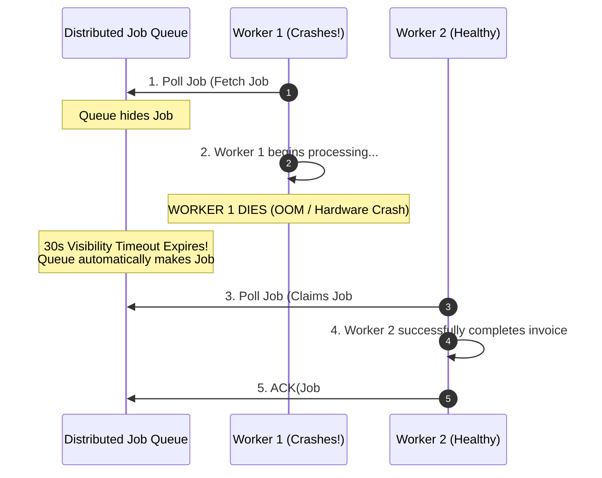
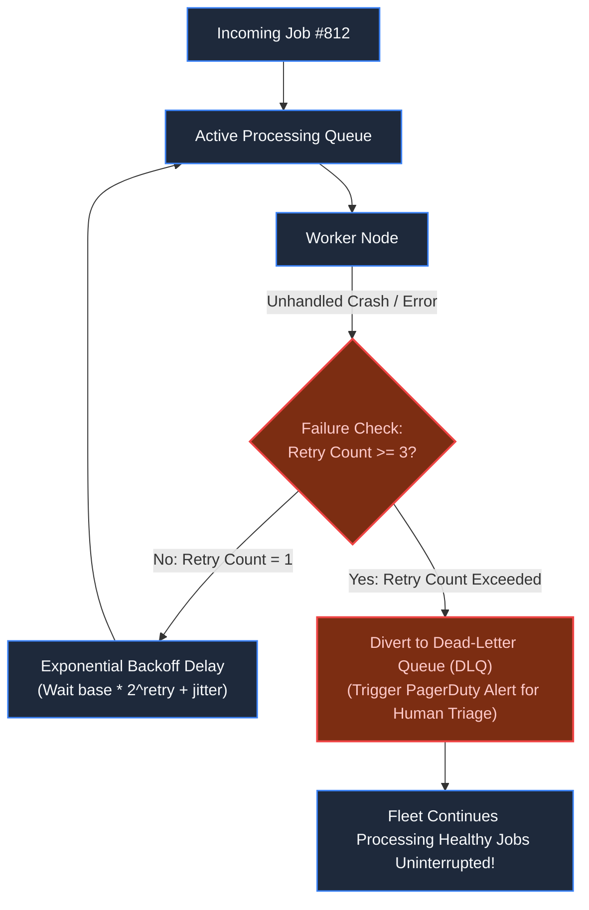

# Chapter 14: Standalone System: Distributed Job Queue & Worker Pool

> *"In distributed systems, a job is not complete when it is picked up; it is complete only when its completion receipt is stamped."*

---

## 1. The Mystery: The OOM Crash & The Poison Pill

At 02:00 AM, a recurring cron triggered monthly subscription billing for 200,000 users. The engineering team used a fast in-memory Redis list:

```python
# WORKER PROCESS
job = redis.lpop("queue:billing") # Pops job off the list immediately
process_invoice(job)
```

At 02:15 AM, Worker 4 suffered an **Out-Of-Memory (OOM) kernel kill** while generating a 500-page PDF invoice. 

Because `LPOP` had permanently removed the job from Redis, the invoice vanished into thin air. Worse, Job #812 contained corrupted UTF-8 bytes that caused an unhandled memory panic:
1. Worker 1 picked up Job #812 and crashed immediately.
2. The orchestrator restarted Worker 1, which picked up Job #812 and crashed again.
3. Within 3 minutes, all 25 workers in the cluster entered a **Cascading Crash Loop**. 

This is the deadly **Poison Pill**: a single malformed job that systematically annihilates an entire worker fleet.

---

## 2. The Core Mechanism: Visibility Timeouts

A robust distributed queue never deletes a job upon extraction. It introduces a **Visibility Timeout**:



If a worker dies, suffers network isolation, or hangs, the visibility lease expires, and the job automatically reappears for another worker to execute.

---

## 3. Isolating Poison Pills: Dead-Letter Queues (DLQ)

To prevent unhandled exceptions from destroying the cluster, track execution attempts:



A job that fails 3 consecutive times is routed to the **Dead-Letter Queue (DLQ)**. The poison pill is quarantined, and the fleet continues processing valid customer jobs.

---

## 4. Production High-Scale Worker Pool Architecture

```mermaid
flowchart TD
    subgraph Producers ["Task Producers"]
        API["Web API Service"]
        Cron["Scheduled Schedulers"]
    end
    
    Producers --> Outbox["Transactional Outbox (DB)"]
    Outbox --> Enqueue["Task Broker (Redis Streams / SQS / RabbitMQ)"]
    
    subgraph QueueEngine ["Queue State Machine"]
        Enqueue --> ReadyQ["Ready Queue (FIFO)"]
        Enqueue --> DelayedQ["Delayed / Scheduled Queue\n(Redis Sorted Set by Unix Timestamp)"]
        DelayedQ -->|Timestamp <= NOW()| ReadyQ
    end
    
    subgraph WorkerFleet ["Distributed Worker Fleet"]
        ReadyQ --> W1["Worker Pod 1\n(Concurrency: 10)"]
        ReadyQ --> W2["Worker Pod 2\n(Concurrency: 10)"]
        ReadyQ --> W3["Worker Pod 3\n(Concurrency: 10)"]
    end
    
    W1 -.->|Extend Timeout| Heartbeat["Heartbeat Service (For 10-minute long jobs)"]
    W1 -->|Success| Ack["ACK -> Delete Task"]
    W1 -->|Exceeded Retries| DLQStore["DLQ Storage & Quarantine Dashboard"]

    classDef default fill:#1e293b,stroke:#3b82f6,stroke-width:1.5px,color:#f8fafc;
    classDef success fill:#064e3b,stroke:#10b981,stroke-width:2px,color:#a7f3d0;
    class Ack success;
```

### The Inevitable Law: At-Least-Once Delivery
Because a worker might crash *after* executing business logic but *before* sending the `ACK` message, the queue will inevitably re-deliver the job.

> **The Architectural Rule**: Background workers **must be idempotent**. Processing the same billing task twice must detect previous execution via idempotency keys or unique database constraints.

---

## 5. Architect-Level Trade-Offs

| Technology | Max Throughput | Ordering Guarantee | Durability Model |
|---|---|---|---|
| **Redis Streams / BullMQ** | 50,000+ jobs/sec | Strict FIFO within stream | In-memory with optional AOF/RDB disk snapshots. |
| **RabbitMQ** | 20,000 jobs/sec | Strict FIFO per queue | Erlang-based disk persistence; complex clustering. |
| **AWS SQS** | Virtually unlimited | Best-effort (or FIFO mode up to 3,000/s) | Managed cloud durability across 3 availability zones. |
| **Apache Kafka** | 1,000,000+ msgs/sec | Partition-level ordering | Distributed commit log (best for event streams, not job queues). |

---

## 6. Part 2 Grand Milestone Recap

We have completed **Part 2: Concurrency, Correctness & State**:


You now possess the foundational engineering discipline to ensure that under extreme concurrency, money is conserved, inventory is protected, records are tamper-proof, and tasks are executed safely.

---

## 7. The Next Dimension: Time & Space

*Correctness within a database is solved. Now we must coordinate across physical geography and asynchronous event streams.*

*Two servers record events: Server A says an event happened at `14:00:00.080`; Server B says a causal reply happened at `14:00:00.020`.*

*Physical quartz clocks drift. NTP synchronizations jitter.*

*How do distributed systems order events without relying on physical clocks?*

👉 **Next: [Part 3: Time, Space & Asynchrony — Event-Driven Systems & Scalability](file:///Users/lspl487/Desktop/software-book/roadmap/03-part-3-time-space-asynchrony.md)**
👉 **Next Chapter: [Chapter 15 — The Illusion of Global Clock Time](file:///Users/lspl487/Desktop/software-book/book/part-03-time-space-asynchrony/chapter-15-illusion-of-global-clock-time.md)**
