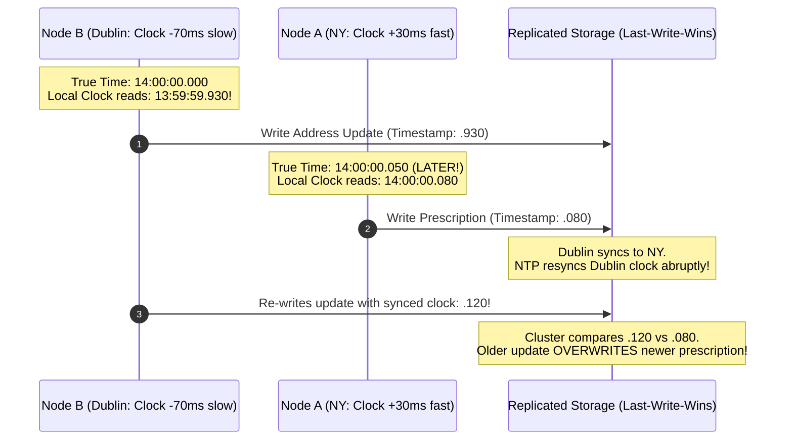
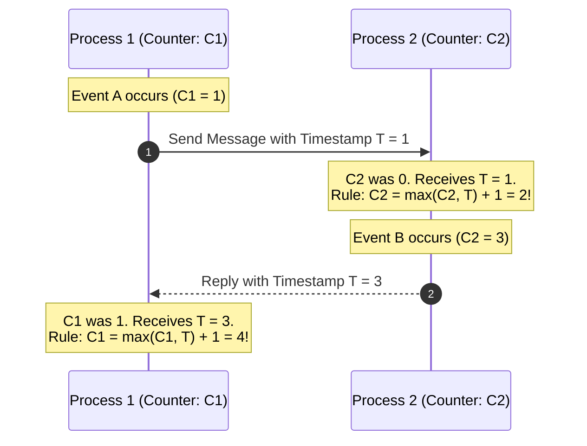
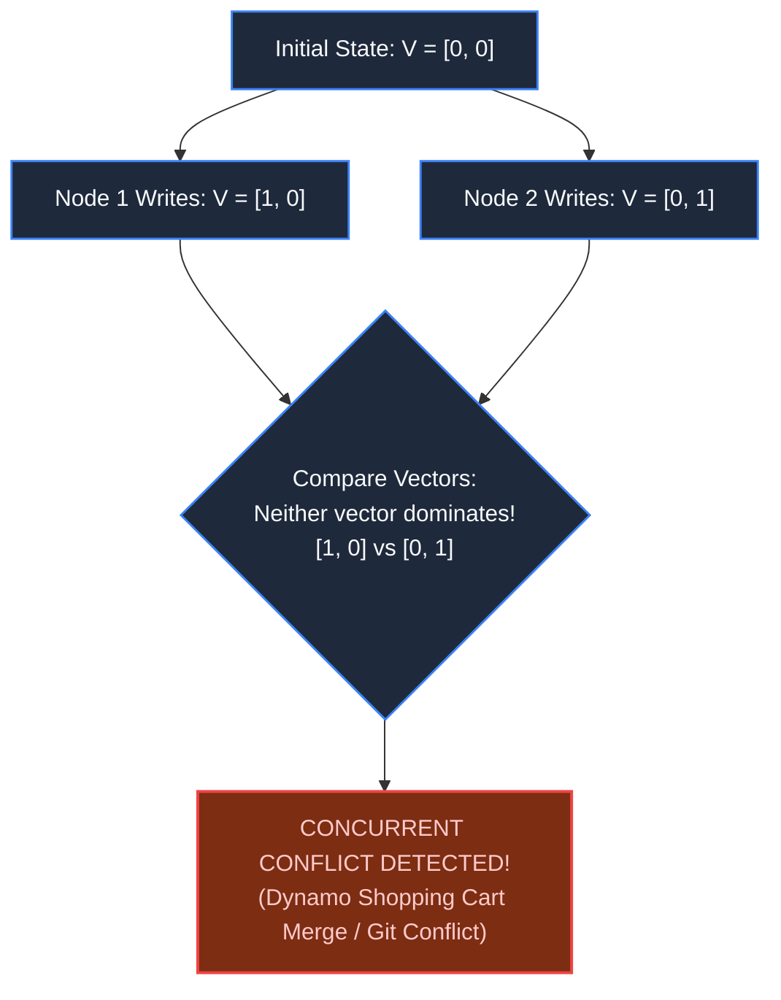

# Chapter 15: The Illusion of Global Clock Time

> *"In distributed systems, physical time is an opinion; causality is a mathematical fact."*

---

## 1. The Mystery: The Overwritten Future

A global healthcare and identity platform deployed a multi-region Cassandra cluster across North America (Node A) and Europe (Node B). To resolve concurrent writes, the database relied on the standard distributed strategy: **Last-Write-Wins (LWW)** using physical server timestamps.

At 14:00:00.000 UTC, a patient updated their emergency contact address in Dublin via Node B.
At 14:00:00.050 UTC (50 milliseconds later), their doctor added a critical prescription note in New York via Node A.

When the patient viewed their profile five minutes later, **the newer prescription note had vanished**. The Dublin address had overwritten it.



Node B's quartz crystal clock had drifted by 70 milliseconds due to temperature variations in the Dublin datacenter. Under Last-Write-Wins, **a silent clock drift erased real-world medical data.**

---

## 2. Physical Clocks: Why True Time Does Not Exist

Operating systems maintain two distinct types of clocks:

1. **Time-of-Day Clock (`gettimeofday` / Wall Clock)**:
   - Measures elapsed seconds since Unix Epoch (1970).
   - Synchronized over the internet via Network Time Protocol (NTP).
   - **The Hazard**: When NTP detects drift, the clock can jump forward, jump backward, or freeze during leap seconds. It is completely non-monotonic and unsafe for ordering events.
2. **Monotonic Clock (`CLOCK_MONOTONIC`)**:
   - Always moves strictly forward from an arbitrary boot point.
   - Ideal for measuring latency elapsed on a *single machine* (`end - start`).
   - **The Hazard**: Meaningless across different machines. Machine A's monotonic clock cannot be compared with Machine B's.

```
NTP Asymmetry Over Internet:
Network packet transit times are never symmetric (t_outbound != t_inbound).
Sub-millisecond synchronization across datacenters over public fiber is physically impossible.
```

---

## 3. Lamport Timestamps: Ordering Without Clocks

In 1978, Leslie Lamport proved that distributed systems do not need physical clocks to establish causality. They only need to know if **Event A happened before Event B** ($A \to B$).

A **Lamport Clock** is a simple monotonically increasing integer counter maintained by each node:



### The Lamport Invariant:
$$\text{If } A \to B \implies L(A) < L(B)$$

However, the reverse is **not true**: if $L(A) < L(B)$, we cannot tell whether $A$ caused $B$, or if they happened concurrently in total isolation.

---

## 4. Vector Clocks: Detecting True Concurrency

To distinguish causal dependency from concurrent conflict, every node maintains an array (vector) of clocks:

$$V = [v_1, v_2, \dots, v_n]$$

Where $v_i$ is the number of events that node $i$ has observed.



### The Vector Dominance Rules:
- **Causality ($A \to B$)**: $V_A \le V_B$ for all elements, and at least one element is strictly smaller ($V_A < V_B$).
- **Concurrency ($A \parallel B$)**: Neither vector dominates the other. Both events occurred independently without awareness of each other. The application must explicitly merge the branches (e.g., combining items in a shopping cart).

---

## 5. Google TrueTime: Bound the Uncertainty

How does Google Spanner achieve global serializable transactions across planet-scale datacenters without vector conflicts?

Google installed **Atomic Clocks and GPS receivers** in every datacenter:


If Node A commits at $[t_1 - \epsilon, t_1 + \epsilon]$, the system intentionally waits for $2\epsilon$ (14ms) before releasing the transaction. By the time Node B reads, true physical time has definitively passed $t_1$.

---

## 6. Architect-Level Trade-Offs

| Time Mechanism | Ordering Accuracy | Network / Storage Overhead | Failure Vulnerability |
|---|---|---|---|
| **Last-Write-Wins (NTP)** | Poor (data loss on clock skew) | Zero overhead (single 64-bit integer) | Silent data loss when server crystals drift. |
| **Lamport Clocks** | Partial causal order | Negligible (1 integer carried on network) | Cannot detect concurrent conflicts. |
| **Vector Clocks** | Perfect concurrency detection | Vector grows with number of cluster nodes ($O(N)$) | Vector size explosion in dynamic peer-to-peer systems. |
| **Google TrueTime** | Strict global linearizability | High hardware cost (Atomic/GPS hardware) | Stalls write transactions during clock sync failures. |

---

## 7. Mental-Model Summary

```
Never use wall-clock timestamps to determine which event happened first in a distributed system.
Use monotonic clocks for elapsed durations on one box.
Use Lamport or Vector clocks for ordering across boxes.
```

- **Rule 1**: Avoid Last-Write-Wins (LWW) whenever data overwrites could lead to permanent loss.
- **Rule 2**: If you must order events causally without specialized atomic hardware, pass vector clocks or causal sequence numbers in request headers.

---

## 8. The Next Battlefield

*We now understand how to order events causally without physical clocks.*

*Now take this fundamental into real-time human interaction: a chat application with 10 million active users.*

*Alice sends: "Did you buy the tickets?"*
*Bob replies: "Yes, I got them!"*

*On Charlie's mobile screen, Bob's reply appears 3 minutes before Alice's question was even delivered. When Alice opens her laptop, Bob's message is missing entirely.*

*How do you build a real-time messaging architecture that enforces conversational causality, syncs state across multiple devices, and delivers offline queues?*

👉 **Next: [Chapter 16 — The Message That Arrived Yesterday: Chat & Collaboration](/book/part-03-time-space-asynchrony/chapter-16-chat-collaboration-ordering.md)**
