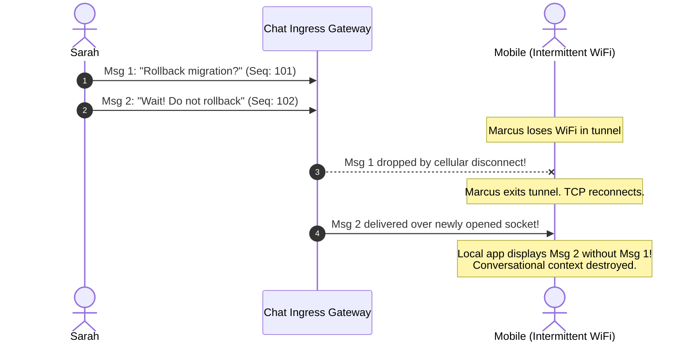
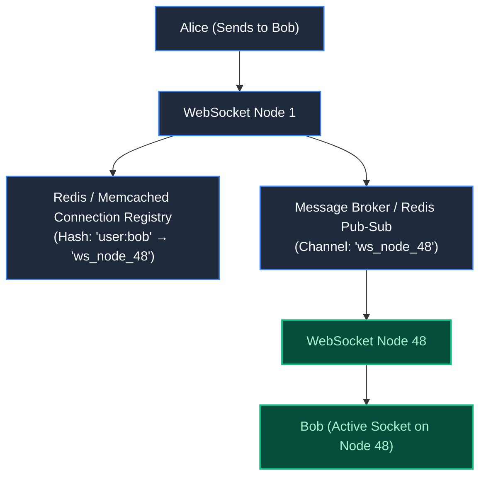
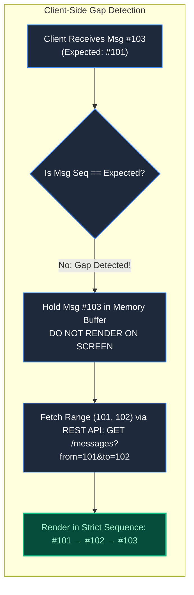
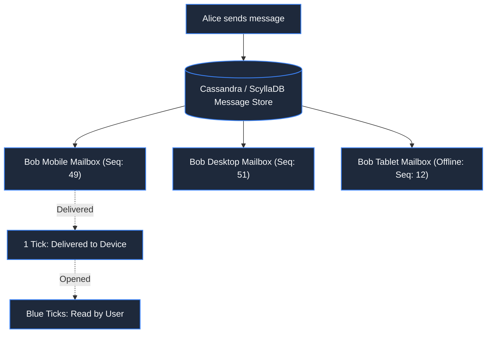

# Chapter 16: The Message That Arrived Yesterday: Chat & Collaboration

> *"In real-time communication, delivery speed is meaningless without conversational sequence. An out-of-order message is worse than no message at all."*

---

## 1. The Mystery: The Inverted Outage Order

During a major production incident, three engineers coordinated in a Slack-like incident channel:

```
[10:02:01] Sarah (Lead): "Should we roll back the database migration?"
[10:02:04] Alex (Dev):   "Wait! Do not roll back yet, fixing config now."
[10:02:08] Sarah (Lead): "Acknowledged. Holding off on rollback."
```

Marcus, an on-call engineer riding a train with intermittent mobile reception, opened the app. His screen displayed:

```
[10:02:08] Sarah (Lead): "Acknowledged. Holding off on rollback."
[10:02:01] Sarah (Lead): "Should we roll back the database migration?"
[10:02:04] Alex (Dev):   "Wait! Do not roll back yet, fixing config now."
```

Because Sarah's acknowledgment rendered *before* the warning, Marcus assumed the rollback was authorized, triggered the script, and dropped production tables.



The system used standard WebSockets, but lacked a **Conversational Ordering Invariant**.

---

## 2. Connection Protocols: The Transport Dilemma

```mermaid
graph TD
    subgraph Polling ["1. Short Polling"]
        P1["Client asks every 2s: Any new msgs?"] --> P2["99% HTTP responses empty\nHigh CPU & socket churn"]
    end
    subgraph LongPoll ["2. Long Polling"]
        LP1["Client opens HTTP request; Server holds socket until message arrives"] --> LP2["High header overhead on reconnection"]
    end
    subgraph SSE ["3. Server-Sent Events (SSE)"]
        SSE1["Single unidirectional HTTP stream (Server → Client)"] --> SSE2["Ultra-lightweight over HTTP/2; cannot send upstream data"]
    end
    subgraph WebSockets ["4. WebSockets"]
        WS1["Bi-directional full-duplex TCP stream (RFC 6455)"] --> WS2["Sub-millisecond latency; requires custom connection routing"]
    end

    classDef default fill:#1e293b,stroke:#3b82f6,stroke-width:1.5px,color:#f8fafc;
    classDef winner fill:#064e3b,stroke:#10b981,stroke-width:2px,color:#a7f3d0;
    class WS2 winner;
```



For interactive chat, **WebSockets** remain the gold standard: once the initial HTTP 101 Switching Protocols handshake completes, messages travel in lightweight 2-to-10-byte binary/text frames without repetitive HTTP headers.

---

## 3. High-Scale Routing: The Connection Registry

When 5,000,000 concurrent users connect to 50 WebSocket servers, how does Server 1 send a direct message to a user connected to Server 48?



1. **Heartbeat Pings**: Every client socket sends a `PING` frame every 30 seconds; missing two pings evicts the session from the registry.
2. **Node-Targeted Pub/Sub**: Rather than broadcasting all messages to every server, each WebSocket node subscribes only to its own node ID topic (`topic:ws_node_48`), routing messages exclusively to the node hosting the recipient.

---

## 4. Enforcing Order: Channel Sequence IDs & Gap Detection

To guarantee that messages render in exact conversational sequence regardless of network reordering:



### The Invariants:
1. Every channel assigns an atomic, strictly increasing integer: `channel_seq_id`.
2. A client never relies on arrival order over the network.
3. If an arriving message sequence is greater than `last_seen_seq + 1`, the client **buffers the message** and triggers a fast synchronization fetch for the missing gap.

---

## 5. Multi-Device Sync & Offline Storage



- **Per-User Cursor (Sync Vector)**: Each device stores its own `last_read_seq`. When Bob opens his tablet after 3 days offline, the app requests: `GET /sync?channel=team&after=12`.
- **Three-State Receipts**:
  1. *Sent (1 tick)*: Stored on server.
  2. *Delivered (2 ticks)*: Acknowledged by recipient client socket.
  3. *Read (Blue ticks)*: Rendered in visible viewport on recipient device.

---

## 6. Architect-Level Trade-Offs

| Delivery Architecture | Fanout Cost | Offline Resilience | Group Scalability |
|---|---|---|---|
| **Fanout-on-Write (Inbox per User)** | High writes on message send | Instant inbox queries | Poor for 50,000-person public channels. |
| **Fanout-on-Read (Single Channel Log)**| Zero write amplification | Requires reading channel log + per-user read cursor | Scales to massive channels (Discord / Twitch). |
| **P2P WebRTC Data Channels** | Zero server bandwidth | Zero offline support | Fails when peer is offline; bandwidth limits in groups. |

---

## 7. Mental-Model Summary

```
Sockets deliver bytes; sequence IDs deliver meaning.
Never trust TCP to guarantee business-level conversation order across mobile reconnects.
Always number messages per channel and buffer gaps on the client.
```

- **Rule 1**: Assign an atomic sequence number (`seq_id`) to every message at the channel level.
- **Rule 2**: Buffer out-of-order messages on the client until missing predecessors are fetched.

---

## 8. The Next Battlefield

*Real-time messaging synchronizes thoughts across time.*

*Now transport real-time coordinates into physical geographic space: 50,000 taxi drivers and 100,000 riders moving across a metropolis.*

*Every driver streams their GPS latitude and longitude every 3 seconds (17,000 GPS writes/second).*

*A rider taps 'Request Ride'. The system must locate the 10 closest available drivers within 2 kilometers in under 50 milliseconds.*

*Standard SQL queries with `ST_Distance()` take 4 seconds per query and melt the CPU.*

*How do spatial indexing algorithms like Geohash, QuadTrees, and Uber H3 divide planet Earth into computational coordinates?*

👉 **Next: [Chapter 17 — Where Is My Driver? Geospatial Indexing & Ride-Hailing](/book/part-03-time-space-asynchrony/chapter-17-geospatial-indexing-ride-hailing.md)**
