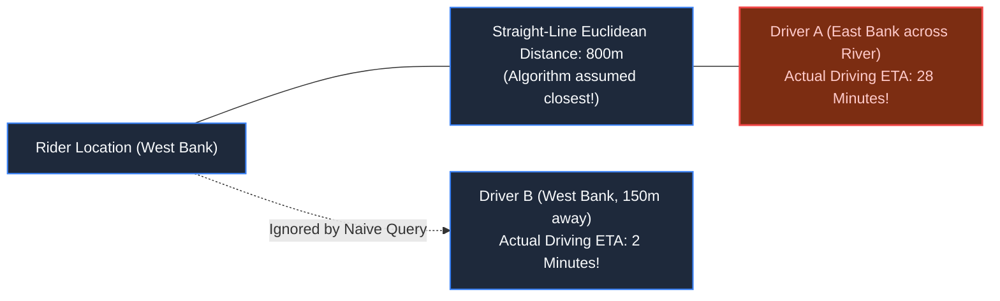
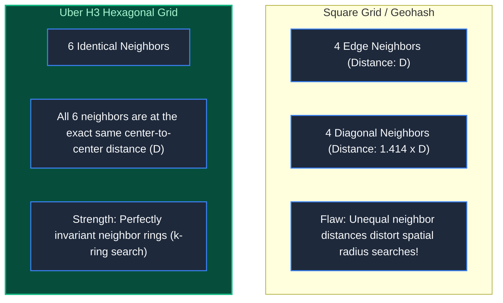
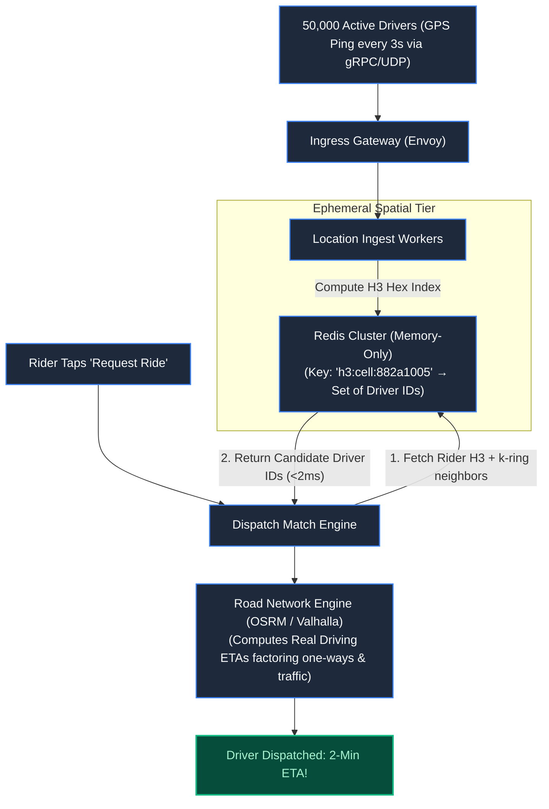
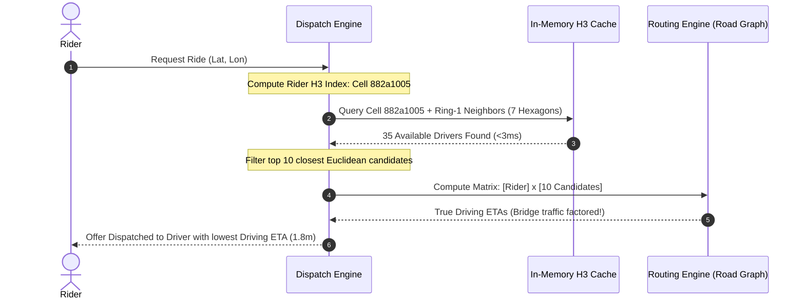

# Chapter 17: Where Is My Driver? Geospatial Indexing & Ride-Hailing

> *"Euclidean distance is an abstraction; one-way streets, traffic choke points, and hexagonal grids are physical reality."*

---

## 1. The Mystery: The 3-Mile River Detour

In Tokyo at 18:30, a commuter tapped "Request Taxi". An available driver was parked 150 meters away on the adjacent boulevard.

Instead, the dispatch algorithm assigned a driver located **3 miles away on the opposite bank of the Sumida River**. The estimated pickup time was 28 minutes because the driver had to cross a gridlocked suspension bridge.



Why did this occur?
1. The backend executed straight-line distance calculations ($\sqrt{\Delta x^2 + \Delta y^2}$) instead of road-network routing.
2. The database attempted to run PostGIS spatial queries directly against a mutable table receiving **25,000 continuous GPS location writes per second**, saturating database CPU to 100%.

---

## 2. Partitioning Earth: Squares vs Hexagons

A database cannot scan 500,000 global drivers on every dispatch request. The surface of the planet must be partitioned into discrete spatial buckets:



### The Power of Uber H3 Hexagonal Hierarchies:
- **Every neighbor is equidistant**: Unlike square grids where diagonals are $\sqrt{2} \times$ farther away, every adjacent hexagon center is exactly $D$ distance away.
- **Hierarchical nesting**: A resolution-8 hexagon ($\sim 460\text{m}$ across) nests cleanly into resolution-7 parent cells, enabling instant multi-level spatial rollups.

---

## 3. High-Throughput Ingestion Architecture

A relational database will collapse if tasked with writing 25,000 GPS pings every second while answering low-latency spatial searches. 

Production platforms (Uber / Lyft) decouple **Location Ingestion** from **Dispatch Matching**:



### Ingestion Rules:
1. **Never write transient GPS pings to disk**: A driver's location from 10 seconds ago is useless garbage. Store coordinates exclusively in in-memory spatial caches with short TTLs (15 seconds).
2. **H3 Spatial Bucketing**: Group available drivers into in-memory Redis sets keyed by their current H3 cell index:
   ```bash
   # Add Driver 401 to Hexagon Cell 882a1005
   SADD h3:882a1005:drivers "driver_401"
   EXPIRE h3:882a1005:drivers 15
   ```

---

## 4. The Two-Phase Dispatch Matching Algorithm

Finding the optimal driver requires two separate phases:



1. **Phase 1: Spatial Filter (Candidate Selection)**: Fetch all drivers in the rider's cell and its immediate 6 neighboring cells ($k=1$ ring) in $<3\text{ms}$.
2. **Phase 2: Graph Routing (True ETA Calculation)**: Query a road network engine (OSRM / Valhalla) with an in-memory directed graph of road segments to determine true turn-by-turn driving duration.

---

## 5. Architect-Level Trade-Offs

| Technology | Write Ingestion Cost | Query Latency | Real-World Accuracy |
|---|---|---|---|
| **PostgreSQL PostGIS (`ST_DWithin`)** | High (disk I/O and B-Tree/R-Tree lockups) | 50-200ms | High geometric accuracy; zero road awareness. |
| **Redis Geospatial (`GEOADD`)** | Low (in-memory sorted sets via Geohash) | Sub-millisecond | Flat radial distance; distorted by grid diagonals. |
| **Uber H3 Hexagonal In-Memory Shards** | Ultra-low (direct hash bucket lookups) | Sub-millisecond | Perfect uniform neighbor rings; ideal for clustering & surge pricing. |

---

## 6. Mental-Model Summary

```
Location pings are perishable telemetry, not durable financial records.
Never write raw GPS breadcrumbs to disk databases.
Filter candidate coordinates in in-memory hexagonal buckets (H3), 
then compute true ETAs across the physical road graph.
```

- **Rule 1**: Store live driver coordinates exclusively in in-memory spatial indexes with automatic expiration.
- **Rule 2**: Separate radial spatial filtering from road-network routing engines.

---

## 7. The Next Battlefield

*We have mastered real-time geospatial dispatch across city streets.*

*Now expand the scale from a 5-mile taxi trip to a 45-day global supply chain: 100,000 cargo containers traveling across oceans, freight trains, customs inspection bays, and automated robotic warehouses.*

*A port barcode scanner in Rotterdam loses internet connectivity for 18 hours. When it reconnects, out-of-order state updates collide with domestic shipping alerts.*

*The physical container is physically stuck in customs, but the database marks it as 'Delivered' to the customer.*

*How do event-sourced state machines reconcile discrepancies between the messy physical world and the digital database?*

👉 **Next: [Chapter 18 — The Lost Container: Logistics, Supply Chains & Event Sourcing](/book/part-03-time-space-asynchrony/chapter-18-logistics-event-sourcing.md)**
