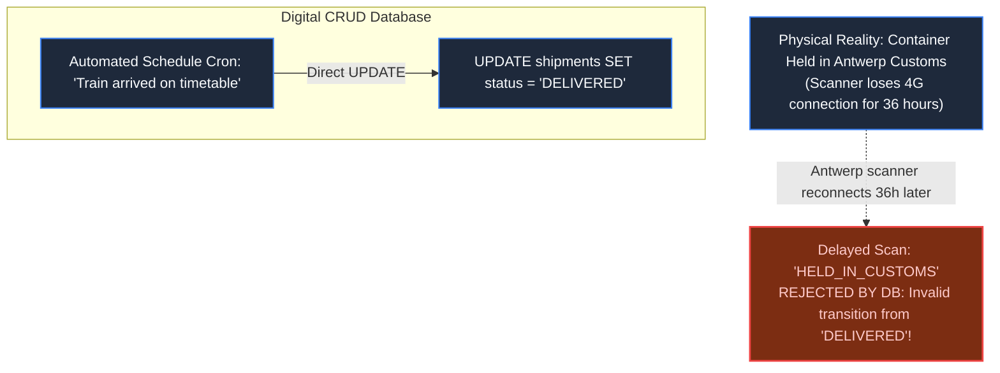
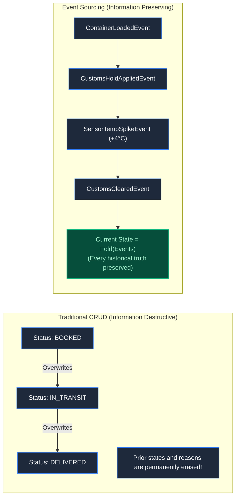
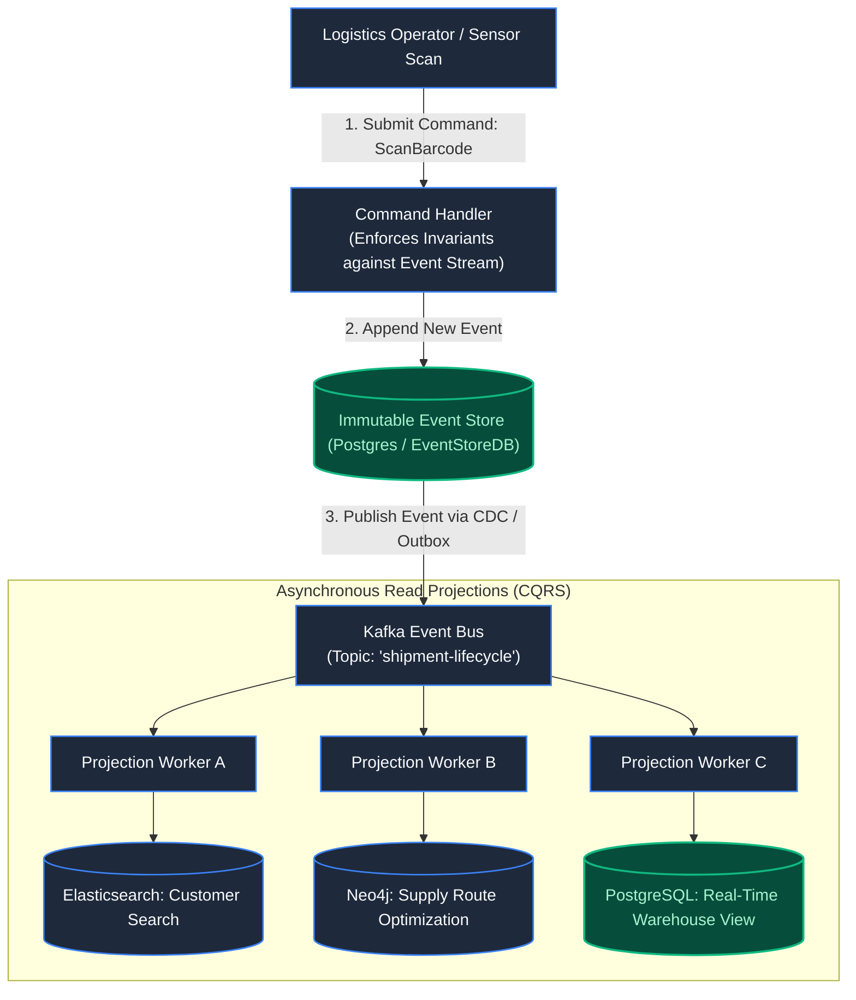
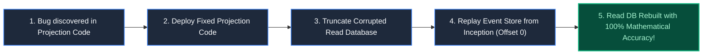

# Chapter 18: The Lost Container: Logistics & Event Sourcing

> *"In the physical world, events happen; they cannot be unhappened. A system that overwrites state is blind to the trajectory that brought it there."*

---

## 1. The Mystery: The Ghost Container of Hamburg

A freight forwarder tracked a refrigerated cargo container carrying $4,000,000 of temperature-sensitive vaccines from Singapore to Hamburg.

The customer portal displayed:
`Status: DELIVERED — Hamburg Hub 3 (Signed by Automated Gate)`

When the pharmaceutical distributor arrived with refrigerated trucks to retrieve the vaccines, the bay was completely bare. 

The physical container was **400 miles away**, sitting on a freight rail siding in Antwerp, held by customs for an uninspected agricultural seal:



Why did the system invent a delivery? 
A traditional CRUD database had overwritten the shipment row based on an automated schedule assumption. When real physical telemetry arrived out-of-order, the database rejected it because it violated a naive state transition rule.

---

## 2. The Core Paradigm: CRUD vs Event Sourcing

In standard CRUD (Create, Read, Update, Delete), you only store the **current snapshot** of state:



Under **Event Sourcing**, state is never updated in place. The single source of truth is an **immutable, append-only event log**. 

$$\text{Current State} = \sum_{i=1}^{n} \text{Event}_i$$

---

## 3. Command Query Responsibility Segregation (CQRS)

In complex logistics, the model required to validate business rules (Write Side) is completely different from the model required to search packages (Read Side).



1. **Write Side (Commands)**: `RecordContainerScanCommand` loads the container's past events, verifies validity, and appends `ContainerScannedEvent`.
2. **Read Side (Queries)**: Independent projection workers consume Kafka events and update specialized read databases asynchronously without impacting write throughput.

---

## 4. Time Travel & The Event Replay Superpower

What happens if an engineer introduces a bug in the warehouse dashboard, corrupting read data across six months?

In a CRUD database, you must restore a 6-month-old backup, losing recent changes.

In an Event-Sourced architecture, you execute an **Event Replay**:



Because the Event Store is immutable, you can re-read all events from Day 1 to build completely new views, reports, and machine learning models retroactively.

---

## 5. Reconciling Digital State with Physical Drift

The physical world is messy: barcode scanners lose battery, RFIDs fail, containers get loaded on the wrong train.

### The Architectural Invariants:
1. **Never Infer Physical State from Timetables**: Never transition a package state based purely on elapsed clock time. Require sensory proof (RFID/Barcode/GPS).
2. **First-Class Exception Events**: When an out-of-order event arrives (e.g. `CustomsHoldApplied` arrives *after* `ArrivedAtDepot`), append an explicit `StateDivergenceDetectedEvent` and trigger human triage rather than crashing the projection.

---

## 6. Architect-Level Trade-Offs

| Architecture Pattern | Auditability & Replay | Eventual Consistency Delay | Operational Complexity |
|---|---|---|---|
| **Traditional Relational CRUD** | None (updates destroy history) | Zero (immediate read-your-writes) | Lowest |
| **Event Sourcing + CQRS** | Infinite (complete time-travel replay) | Milliseconds to seconds (read model lag) | High (schema evolution, event versioning) |

---

## 7. Mental-Model Summary

```
CRUD tells you where a system is right now; Event Sourcing tells you every step of how it got there.
When physical inventory drifts from digital records, 
an event log is the only forensics tool that can reconstruct the truth.
```

- **Rule 1**: Store business events as the immutable source of truth; treat database tables as disposable projections.
- **Rule 2**: Build asynchronous read models tailored specifically to query access patterns.

---

## 8. The Next Battlefield

*Event sourcing tracks physical cargo over weeks.*

*Now transition from freight logistics to consumer travel: booking a multi-leg journey across United Airlines, a Marriott hotel in Paris, and an Avis car rental in a single transaction.*

*You must coordinate with legacy airline mainframes built in 1968 running COBOL and SABRE GDS. An airline API call takes 8 seconds; the rental car confirmation fails on the return leg.*

*How do you build distributed travel aggregation engines that manage long-lived sagas across fragile legacy protocols?*

👉 **Next: [Chapter 19 — The Multi-Leg Journey: Travel & Hospitality Systems](file:///Users/lspl487/Desktop/software-book/book/part-03-time-space-asynchrony/chapter-19-travel-hospitality-systems.md)**
