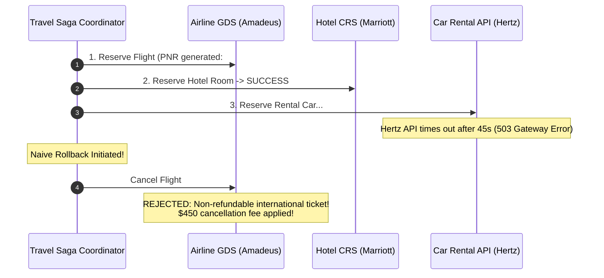
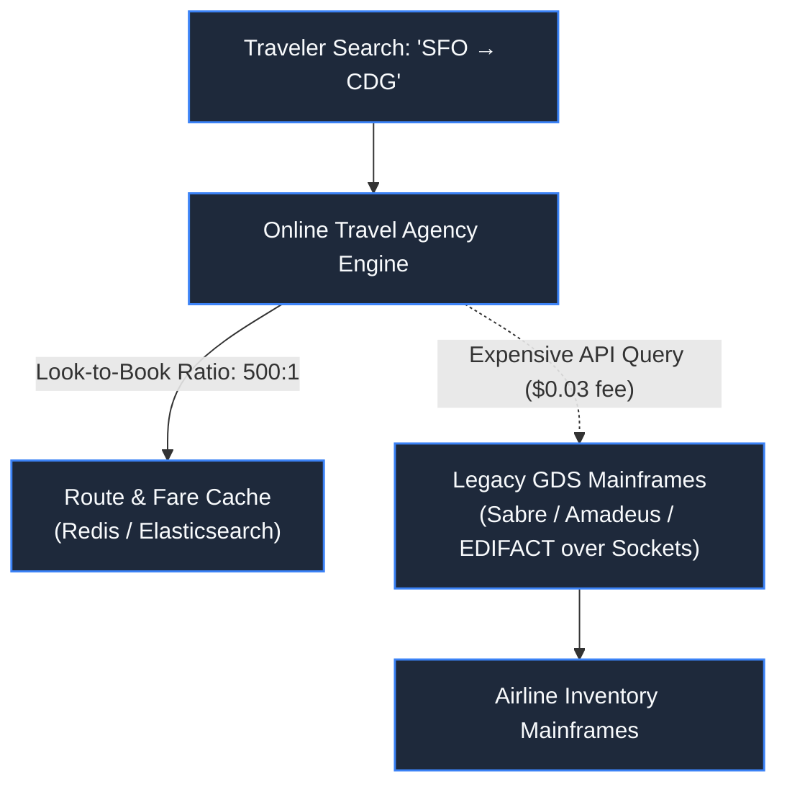
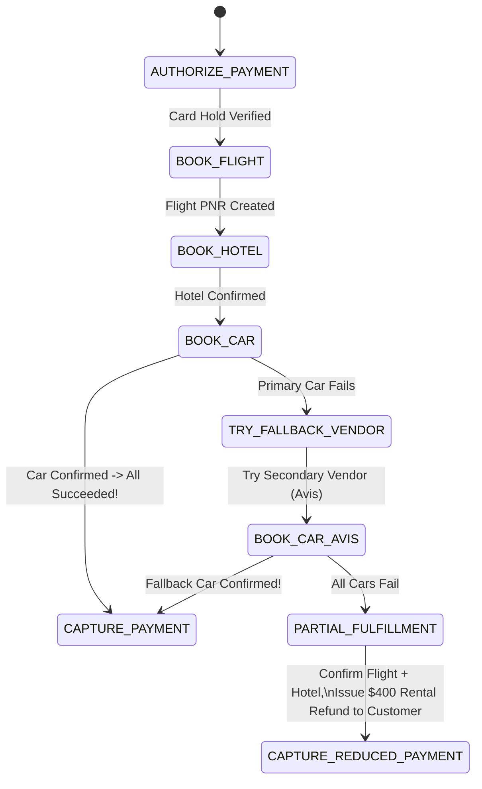
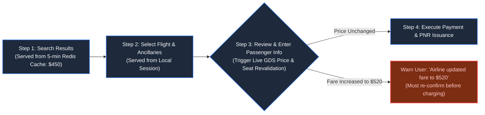

# Chapter 19: The Multi-Leg Journey: Travel & Hospitality Systems

> *"In multi-vendor travel, failure is not an exceptional state; it is the default operating environment. Design for graceful fallback, not magical rollback."*

---

## 1. The Mystery: The Stranded in Paris Dilemma

An Online Travel Agency (OTA) offered a bundled vacation package:
1. **Flight**: San Francisco to Paris (Air France via Amadeus GDS)
2. **Hotel**: 5 Nights in Central Paris (Marriott CRS)
3. **Car Rental**: SUV at Charles de Gaulle Airport (Hertz API)

A traveler submitted their $3,800 payment:



The car rental failed. When the system attempted to roll back, the airline rejected cancellation because the ticket was non-refundable.

The customer was left in limbo: charged $3,800, holding an un-cancelled flight, an orphan hotel room, and no car.

---

## 2. Legacy Infrastructure: The Reality of GDS

Unlike modern cloud microservices, the travel industry operates on **Global Distribution Systems (GDS: Sabre, Amadeus, Travelport)** engineered in the 1960s on mainframe TPF systems:



### The Inherent Constraints:
1. **Look-to-Book Penalty**: For every 500 flight searches performed by users, only 1 ticket is purchased. Querying GDS mainframes directly for every search is cost-prohibitive ($0.02–$0.05 per query).
2. **The Ghost Fare Dilemma**: To avoid GDS query fees, OTAs cache flight availability. However, if another traveler buys the last seat on Air France directly, the OTA cache serves a **Ghost Fare** (a price that no longer exists when the user clicks 'Checkout').

---

## 3. The Travel Saga: Graceful Fallbacks Over Pure Rollbacks

In multi-vendor travel, rolling back a distributed transaction is often legally or commercially impossible. The **Travel Saga Coordinator** uses **Forward Recovery and Fallbacks**:



### The Architectural Rules:
1. **Order of Irreversibility**: Book resources in order of increasing cancellation difficulty:
   - First: Fully refundable hotels.
   - Second: Flexible rental cars.
   - Last: Non-refundable, non-amendable airline tickets.
2. **Vendor Fallback Chains**: If the primary supplier fails, immediately failover to an alternative integration (Hertz $\to$ Avis $\to$ Sixt).
3. **Partial Fulfillment**: If car rental fails completely, never destroy the vacation. Confirm the flights and hotel, credit the user's card for the missing car, and notify them gracefully.

---

## 4. Cache Revalidation at the Checkout Funnel



Never book a flight based on cached pricing. Execute a single authoritative GDS revalidation call at the exact moment the user transitions to entering passenger passport details.

---

## 5. Architect-Level Trade-Offs

| Booking Strategy | Customer Experience | Financial Risk | Integration Complexity |
|---|---|---|---|
| **Atomic All-or-Nothing (Strict Rollback)** | Disastrous (vacation cancelled over a missing rental car) | High (supplier cancellation penalties) | Medium |
| **Saga with Forward Recovery (Fallbacks)** | Excellent (substitutes supplier transparently) | Zero (payment adjusted to actual fulfillment) | High (requires multi-provider adapter interfaces) |
| **Pure Live GDS Queries (Zero Caching)** | Zero ghost fares | Financial ruin from GDS query fees; 4s search latency | Low |

---

## 6. Mental-Model Summary

```
When integrating external legacy systems, Two-Phase Commit does not exist.
You cannot force third-party mainframes to participate in your database transaction.
Orchestrate sagas that favor graceful fallback and partial fulfillment over destructive rollbacks.
```

- **Rule 1**: Execute non-reversible external bookings last in the saga chain.
- **Rule 2**: Revalidate cached travel inventory authoritatively before presenting the final payment screen.

---

## 7. The Next Battlefield

*The travel saga coordinates flights, hotels, and rentals smoothly.*

*Now suppose a tropical cyclone hits Miami International Airport: 1,500 flights are cancelled, affecting 250,000 passengers.*

*The airline system must dispatch 250,000 urgent push notifications, SMS alerts, and rebooking emails across dozens of regional telecommunication carriers in under 60 seconds.*

*Telco rate limits block SMS gateways. Email providers throttle marketing domains. Push notification servers crash under connection surges.*

*How do you build a multi-channel Notification Engine that prioritizes emergency alerts, enforces per-user anti-fatigue limits, and guarantees delivery across carriers?*

👉 **Next: [Chapter 20 — Standalone System: Planetary Notification Engine](/book/part-03-time-space-asynchrony/chapter-20-system-planetary-notification-engine.md)**
