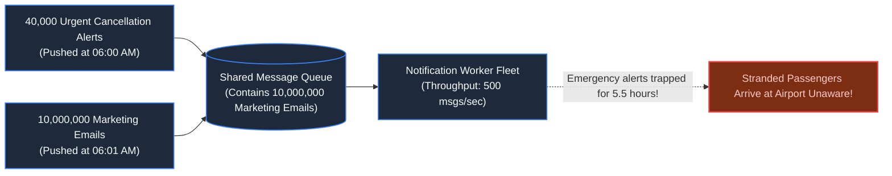
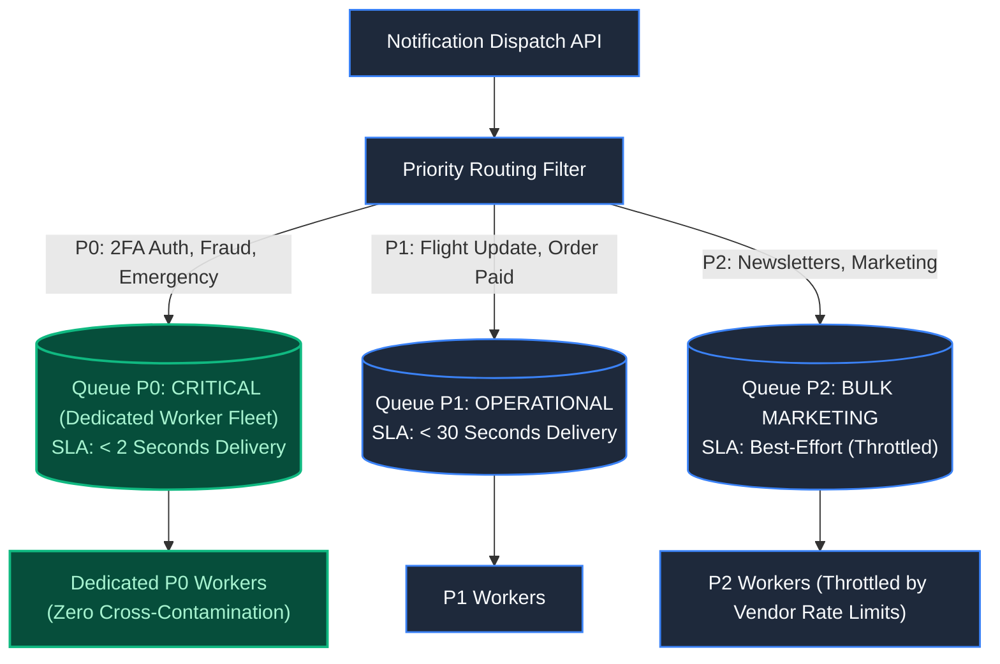
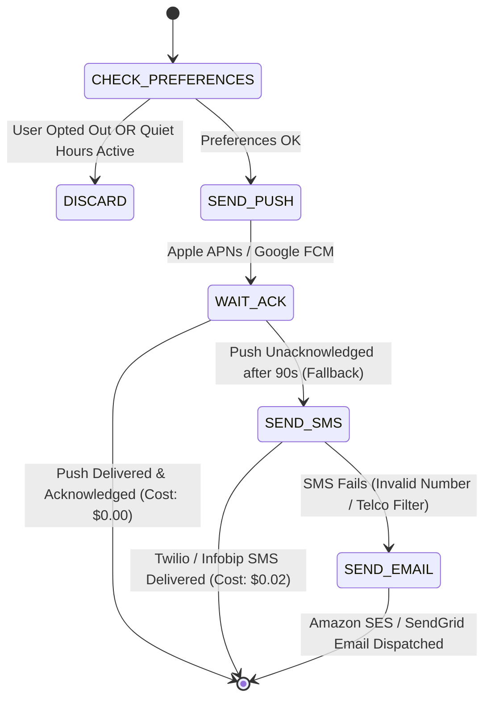
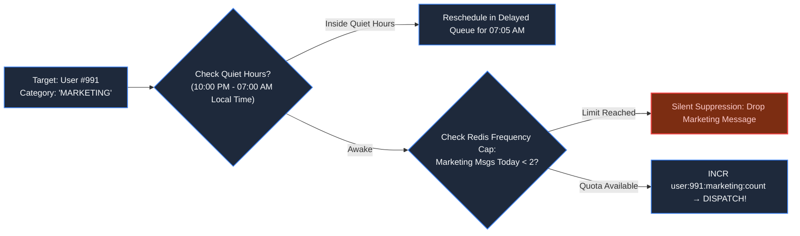
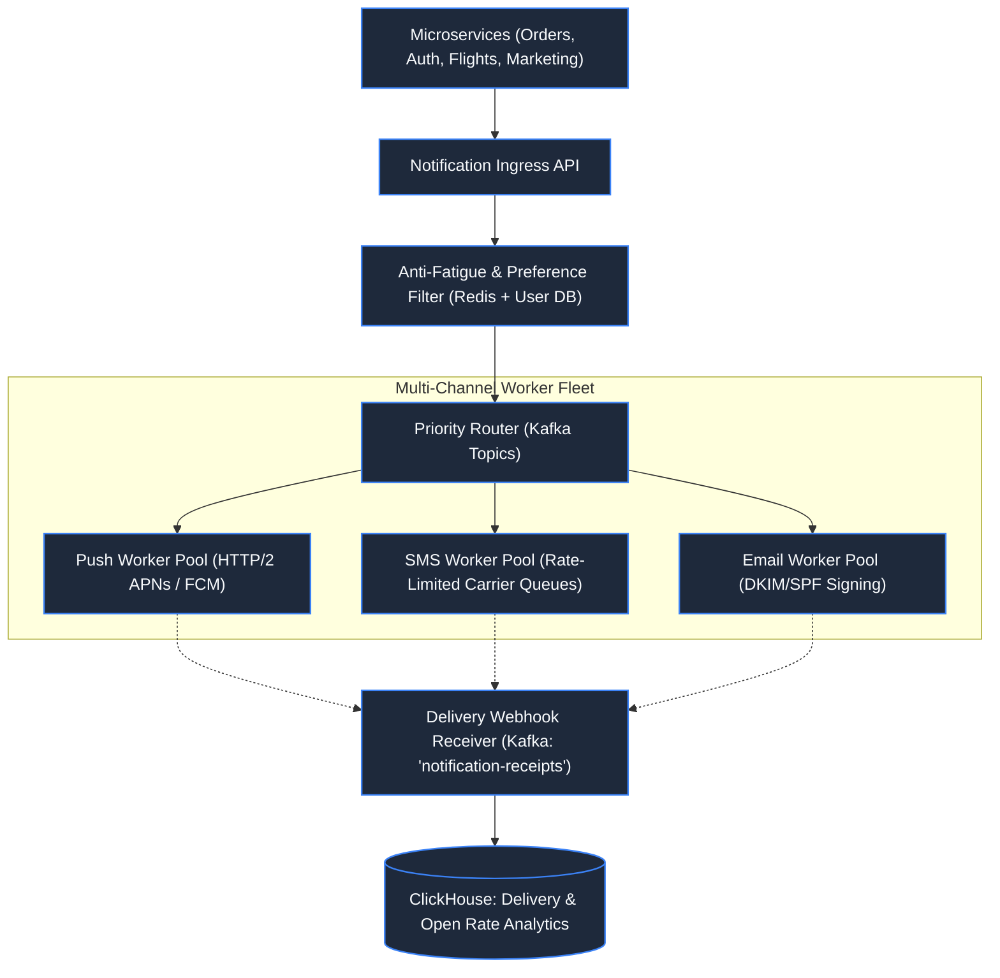

# Chapter 20: Standalone System: Planetary Notification Engine

> *"Never let a promotional newsletter stand in the way of an emergency flight cancellation. Priority is an architectural design, not a queue label."*

---

## 1. The Mystery: The Trapped Blizzard Alert

At 06:00 AM, a blizzard shut down Chicago O'Hare International Airport. Flight operations triggered an urgent alert: **40,000 passengers had their flights cancelled**.

At 06:01 AM, the marketing department launched an automated spring campaign: **10,000,000 promotional emails and push notifications** ("20% Off Hawaii Flights!").

Both systems published to a single shared message queue:



The 40,000 emergency alerts were trapped behind millions of promotional emails. Stranded travelers arrived at the airport unaware, causing terminal chaos and national headlines.

The team made the classic distributed mistake: **treating all notifications as equal events.**

---

## 2. Multi-Tier Priority Ingress

A planetary notification system must physically isolate traffic into **Strict Priority Lanes**:



Even if the marketing queue holds 50,000,000 pending emails, the **P0 Critical Queue** operates with dedicated workers and zero contention. A 2FA login code or emergency alert is dispatched within 800 milliseconds.

---

## 3. The Multi-Channel Delivery Fallback Chain

Delivering messages across mobile devices is fraught with provider failures. A resilient engine deploys **Cascading Fallbacks**:



### The Cost Invariant:
- **Mobile Push (APNs/FCM)**: Free ($0.00). Always attempt first.
- **SMS (Twilio/Infobip)**: Expensive ($0.015 to $0.06 per message).
- **Email (SES/SendGrid)**: Inexpensive ($0.0001 per email), but suffers spam filters.

Fallback chains save millions of dollars annually while ensuring critical messages reach offline users.

---

## 4. User Preferences & The Anti-Fatigue Engine

Spamming users destroys brand reputation and triggers app uninstalls. Every dispatch must pass the **Anti-Fatigue Filter**:



---

## 5. Complete Production Notification Topology



---

## 6. Architect-Level Trade-Offs

| Decision | Low Latency Benefit | Risk Profile |
|---|---|---|
| **Dedicated Priority Queues** | Guaranteed sub-second delivery for P0 alerts | Higher infrastructure cost (idle workers on P0). |
| **Instant SMS Fallback** | Maximum reach for emergency cancellations | Risk of double-dispatch if push delivery ACK was merely delayed. |
| **Strict Anti-Fatigue Capping** | Prevents user churn and notification fatigue | Marketing teams cannot spam flash sales. |

---

## 7. Mental-Model Summary

```
A notification system is not a mail carrier; it is an intelligent air traffic controller.
It must separate life-safety alerts from marketing noise, respect user quiet hours,
and fall back across channels gracefully.
```

- **Rule 1**: Never mix transactional alerts with bulk marketing in the same queue.
- **Rule 2**: Enforce rate-limits and quiet hours in memory before generating provider payloads.

---

## 8. The Next Battlefield

*Notifications push information to users.*

*Now reverse the flow: a user actively pulls information by typing into a search box.*

*As the shopper types: `n` $\to$ `ni` $\to$ `nik` $\to$ `nike` $\to$ `nike a` $\to$ `nike air`, the client fires an HTTP request on every single keystroke.*

*The catalog holds 50,000,000 products. The autocomplete engine must return relevant suggestions, brand matches, and typo corrections in **under 15 milliseconds**.*

*Relational `LIKE 'nike%'` queries crash the database on keystroke 2.*

*How do Trie data structures and Inverted Indexes answer queries at the speed of human thought?*

👉 **Next: [Chapter 21 — Standalone System: Distributed Search & Real-Time Autocomplete](/book/part-03-time-space-asynchrony/chapter-21-system-distributed-search-autocomplete.md)**
