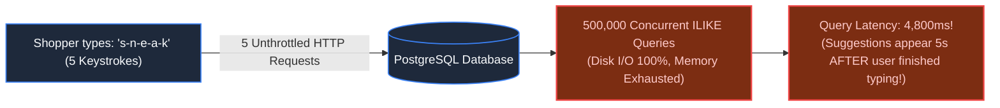
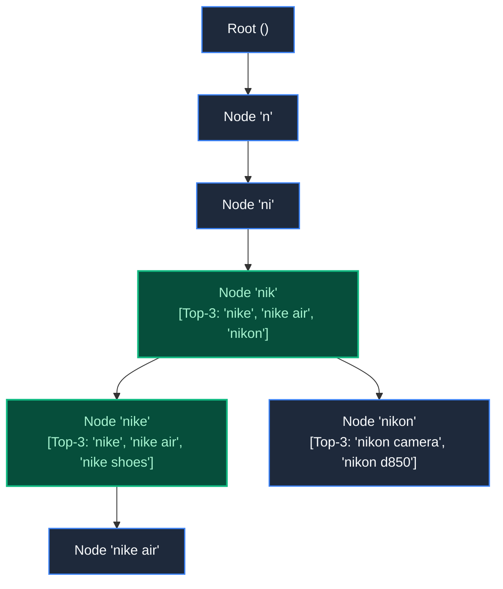

# Chapter 21: Standalone System: Distributed Search & Autocomplete

> *"Autocomplete is not search; it is prefix prediction. Never search fifty million documents when you can walk five steps down a tree."*

---

## 1. The Mystery: The Keystroke Avalanche

An e-commerce marketplace added real-time autocomplete to their mobile search bar across 50,000,000 catalog products.

The implementation used a standard SQL pattern:
```sql
SELECT name, category, popularity 
FROM products 
WHERE name ILIKE 'sneaker%' 
ORDER BY popularity DESC LIMIT 5;
```

When 50,000 shoppers started typing during lunch hour, disaster struck:
- Each user typed an average of 12 characters (`s-n-e-a-k-e-r-s...`).
- 50,000 shoppers $\times$ 12 keystrokes = **600,000 database queries in 30 seconds**.



The database collapsed under the **Keystroke Avalanche**. Autocomplete latency spiked to 4.8 seconds, rendering the feature completely useless.

---

## 2. The Core Data Structure: The Trie (Prefix Tree)

Relational B-Trees index whole values. To answer prefix queries in sub-millisecond time, we use a **Trie (Prefix Tree)**:



### The $O(L)$ Time Invariant:
Finding suggestions for prefix `"nike"` requires walking **exactly 4 pointers down the tree**, regardless of whether the catalog contains 10,000 or 100,000,000 products:

$$\text{Lookup Time} = O(L) \quad (\text{where } L \text{ is the prefix length, e.g., } 4)$$

### The Top-$K$ Pre-Computation Trick:
In a naive Trie, finding the top suggestions requires traversing all descendants of `"nik"`. 
**The Optimization**: Store the pre-computed Top-5 suggestions directly inside each node! Walking to `"nik"` returns the top completions in **nanoseconds with zero child traversals**.

---

## 3. Typo Tolerance: Inverted Indexes & N-Grams

What happens when a shopper mistypes `"sneekers"`? A pure Trie lookup fails immediately.

To handle typos, search systems deploy **N-Gram Tokenization**:

```
Term: "sneaker"
3-Grams: ["sne", "nea", "eak", "ake", "ker"]

Mistyped Query: "sneeker"
3-Grams: ["sne", "nee", "eek", "eke", "ker"]
Overlapping Grams: ["sne", "ker"] -> Matches "sneaker" with 2 edits!
```


---

## 4. Production High-Scale Autocomplete Topology

```mermaid
flowchart TD
    Client["Client Mobile App (Debounce: 150ms)"] --> Edge["Edge CDN (Cloudflare POP)"]
    Edge -->|Cache Hit (Top 5% 2-Letter Prefixes)| EdgeReturn["Instant Edge Response (<5ms)"]
    
    Edge -->|Cache Miss| Gateway["API Gateway"]
    Gateway --> TrieFleet["In-Memory Trie Fleet (Go / Rust)\n(Sharded by Prefix Hash: 'hash(prefix) % N')"]
    
    TrieFleet -->|Trie Miss / Long Tail Fuzzy| ESCluster[("Elasticsearch / OpenSearch\n(N-Gram Inverted Index Fallback)")]
    
    subgraph OfflinePipeline ["Offline Popularity Pipeline"]
        Kafka["Clickstream Kafka Topic"] --> Spark["Spark / Flink Batch Job"]
        Spark --> Weights[("Pre-compute Top-K Weights & Rebuild Trie Daily")]
        Weights -.->|Deploy Immutable Snapshot| TrieFleet
    end

    classDef default fill:#1e293b,stroke:#3b82f6,stroke-width:1.5px,color:#f8fafc;
    classDef success fill:#064e3b,stroke:#10b981,stroke-width:2px,color:#a7f3d0;
    class EdgeReturn success;
```

### The Three Critical Ingress Optimizations:
1. **Client-Side Debouncing**: The app waits 150ms after a keystroke before firing an HTTP request, cutting outbound traffic by 60%.
2. **Edge Prefix Caching**: The most popular prefixes (`"a"`, `"ap"`, `"app"`, `"sh"`, `"sn"`) are micro-cached at Anycast CDN edges, absorbing 70% of requests.
3. **Immutable Snapshot Swapping**: Real-time traffic never writes to the Trie. An offline worker rebuilds an immutable Trie snapshot every hour and swaps pointers in memory in $<1\text{ms}$.

---

## 5. Architect-Level Trade-Offs

| Autocomplete Technology | Latency | Memory Footprint | Typo Tolerance |
|---|---|---|---|
| **SQL B-Tree (`LIKE 'str%'`)** | Poor (collapses under load) | Zero additional memory | Zero |
| **In-Memory Top-$K$ Trie** | Ultra-Fast (<2ms) | High (stores prefix trees in RAM) | Poor (requires fuzzy backtracking) |
| **Elasticsearch N-Gram Index** | Fast (10-25ms) | Medium (disk + OS page cache) | Superb (automatic Levenshtein fuzzy matching) |
| **Hybrid (Trie Edge + ES Fallback)**| Best of both worlds | Balanced | Instant exact prefix + robust fuzzy fallback |

---

## 6. Part 3 Grand Milestone Recap

We have completed **Part 3: Time, Space & Asynchrony**:


We now possess the architectural mastery to coordinate time across drifting clocks, synchronize real-time messaging, partition global geography with hexagons, track physical cargo through event streams, execute multi-vendor travel sagas, dispatch multi-channel alerts, and predict search prefixes at the speed of thought.

---

## 7. The Next Dimension: Massive Media & The Edge

*Our systems have conquered textual data, coordinates, and event streams.*

*Now enter the physical physics of massive binary data: moving gigabytes of 4K video, encoding adaptive bitrates, serving viral social feeds to 80 million followers, and syncing multiplayer game physics at 60 ticks per second.*

*A user uploads a 4GB video file over mobile cellular data. At 99% completion, the signal drops.*

*Why does the upload have to restart from byte zero, and how do content-addressable storage and chunking protocols make uploads unbreakable?*

👉 **Next: [Part 4: Data at Rest and in Motion — Media, Feeds & The Edge](file:///Users/lspl487/Desktop/software-book/roadmap/04-part-4-media-search-edge.md)**
👉 **Next Chapter: [Chapter 22 — The Anatomy of Large Data: Chunks, Checksums & Object Storage](file:///Users/lspl487/Desktop/software-book/book/part-04-media-search-edge/chapter-22-anatomy-of-large-data-chunks-checksums.md)**
