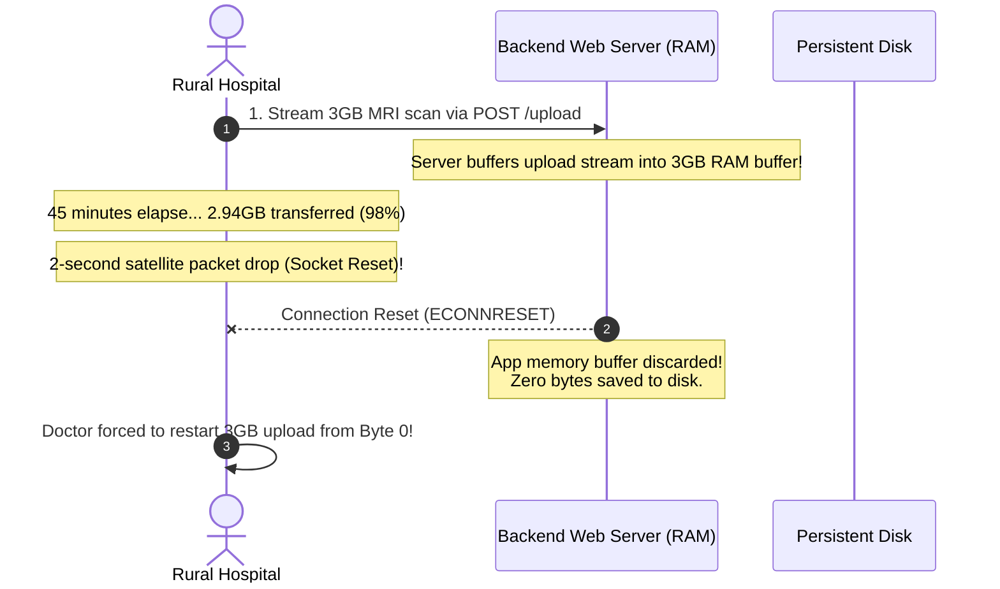
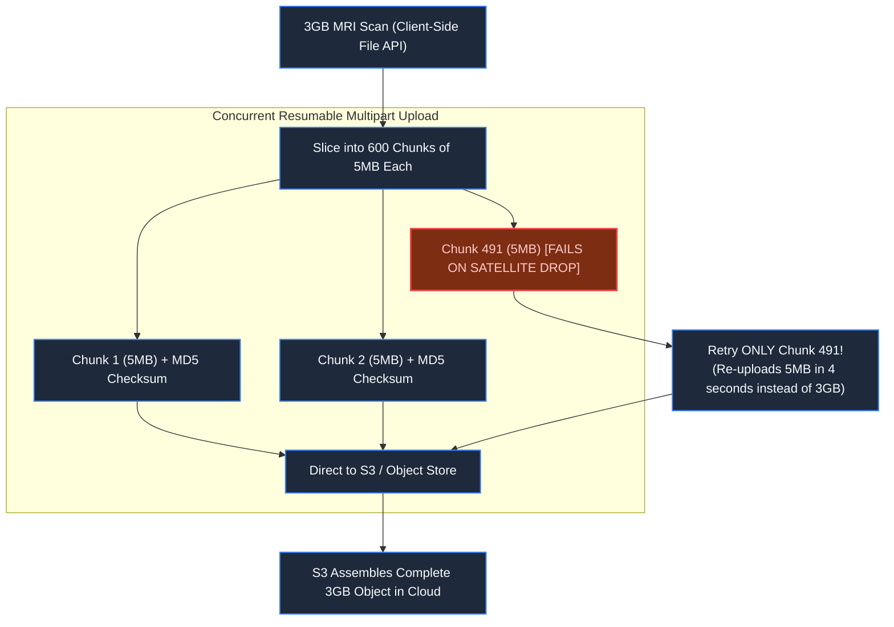
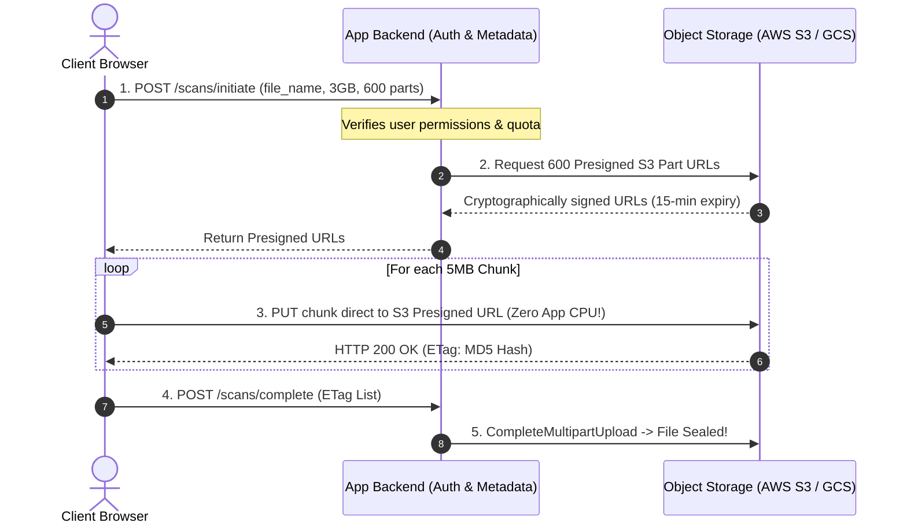
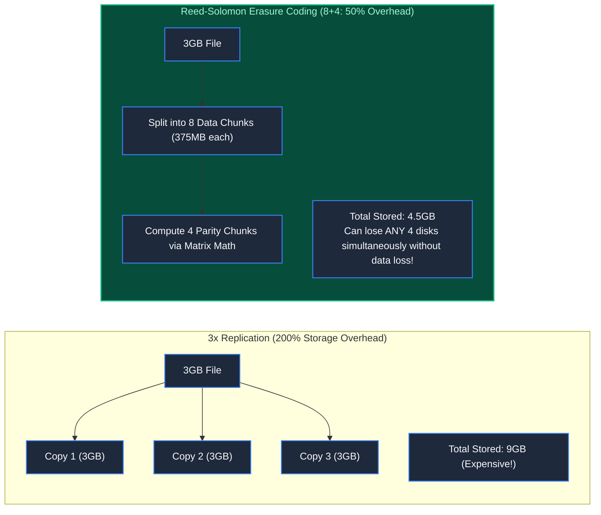

# Chapter 22: The Anatomy of Large Data: Chunks & Checksums

> *"Never stream gigabytes through application memory. Let storage engines store, let compute engines compute, and verify every byte with cryptographic checksums."*

---

## 1. The Mystery: The 98% Upload Heartbreak

A healthcare platform enabled hospitals to upload high-resolution 3GB DICOM MRI scans. 

A rural clinic with a 10 Mbps satellite link spent 45 minutes uploading a critical patient scan. At **2.94GB (98% progress)**, a momentary atmospheric storm caused a 2-second packet drop.

The browser socket disconnected. The application server threw an `ECONNRESET` exception, flushed its memory buffer, and closed the connection.

The doctor’s screen flashed:
`"Upload Failed. Please try again."`



Worse, twenty clinics uploading scans simultaneously consumed **60GB of application RAM**, triggering the Linux Out-Of-Memory (OOM) killer and crashing the entire hospital scheduling portal.

The architecture violated two laws of scale: **it piped heavy binary blobs through application compute, and treated a multi-gigabyte upload as an atomic, all-or-nothing operation.**

---

## 2. Multipart Uploads & Chunked Checksums

A 3GB file must never travel as a single HTTP stream. It must be sliced into independent **Chunks**:



### The Resumability Invariants:
1. **Parallel Uploads**: The browser uploads 4 chunks concurrently across separate HTTP connections, saturating available bandwidth.
2. **Granular Retries**: If network drops at 98%, only the currently active 5MB chunk fails. The preceding 599 chunks are already safely stored.
3. **End-to-End Checksums**: Each chunk carries an `Content-MD5` header. The storage engine validates that received bits match transmitted bits before confirming receipt.

---

## 3. Bypassing Application Compute: Presigned URLs

Application servers should never act as high-bandwidth network proxies for large binary payloads:



The application server processes only lightweight JSON metadata (milliseconds of CPU). **Gigabytes of binary traffic flow directly from the client to cloud storage.**

---

## 4. Erasure Coding: The Math of "11 Nines" Durability

How do cloud providers (AWS S3) guarantee **99.999999999% durability** without tripling infrastructure costs?

Traditional **3x Replication** stores 3 identical copies of every file, consuming **200% storage overhead**:



Under **Reed-Solomon (8+4) Erasure Coding**, a file is divided into 8 data fragments and transformed into 4 parity fragments distributed across 12 independent server racks. 

Any 8 fragments can mathematically reconstruct the entire file. You can suffer a catastrophic hardware failure of **4 complete server racks simultaneously with zero data loss**, all while requiring only **50% extra storage** instead of 200%.

---

## 5. Content-Addressable Storage (CAS) & Deduplication

In modern enterprise architectures, objects are named by their cryptographic hash:

$$\text{Object Key} = \text{SHA-256}(\text{File Payload})$$

```
s3://bucket/blobs/e3b0c44298fc1c149afbf4c8996fb92427ae41e4649b934ca495991b7852b855
```

If 10,000 employees in an enterprise attach the same 50MB PDF to an email, the system computes the hash, discovers the object already exists in CAS storage, and creates a metadata pointer. **499.95 GB of disk storage is saved instantly.**

---

## 6. Architect-Level Trade-Offs

| Storage Architecture | Durability | Storage Overhead | Compute Cost |
|---|---|---|---|
| **Direct Application Ingest** | Poor (vulnerable to server OOM) | 0% | Massive CPU & RAM hog on web servers. |
| **Presigned S3 Direct Upload** | Absolute (offloaded to cloud storage) | 0% app overhead | Requires multipart coordination state. |
| **3x Replication** | High | 200% extra disk | Zero CPU overhead (simple file copy). |
| **Reed-Solomon Erasure Coding** | Extreme ("11 Nines") | 30%–50% extra disk | CPU cost for parity matrix computation on write/rebuild. |

---

## 7. Mental-Model Summary

```
Large binary files are physical payloads, not database records.
Slice them into checksummed chunks, upload them directly to storage via presigned URLs,
and protect durability with erasure coding rather than naive replication.
```

- **Rule 1**: Never buffer large uploads in application server RAM; stream directly to object storage via presigned URLs.
- **Rule 2**: Enforce multipart chunking with client-side checksums (`Content-MD5`) for any file larger than 100MB.

---

## 8. The Next Battlefield

*We now store and assemble multi-gigabyte binary files reliably.*

*Now change the requirement: the user cannot wait 10 minutes to download a 4GB movie file before pressing play.*

*A user taps 'Play' on a 4K movie stream. They demand playback startup in under 800 milliseconds, zero buffering, and seamless visual fidelity even as their phone switches from high-speed home fiber to cellular data in an elevator.*

*How do HLS, DASH, and Adaptive Bitrate (ABR) encoding transcode and slice video into dynamic edge streams?*

👉 **Next: [Chapter 23 — The Spinning Wheel: Video & Audio Streaming Architecture](file:///Users/lspl487/Desktop/software-book/book/part-04-media-search-edge/chapter-23-video-audio-streaming-architecture.md)**
