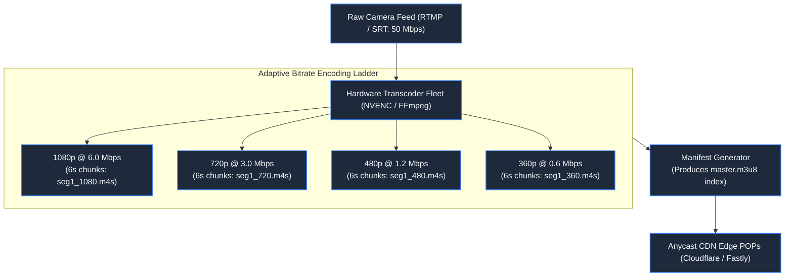
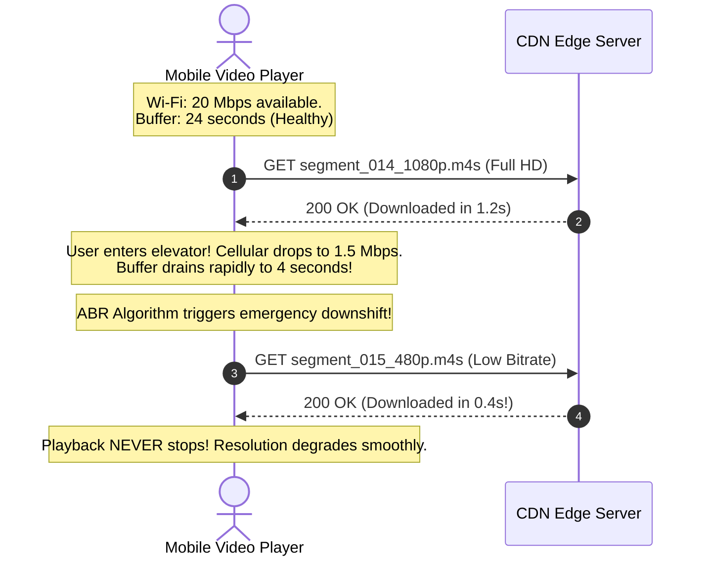

# Chapter 23: The Spinning Wheel: Video & Audio Streaming

> *"Streaming is not file transfer; it is a relay race of micro-chunks. Never send a movie; send six seconds of the future."*

---

## 1. The Mystery: The 30-Second Spoiler

During the World Cup final, 15,000,000 fans streamed the match live. 

In an apartment building in Madrid, Carlos watched the stream on his tablet. At the 89th minute, his neighbors down the hall erupted into cheers. 

Carlos stared at his screen: the ball was still in midfield. **His digital stream was 34 seconds behind real-world broadcast cable.** Ten seconds later, his video froze completely, replaced by a spinning buffer wheel.

```mermaid
timeline
    title The Live Streaming Latency Gap
    00:00 : Real-World Goal Scored in Stadium
    00:03 : Terrestrial TV Cable Broadcast Reaches Neighbors (Cheers Erupt!)
    00:15 : Ingestion & Transcoding Pipeline (Keyframe Alignment)
    00:25 : CDN Edge Segment Delivery
    00:37 : Carlos Sees the Goal (Spoiler ruined by 34 seconds!)
```

The streaming platform used traditional HTTP progressive download of monolithic MP4 files. When mobile bandwidth fluctuated, the player stalled, fell behind, and could not recover.

---

## 2. Sliced Streaming: HLS & MPEG-DASH

Modern streaming platforms (Netflix, YouTube, Twitch) never transmit a single `.mp4` file over the wire. They slice video into **discrete, self-contained micro-segments** (typically 2 to 6 seconds long):



### The Manifest Hierarchy (`.m3u8`):
The player first downloads a **Master Playlist**:
```http
#EXTM3U
#EXT-X-STREAM-INF:BANDWIDTH=6000000,RESOLUTION=1920x1080
1080p/index.m3u8
#EXT-X-STREAM-INF:BANDWIDTH=1200000,RESOLUTION=854x480
480p/index.m3u8
```
Inside `1080p/index.m3u8`, the player reads sequential chunk URLs:
```http
#EXTINF:6.000,
segment_001.m4s
#EXTINF:6.000,
segment_002.m4s
```

---

## 3. Adaptive Bitrate (ABR): Surviving the Elevator

A client video player is an autonomous control system. It continuously measures:
1. **Current Bandwidth Throughput** (bytes received per millisecond).
2. **Buffer Fill Level** (seconds of decoded video waiting in memory).



If the buffer drains near empty, the ABR algorithm downshifts to a 480p segment. **The user notices a momentary drop in crispness, but the dreaded spinning wheel never appears.**

---

## 4. Edge CDN Caching: The 99.8% Offload

Video segments are **immutable static files**. Segment 14 of 1080p video will never change its bytes.

```mermaid
flowchart LR
    TenMillion["15,000,000 Concurrent Viewers"] --> Edge["CDN Edge POPs (10,000 Edge Nodes)"]
    Edge -->|Cache Hit (99.8%)| Instant["Instant Segment Delivery (<15ms)"]
    Edge -.->|Cache Miss (First Fetch Only)| Origin["Video Packager Origin Server\n(Absorbs only 0.2% of total traffic!)"]

    classDef default fill:#1e293b,stroke:#3b82f6,stroke-width:1.5px,color:#f8fafc;
    classDef success fill:#064e3b,stroke:#10b981,stroke-width:2px,color:#a7f3d0;
    class Instant success;
```

Because segments are cached at Anycast CDN edges globally, 15,000,000 viewers streaming a 6 Mbps video stream generate **90 Terabits/second of egress** at the CDN edge, while the origin transcoders experience a calm trickle of under 200 requests/second.

---

## 5. Low-Latency HLS (LL-HLS) vs WebRTC

| Streaming Protocol | Latency | Scalability (Viewers) | Primary Use Case |
|---|---|---|---|
| **Standard HLS / DASH** | 15–30 seconds | Unlimited (Millions via standard CDNs) | On-demand movies (Netflix), high-scale sports. |
| **Low-Latency HLS (LL-HLS)** | 2–4 seconds | Extremely High (HTTP/2 chunked transfer via CDNs) | Live sports broadcasting, interactive Twitch streams. |
| **WebRTC** | Sub-500 milliseconds | Low-to-Medium (Stateful UDP peer/relay mesh) | Video conferencing (Zoom, Google Meet), 1-on-1 calls. |

> **The Architectural Rule**: Never use WebRTC for millions of one-way broadcast viewers. Use **LL-HLS** or **CMAF (Chunked Low-Latency DASH)** to leverage global HTTP caching infrastructure.

---

## 6. Mental-Model Summary

```
Monolithic media files are hostile to mobile networks.
Slice video into immutable micro-chunks across an adaptive bitrate ladder.
Let client players dynamically choose resolution based on buffer depth,
and let edge CDNs absorb 99.8% of planetary distribution.
```

- **Rule 1**: Encode video into multiple discrete bitrate renditions (ABR ladder).
- **Rule 2**: Use immutable 2-to-6 second media segments so edge CDNs can cache them permanently.

---

## 7. The Next Battlefield

*Video streaming distributes immutable binary chunks from one broadcaster to millions of viewers.*

*Now invert the graph: millions of users generating short text, photo, and video posts that must be assembled into customized, real-time social feeds.*

*A superstar creator with 80,000,000 followers taps 'Publish'.*

*If you write the post into 80 million follower timelines, the database write queue stalls for 25 minutes.*
*If you query the database on read, loading a single user's feed takes 6 seconds.*

*How do social media architectures solve the Celebrity Problem and balance write amplification against query latency?*

👉 **Next: [Chapter 24 — The Celebrity Problem: Social Media & Dynamic Feeds](file:///Users/lspl487/Desktop/software-book/book/part-04-media-search-edge/chapter-24-social-media-dynamic-feeds.md)**
