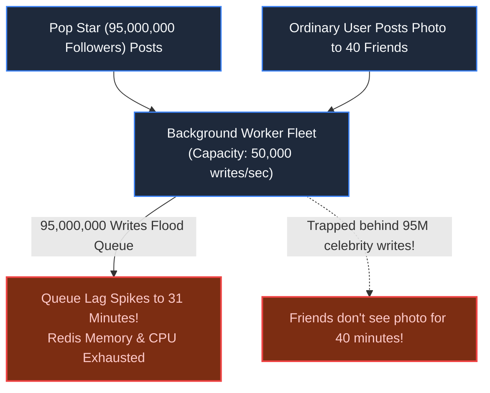
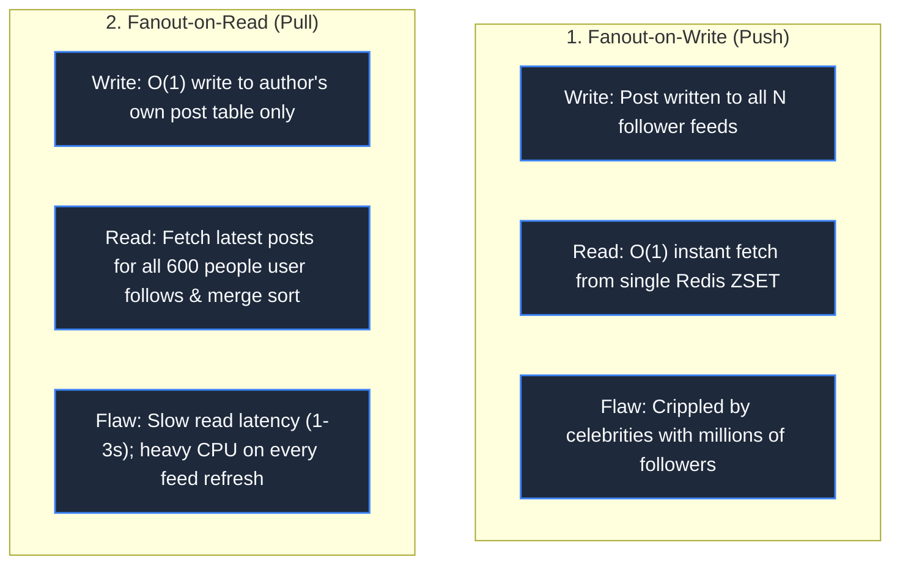
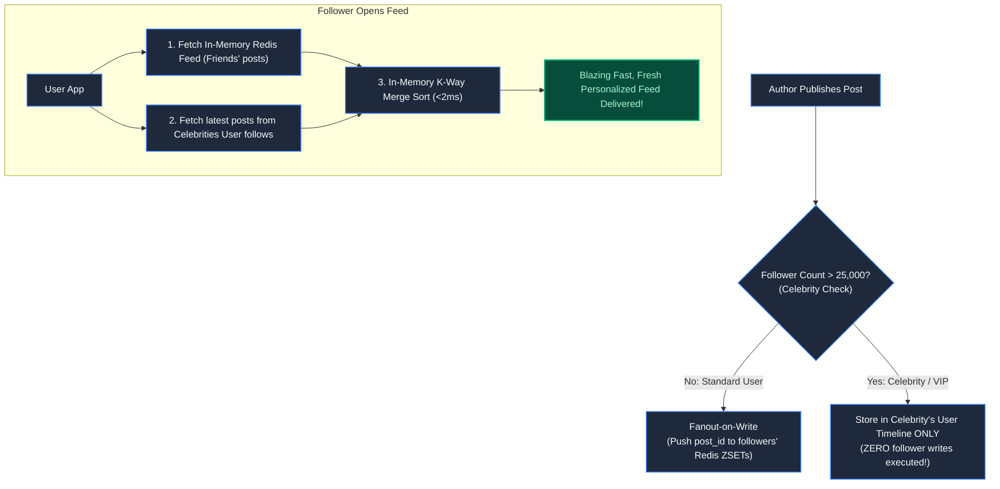
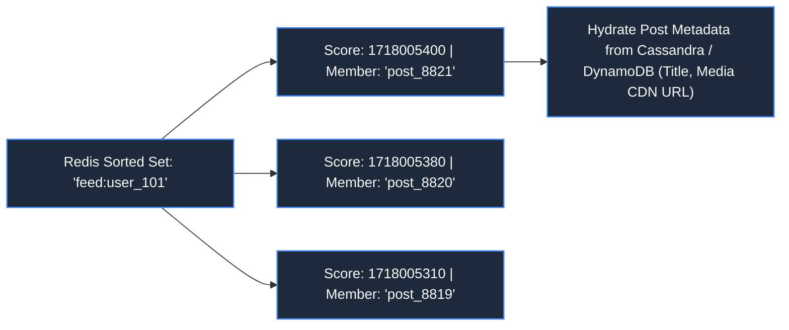

# Chapter 24: The Celebrity Problem: Social Media & Dynamic Feeds

> *"All users are equal, but their fanout graphs are profoundly unequal. Never treat an account with eighty million followers like an account with eighty."*

---

## 1. The Mystery: The 95-Million Write Avalanche

A social media platform designed its timeline using the industry-standard **Fanout-on-Write (Push Model)**:

```python
def publish_post(author_id, post_id):
    followers = get_followers(author_id)
    for follower_id in followers:
        # Push post_id into every follower's in-memory feed
        redis.zadd(f"feed:{follower_id}", timestamp, post_id)
```

At 20:00 UTC, a global pop icon with **95,000,000 followers** posted a 5-second teaser: *"Surprise album drops tonight!"*

Within two seconds, the background queue was inundated with **95,000,000 write tasks**. 



Ordinary users posting photos to 40 friends found their updates trapped in a 30-minute queue delay. The platform suffered catastrophic **Write Amplification**.

---

## 2. The Two Extreme Paradigms



- **Fanout-on-Write** optimizes for fast reads at the cost of catastrophic write spikes.
- **Fanout-on-Read** optimizes for fast writes at the cost of slow, expensive reads.

---

## 3. The Architectural Cure: The Hybrid Fanout Model

A production social platform (Twitter / Instagram architecture) separates users into two distinct tiers based on a **Follower Threshold** (e.g., 25,000 followers):



### The Invariants:
1. **Normal Users (99.9% of population)**: Use Fanout-on-Write. A user with 200 followers generates 200 Redis writes, completing in under 5ms.
2. **Celebrities (0.1% of population)**: Use Fanout-on-Read. Their post writes to their own post table **once**.
3. **Feed Assembly**: When a follower opens the app, the service pulls their pre-computed Redis feed, queries the small list of celebrities they follow, and executes an in-memory **K-Way Merge Sort** in $<2\text{ms}$.

---

## 4. Timeline Storage: Redis Sorted Sets (ZSET)

How is an individual user's feed stored in memory?

```bash
# Add Post 8821 to User 101's timeline with Unix timestamp as score
ZADD feed:user_101 1718005400 "post_8821"

# Trim timeline: Keep only latest 800 posts (eliminate unbounded memory growth)
ZREMRANGEBYRANK feed:user_101 0 -801

# Fetch top 20 latest posts
ZREVRANGE feed:user_101 0 19 WITHSCORES
```



Timelines store **only 64-bit integer Post IDs**, not full post content. When a page of 20 IDs is fetched, post text and media CDN URLs are hydrated in parallel from distributed document stores.

---

## 5. Inactive Users: Ghost Follower Pruning

If 40% of an account's followers have not logged in for 30 days, pushing updates into their Redis timelines is a colossal waste of expensive RAM.

> **The Architectural Rule**: Never fan out to inactive users. If a user is dormant for $>30$ days, evict their Redis timeline. When they open the app after months away, reconstruct their feed on demand.

---

## 6. Architect-Level Trade-Offs

| Feed Architecture | Read Latency | Write Amplification | Operational Cost |
|---|---|---|---|
| **Pure Fanout-on-Write (Push)** | Blazing (<5ms) | Disastrous on high-follower accounts | High RAM consumption (Redis per user). |
| **Pure Fanout-on-Read (Pull)** | Slow (500–2,000ms) | Negligible ($O(1)$ write) | Heavy database query load on read. |
| **Hybrid Fanout Model** | Ultra-Fast (<15ms) | Bounded (zero celebrity write storms) | Requires maintaining celebrity status flags & merge logic. |

---

## 7. Mental-Model Summary

```
Feed architecture is an asymmetric game.
Do not push writes to millions of inboxes when you can pull from a single author on read.
Isolate celebrities into on-demand pull streams and keep the push queue calm.
```

- **Rule 1**: Cap user feed depth in RAM (e.g., maximum 800 post IDs in Redis).
- **Rule 2**: Route accounts with high follower counts through Fanout-on-Read, merging them at query time.

---

## 8. The Next Battlefield

*Social feeds coordinate media at human reading speeds (seconds to minutes).*

*Now collapse the timeline down to the physiological threshold of human reflex: **16 milliseconds (60 frames per second)**.*

*In a multiplayer combat game (Fortnite / Valorant style), 100 players run, steer vehicles, and fire weapons across a virtual landscape.*

*TCP introduces head-of-line blocking: a single dropped packet freezes the game for 150ms, causing players to experience jarring 'rubber-banding'.*

*How do authoritative game servers, UDP networking, client-side prediction, and lag compensation maintain a shared virtual reality across erratic internet connections?*

👉 **Next: [Chapter 25 — 60 Ticks per Second: Gaming & Real-Time Multiplayer Systems](/book/part-04-media-search-edge/chapter-25-gaming-multiplayer-systems.md)**
