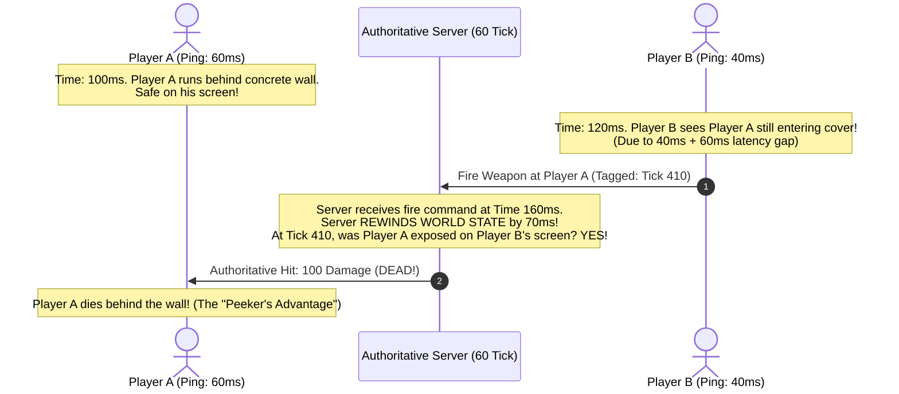
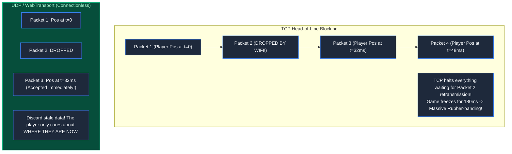
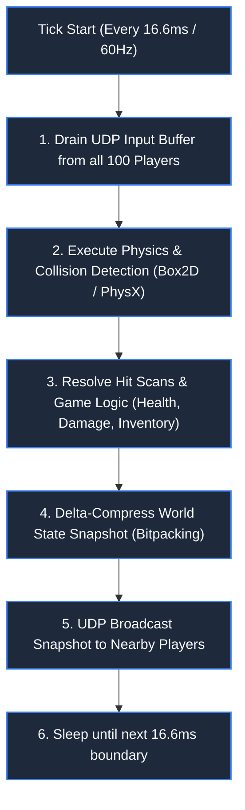
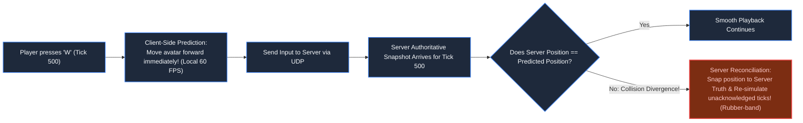
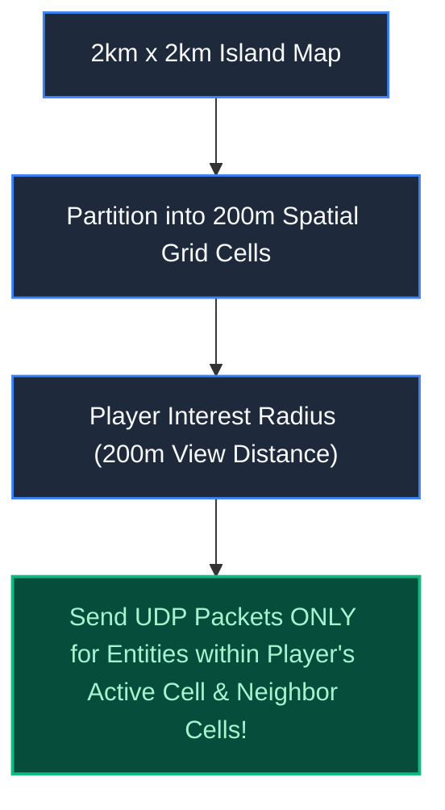

# Chapter 25: 60 Ticks per Second: Gaming & Real-Time Multiplayer

> *"In real-time multiplayer, physical synchronization over fiber is impossible; the game engine is an illusionist harmonizing past, present, and predicted futures."*

---

## 1. The Mystery: The Death Behind the Concrete Wall

In an esports tournament, Player A (60ms ping) retreated behind a solid concrete wall. He was completely out of line-of-sight.

Eighty milliseconds later, Player A dropped dead. The killfeed announced:
`Player B eliminated Player A (Headshot)`



Player A raged: *"I was behind cover! The hit registration is broken!"*

The game engine was not broken; it was executing **Lag Compensation**. To make shooting feel fair, the server had temporarily rewound physical history.

---

## 2. Why TCP is Fatal for Real-Time Gaming

Standard web development relies on TCP for reliable delivery. In high-speed gaming, TCP is catastrophic:



A position packet from 100 milliseconds ago is worthless garbage. Re-transmitting it over TCP wastes bandwidth and freezes the simulation. Multiplayer games use **UDP**: if a packet drops, ignore it and process the next frame.

---

## 3. The 16.6ms Game Loop: Authoritative Server Simulation

Never trust the client. If a client transmits `x, y, z` coordinates, malicious players will write memory hacks to fly through walls.

The client transmits **only user inputs**:
```json
{"tick": 1042, "keys": ["W", "D"], "yaw": 44.2, "fire": true}
```

The server runs an unyielding physical simulation loop every **16.6 milliseconds (60 Ticks per Second)**:



---

## 4. Client-Side Prediction & Server Reconciliation

If a player presses 'W' and waits for the server to confirm movement 80ms later, the controls will feel sluggish and unplayable.



The client **predicts the future locally**. When authoritative snapshots arrive, the client smoothly reconciles any divergences.

---

## 5. Spatial Interest Management (Area of Interest - AOI)

In a 100-player Battle Royale (e.g. Warzone), broadcasting every player’s position to all 100 clients requires:
$$100 \times 100 = 10,000\text{ network streams per tick}$$



Filtering entities outside the player's visual horizon slashes server outbound bandwidth by **85%** and prevents wallhack cheats from scanning the entire map memory.

---

## 6. Architect-Level Trade-Offs

| Network Model | Latency Feel | Cheat Vulnerability | Server Infrastructure Cost |
|---|---|---|---|
| **Peer-to-Peer (P2P Lockstep)** | Stalls on slowest player ping | High (clients share game state directly) | Zero server costs (players host). |
| **Authoritative 64-Tick Server** | Smooth (prediction hides latency) | Minimum (server verifies all physics) | Moderate ($0.05 per player-hour). |
| **Authoritative 128-Tick Server** | Esports grade (sub-8ms input latency) | Minimum | 2.5x higher CPU & network bandwidth cost. |

---

## 7. Mental-Model Summary

```
In real-time multiplayer, TCP guarantees arrival at the cost of freshness;
UDP guarantees freshness at the cost of arrival.
Always predict inputs on the client, simulate physics on the server, 
and rewind historical buffers to make shooting feel fair.
```

- **Rule 1**: Never use TCP for fast-paced game simulation; use UDP with client-side prediction.
- **Rule 2**: Store a 1,000ms circular buffer on the server to execute historical lag compensation.

---

## 8. The Milestone Awaits

We have mastered large data chunks ([Ch 22](file:///Users/lspl487/Desktop/software-book/book/part-04-media-search-edge/chapter-22-anatomy-of-large-data-chunks-checksums.md)), adaptive video streaming ([Ch 23](file:///Users/lspl487/Desktop/software-book/book/part-04-media-search-edge/chapter-23-video-audio-streaming-architecture.md)), social media timeline fanout ([Ch 24](file:///Users/lspl487/Desktop/software-book/book/part-04-media-search-edge/chapter-24-social-media-dynamic-feeds.md)), and real-time multiplayer simulation ([Ch 25](file:///Users/lspl487/Desktop/software-book/book/part-04-media-search-edge/chapter-25-gaming-multiplayer-systems.md)).

Now, we integrate these lessons into our next production-grade standalone system: **A Resilient File Upload & Distributed Object Storage Platform**.

👉 **Next: [Chapter 26 — Standalone System: Resilient File Upload & Distributed Storage](file:///Users/lspl487/Desktop/software-book/book/part-04-media-search-edge/chapter-26-system-resilient-file-upload.md)**
