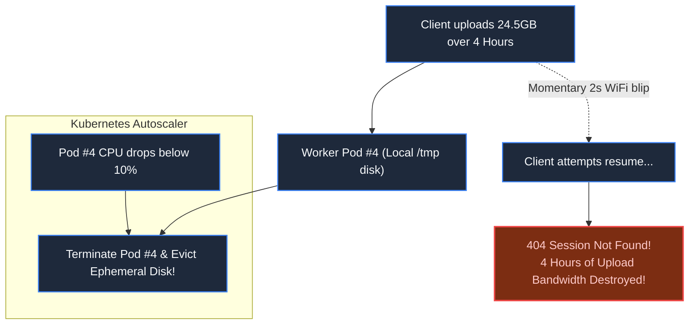
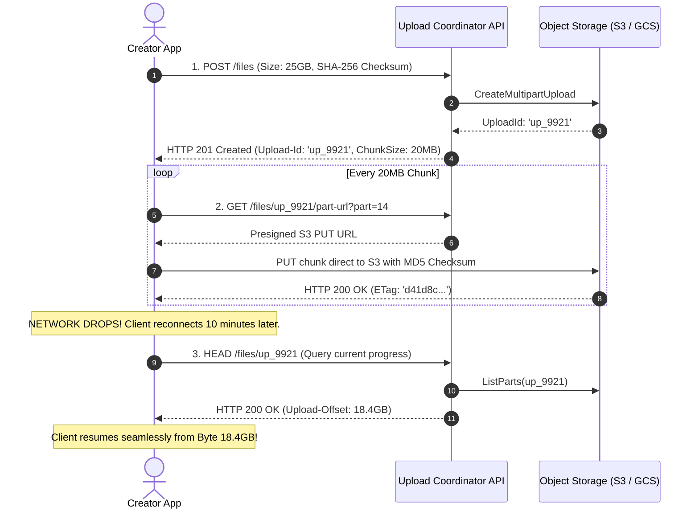
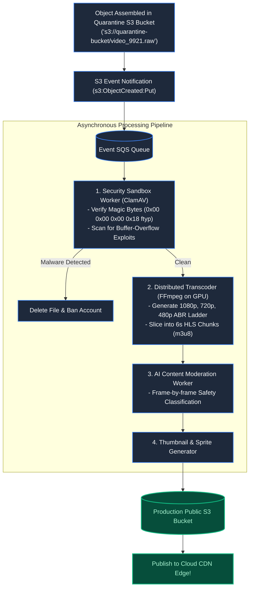
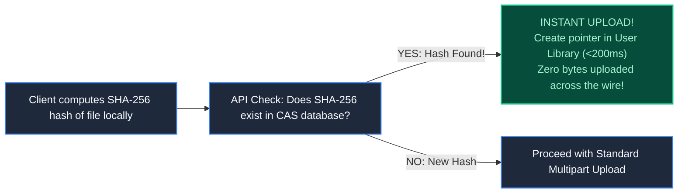

# Chapter 26: Standalone System: Resilient File Upload Platform

> *"An upload is not complete when the bytes reach the cloud; it is complete only when the content is quarantined, verified, transcoded, and sealed."*

---

## 1. The Mystery: The 24-Gigabyte Eviction

A creator platform invited filmmakers to upload raw 4K documentary reels (20GB to 50GB per file).

A filmmaker in Kenya spent four hours uploading a **24.5GB video file**. At 98% completion, her router momentarily refreshed its DHCP lease. The browser paused for three seconds and attempted to reconnect.

The backend had stored partial chunk files on the local disk (`/tmp/uploads/`) of Worker Pod #4. 

While the filmmaker's router reconnected, Kubernetes autoscaling noticed cluster CPU had dropped and **terminated Worker Pod #4**. The local `/tmp` directory vanished into thin air.

The filmmaker was greeted with:
`"Upload Session Expired. Please select file to restart (0% complete)."`

The system broke the primary rule of resilient storage: **ephemeral application servers must never store in-progress binary state.**

---

## 2. Resumable Upload Protocol (Tus & S3 Multipart)

A production file upload platform requires a standardized, stateful handshaking protocol (such as the open-source **Tus Protocol** or S3 Multipart API):

Because partial chunks live directly in durable cloud object storage, **any application server can crash or reboot without impacting the upload.**

---

## 3. Asynchronous Post-Processing & Quarantine Pipeline

Never publish user-uploaded files directly to a public CDN without passing through an **Isolated Quarantine Sandbox**:

---

## 4. Instant Upload: Content-Addressable Deduplication

If a creator uploads a popular 5GB sound library that another user already uploaded last week:

Client-side hash verification enables **Instant Uploads**, saving terabytes of egress bandwidth and delighting users.

---

## 5. Architect-Level Trade-Offs

| Architecture Pattern | Scalability | Security Isolation | Cost Profile |
|---|---|---|---|
| **Direct Application Ingest** | Poor (servers run out of memory/disk) | Low (exploits touch app memory directly) | Expensive server instances. |
| **Presigned S3 Direct Upload** | Virtually infinite | High (quarantine bucket isolates raw binaries) | Cheap (serverless execution). |
| **Synchronous Processing** | Terrible (user waits 20 minutes for transcode) | Poor | Stalls HTTP connection threads. |
| **Asynchronous SQS Pipeline** | Flawless (processes petabytes in background) | High (isolated worker sandboxes) | Pay-per-second GPU / compute. |

---

## 6. Part 4 Grand Milestone Recap

We have completed **Part 4: Data at Rest and in Motion**:

We now possess the architectural mastery to handle multi-gigabyte binary files, slice video for adaptive streaming, scale social feeds past the celebrity hurdle, synchronize 60Hz multiplayer physics, and engineer unbreakable file ingestion platforms.

---

## 7. The Next Battlefield: Trust & Isolation

*Our systems now move petabytes of data at planetary velocity.*

*Now change the challenge from speed to survival: **Trust, Isolation & Compliance**.*

*A pediatric healthcare system accidentally displays children's oncology records to an unrelated adult patient because of shared session caches.*

*A single enterprise SaaS tenant executes an unindexed search query that consumes 95% of database I/O, crashing all other 4,000 corporate clients.*

*How do you engineer Zero-Trust perimeters, strict multi-tenant boundaries (Pool vs Silo), and HIPAA/GDPR compliance?*

👉 **Next: [Part 5: Trust, Isolation & Compliance — Security, Multi-Tenancy & Edge Cases](file:///Users/lspl487/Desktop/software-book/roadmap/05-part-5-trust-multitenancy.md)**
👉 **Next Chapter: [Chapter 27 — The Zero-Trust Perimeter: Authentication, Authorization & Boundaries](file:///Users/lspl487/Desktop/software-book/book/part-05-trust-multitenancy/chapter-27-zero-trust-perimeters.md)**
