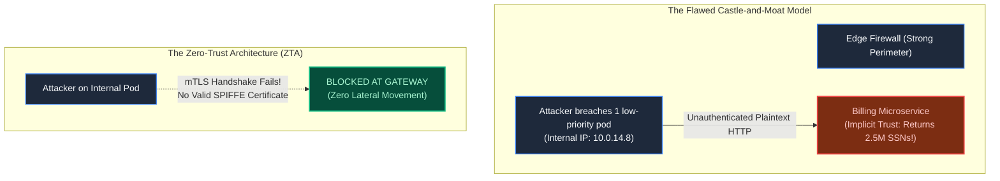
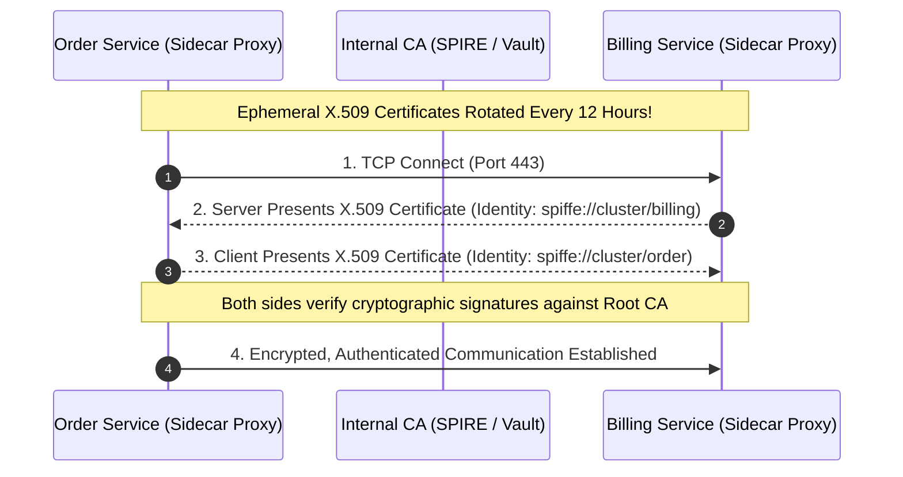
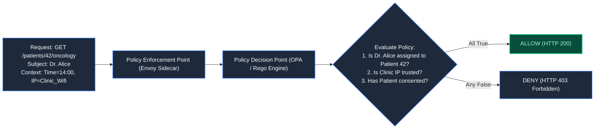
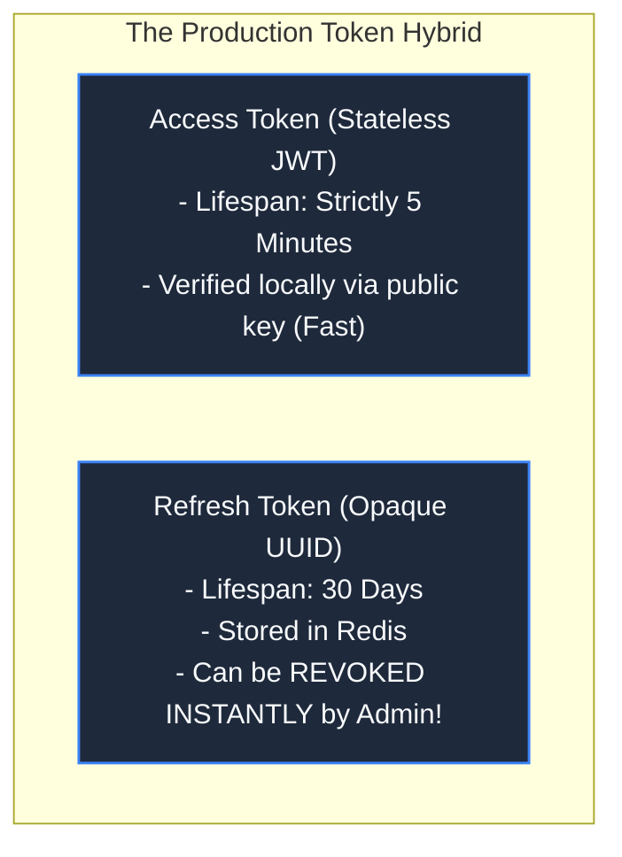

# Chapter 27: The Zero-Trust Perimeter: Auth & Boundaries

> *"Network location is not identity. A packet from an internal IP address deserves the exact same skepticism as a packet from the public internet."*

---

## 1. The Mystery: The Compromised Marketing Container

A fintech company defended its infrastructure using the classic **Castle-and-Moat Security Model**: a formidable Web Application Firewall (WAF) shielded the public edge, but everything inside the private Amazon VPC (10.0.0.0/16) was considered trusted.

An attacker discovered a remote code execution (RCE) vulnerability in an internal marketing analytics dashboard container.

Once inside the private VPC, the attacker discovered that microservices communicated over plaintext HTTP without credentials. From the compromised marketing container, the attacker ran:

```bash
curl http://billing-service.internal:8080/v1/customers/export
```

The billing microservice saw an internal IP address, assumed it was a legitimate internal cron job, and streamed **2,500,000 unencrypted customer records, tax IDs, and bank account numbers** to the attacker.



The company suffered a $45,000,000 regulatory fine because they confused **network location** with **authenticated identity**.

---

## 2. Mutual TLS (mTLS): Cryptographic Service Identity

In a **Zero-Trust Architecture (ZTA)**, the network is assumed to be already hostile. Every service-to-service hop must verify identity cryptographically via **Mutual TLS (mTLS)**:



Even if an attacker gains root access to an internal marketing node, they cannot execute requests to the billing service because they lack a valid cryptographic certificate signed by the internal Certificate Authority.

---

## 3. Authentication vs Authorization: The ABAC Paradigm

- **Authentication (AuthN)**: *"Who are you?"* (e.g., Cryptographic proof that caller is `user_881` via OIDC / JWT).
- **Authorization (AuthZ)**: *"Are you permitted to execute THIS action on THIS specific resource right now?"*

Traditional systems use **Role-Based Access Control (RBAC)**:
```
IF user.role == 'DOCTOR' THEN allow()
```
In real-world compliance, RBAC fails catastrophically: an oncologist should not have access to psychiatric records of a patient in another clinic just because both have the role `"DOCTOR"`.

Modern systems use **Attribute-Based Access Control (ABAC)** powered by Policy-as-Code engines (Open Policy Agent - OPA):



---

## 4. The JWT Trap: Expiration vs Instant Revocation

JSON Web Tokens (JWT) allow stateless authentication, but introduce an existential security vulnerability: **a signed JWT cannot be revoked before its expiration timestamp.**

If an employee is fired or their API token is compromised:
```json
{"sub": "usr_991", "exp": 1718090000, "role": "ADMIN"}
```
The token remains completely valid across all microservices until `exp` passes!



> **The Architectural Rule**: Never issue long-lived JWTs. Set access token expiration to **5 minutes**. Use stateful refresh tokens stored in Redis for instant session termination.

---

## 5. Architect-Level Trade-Offs

| Security Model | Defense Depth | Latency Overhead | Operational Cost |
|---|---|---|---|
| **Perimeter Firewall Only** | Vulnerable (one breach compromises all) | Zero overhead internal | Simplest to deploy; fails all compliance audits. |
| **Service Mesh mTLS (Istio/Envoy)** | Absolute (every packet encrypted & signed) | 0.5–1.5ms per hop | Requires managing sidecars and CA certificate rotation. |
| **Stateless Long-Lived JWT** | Poor (no instant revocation) | Zero DB lookups | Catastrophic leak window if token is stolen. |
| **Short-Lived JWT + Refresh Token** | High (instant revocation within 5 min) | Verification at edge only | Requires maintaining stateful refresh token store in Redis. |

---

## 6. Mental-Model Summary

```
The boundary of your system is not the perimeter firewall;
the boundary is every single function and microservice interface.
Never trust an IP address; authenticate with mTLS, authorize with ABAC policies,
and keep token lifetimes aggressively short.
```

- **Rule 1**: Implement mutual TLS (mTLS) for all internal service-to-service communication.
- **Rule 2**: Use Attribute-Based Access Control (ABAC) with Policy-as-Code (OPA) rather than simplistic role labels.

---

## 7. The Next Battlefield

*We now enforce Zero-Trust boundaries and cryptographic identity between services.*

*Now enter the most stringently regulated domain in software engineering: **Healthcare & Medical Systems**.*

*A pediatric healthcare platform operates an electronic health records (EHR) database under federal HIPAA and GDPR regulations.*

*A query caching optimization accidentally leaks a child patient's oncology records into an unrelated adult portal.*

*How do you engineer healthcare architectures utilizing HL7/FHIR standards, patient consent graphs, and field-level envelope encryption with customer-managed keys?*

👉 **Next: [Chapter 28 — The Leaked Health Record: Healthcare & Medical Architecture](/book/part-05-trust-multitenancy/chapter-28-healthcare-medical-systems.md)**
