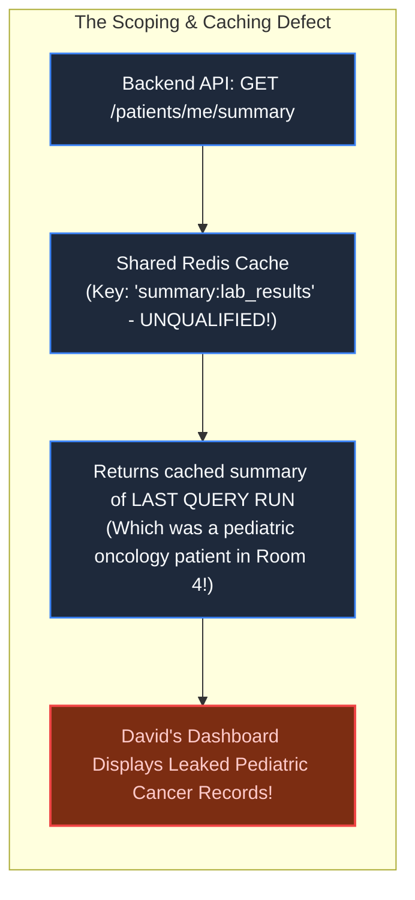
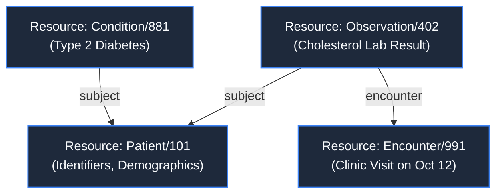
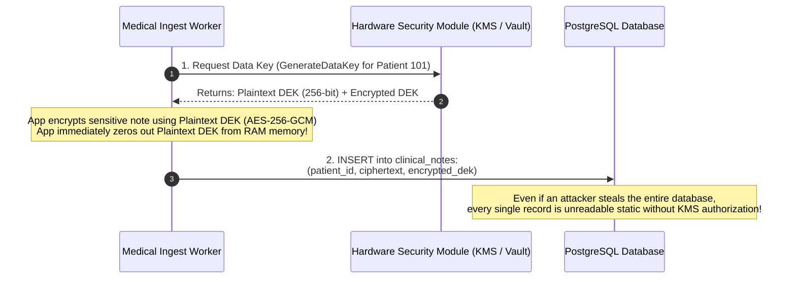
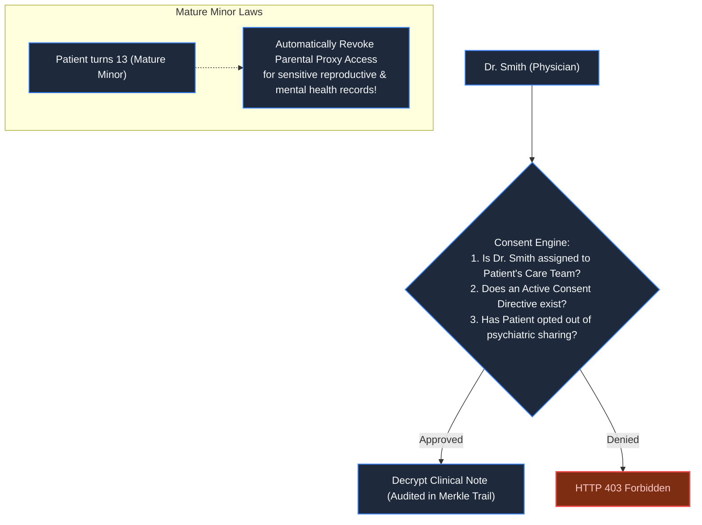

# Chapter 28: Healthcare & Medical Systems Architecture

> *"Disk-level encryption only protects against stolen hard drives; field-level envelope encryption protects against stolen databases."*

---

## 1. The Mystery: The Pediatric Record in the Adult Portal

An adult patient, David, logged into his hospital health portal to check routine cholesterol blood work.

On his dashboard, beneath his lab report, appeared an unexpected clinical note:
`Patient: Maya L. (Age 6) — Pediatric Oncology: Stage III Neuroblastoma Protocol`

David had no children and had never visited the oncology ward.



An immediate HIPAA federal breach investigation was launched. 

The cause was twofold:
1. The engineering team added a caching layer that failed to qualify cache keys with the patient ID.
2. The database stored medical clinical notes in **plaintext**. Anyone who bypassed the application layer had uninhibited access to the nation's most sensitive medical histories.

---

## 2. Standardizing Health Data: The FHIR Paradigm

Modern healthcare systems reject legacy pipe-delimited HL7 v2 messages in favor of **FHIR (Fast Healthcare Interoperability Resources)**: a standardized, graph-linked RESTful JSON specification:



FHIR standardizes medical entities into interoperable, linkable nodes. However, standard schemas do not solve the fundamental problem of **privacy isolation**.

---

## 3. Field-Level Envelope Encryption with KMS

Encrypting a database disk volume (AWS EBS Encryption / TDE) protects against a thief physically stealing hard drives from a datacenter. **It provides ZERO protection against SQL injection, compromised credentials, or rogue DBAs.**

To guarantee privacy, deploy **Field-Level Envelope Encryption**:



### The Architectural Security Invariant:
- Every patient record is encrypted with a unique **Data Encryption Key (DEK)**.
- The DEK is encrypted by a master **Key Encryption Key (KEK)** held inside a certified Hardware Security Module (HSM).
- Reading a record requires a logged, auditable call to KMS. If a breach is suspected, revoking the patient's KEK in KMS renders the stolen data cryptographically inaccessible instantly.

---

## 4. Dynamic Patient Consent Graphs

Access control in healthcare cannot be hardcoded into user roles. It requires a **Dynamic Consent Graph**:



In healthcare, **reading data is as legally consequential as writing it**. Every `SELECT` query must emit an immutable audit log detailing:
`Who accessed which patient's record, at what millisecond, and for what medical purpose.`

---

## 5. Architect-Level Trade-Offs

| Encryption Strategy | Attack Protection | Queryability | Latency Overhead |
|---|---|---|---|
| **Transparent Disk Encryption (TDE)** | Only protects against physically stolen disks | Full SQL searching & indexing | Zero app overhead. |
| **Field-Level Envelope Encryption** | Immune to DB dumps, rogue DBAs, and SQL injection | Cannot run `WHERE note ILIKE '%term%'` | 2–5ms per record (KMS decryption). |
| **Homomorphic / Blind Indexing** | Searchable while encrypted | Requires auxiliary deterministic HMAC hashes | High cryptographic complexity. |

---

## 6. Mental-Model Summary

```
In healthcare, a database breach is not an operational failure; it is an existential catastrophe.
Never store protected health information (PHI) in plaintext.
Encrypt each record with its own envelope key, qualify every cache key with tenant identity,
and audit every read operation.
```

- **Rule 1**: Always use envelope encryption (AES-256-GCM + KMS) for sensitive clinical fields.
- **Rule 2**: Log every read operation with purpose-of-use metadata in a tamper-evident audit trail.

---

## 7. The Next Battlefield

*Healthcare architectures enforce individual patient isolation.*

*Now expand isolation from individual human patients to corporate enterprises: **Enterprise Multi-Tenant SaaS**.*

*Your B2B cloud hosts 5,000 corporate clients, ranging from 10-person startups to Fortune 500 banks.*

*At 09:00 AM, Tenant #402 runs a massive, unindexed financial analytics export across 10 years of data. The query locks 95% of database I/O.*

*The other 4,999 corporate clients experience frozen dashboards and connection timeouts.*

*How do you build multi-tenant architectures (Silo vs Pool vs Bridge) that neutralize the Noisy Neighbor problem and guarantee absolute tenant boundary isolation?*

👉 **Next: [Chapter 29 — The Noisy Neighbor: Enterprise SaaS & Multi-Tenancy](file:///Users/lspl487/Desktop/software-book/book/part-05-trust-multitenancy/chapter-29-enterprise-saas-multitenancy.md)**
