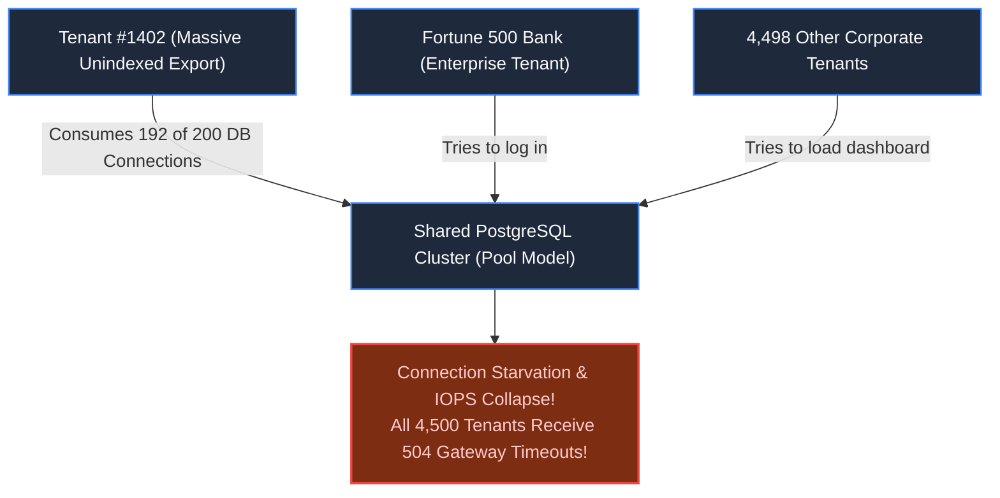
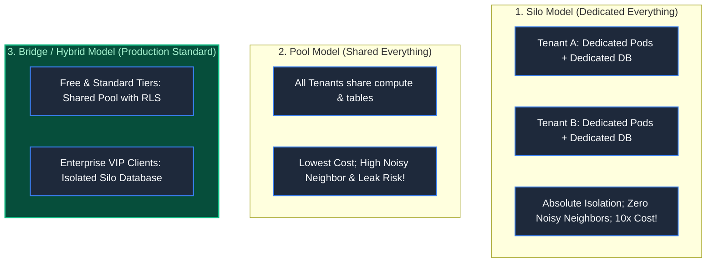
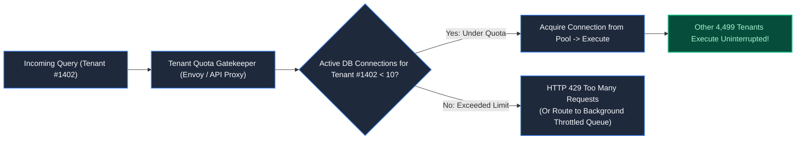

# Chapter 29: The Noisy Neighbor: Enterprise SaaS & Multi-Tenancy

> *"Tenant isolation is not an application feature; it is an architectural invariant. Never trust developers to remember the WHERE tenant_id clause; enforce it in the database kernel."*

---

## 1. The Mystery: The Monday Morning Blackout

A B2B analytics SaaS platform served 4,500 corporate clients on a shared cloud database.

At 09:14 AM on Monday, an operations analyst at Tenant #1402 (a logistics company) exported ten years of unindexed shipment history across 20,000,000 rows.

The query triggered a sequential table scan:
- **Database CPU hit 100%**.
- **Disk IOPS throttled to minimum baseline**.
- **192 out of 200 database connections** were seized by Tenant #1402's export worker.



A single customer brought down the entire company. Worse, a developer debugging the outage wrote a quick diagnostic query without a `tenant_id` filter and accidentally dumped Tenant A's private sales leads into Tenant B's web view.

This is the twin disaster of multi-tenancy: **The Noisy Neighbor** and **Cross-Tenant Data Contamination**.

---

## 2. The Three Tenancy Models: Silo vs Pool vs Bridge



---

## 3. Kernel-Enforced Isolation: Row-Level Security (RLS)

Relying on application engineers to remember `WHERE tenant_id = ?` on every SQL query is a mathematical guarantee of a future data breach.

Production architectures enforce tenant boundaries inside the **Database Kernel via PostgreSQL Row-Level Security (RLS)**:

```sql
-- 1. Enable RLS on the table
ALTER TABLE accounts ENABLE ROW LEVEL SECURITY;

-- 2. Define the security policy
CREATE POLICY tenant_isolation_policy ON accounts
FOR ALL
USING (tenant_id = current_setting('app.current_tenant_id')::UUID);
```

```mermaid
sequenceDiagram
    autonumber
    actor App as App Backend Connection
    participant DB as PostgreSQL Kernel

    Note over App: 1. Extract tenant_id from validated JWT
    App->>DB: SET LOCAL app.current_tenant_id = 'tenant_42';
    App->>DB: SELECT * FROM accounts; (Notice: ZERO WHERE CLAUSE!)
    
    Note over DB: PostgreSQL Kernel intercepts query!<br/>Automatically rewrites AST: WHERE tenant_id = 'tenant_42'
    DB-->>App: Returns ONLY Tenant 42's rows! (100% Cryptographic Isolation)
```

Even if a junior engineer writes `SELECT * FROM accounts`, the database engine intercepts the query and strictly returns rows belonging to the active session tenant. **Cross-tenant leaks are mathematically impossible.**

---

## 4. Taming the Noisy Neighbor: Tenant Concurrency Quotas

To prevent a single tenant from starving the database connection pool:



### The Invariants:
1. **Per-Tenant Connection Ceilings**: Cap maximum concurrent database transactions per tenant (e.g., maximum 10 out of 200 connections).
2. **Read Replica Segregation**: Route heavy reporting and export queries to asynchronous read replicas or ClickHouse OLAP stores, shielding the primary transactional engine.

---

## 5. Architect-Level Trade-Offs

| Multi-Tenancy Architecture | Isolation Assurance | Cost per Tenant | Operational Burden |
|---|---|---|---|
| **Pure Silo (Database-per-Tenant)** | Absolute (physical separate servers) | Extremely High ($$$) | Migrating 5,000 separate databases takes days. |
| **Schema-per-Tenant** | High (separate PostgreSQL schemas) | Medium | DDL migrations choke when tables exceed 100,000. |
| **Shared Pool with RLS** | High (kernel-enforced boundaries) | Lowest ($) | Requires strict connection pooling and RLS tuning. |
| **Tiered Hybrid (Pool + VIP Silo)** | Optimum for B2B SaaS | Balanced | Requires dynamic connection routing layer in application. |

---

## 6. Mental-Model Summary

```
In multi-tenant SaaS, you are not building one application; 
you are building an operating system managing competing corporate workloads.
Enforce security at the database kernel via Row-Level Security, 
and enforce resource fairness at the connection pool.
```

- **Rule 1**: Always use database-level Row-Level Security (RLS) rather than relying on application-level filtering.
- **Rule 2**: Enforce hard connection ceilings per tenant to isolate noisy neighbors.

---

## 7. The Next Battlefield

*Enterprise SaaS manages thousands of corporate tenants.*

*Now expand the scale to an entire sovereign nation: **Government & Public Services Platforms**.*

*At 09:00 AM, a national government launches an emergency citizen relief portal: **50,000,000 citizens log in within a two-hour window**.*

*Authentication clusters crash under massive concurrency spikes. Biometric matching algorithms overheat. Sovereign data privacy laws strictly forbid using public US cloud regions.*

*How do you engineer high-concurrency public service platforms that operate in air-gapped sovereign environments and degrade gracefully under national load?*

👉 **Next: [Chapter 30 — 50 Million Citizens: Government & Identity Platforms](/book/part-05-trust-multitenancy/chapter-30-government-identity-platforms.md)**
