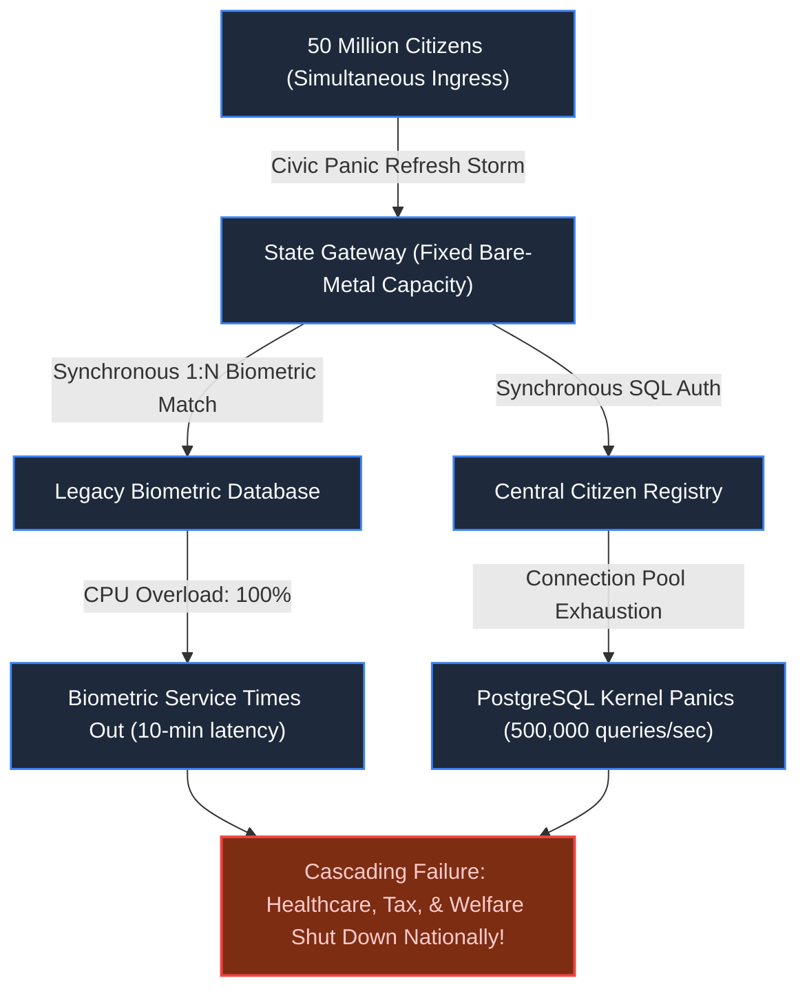
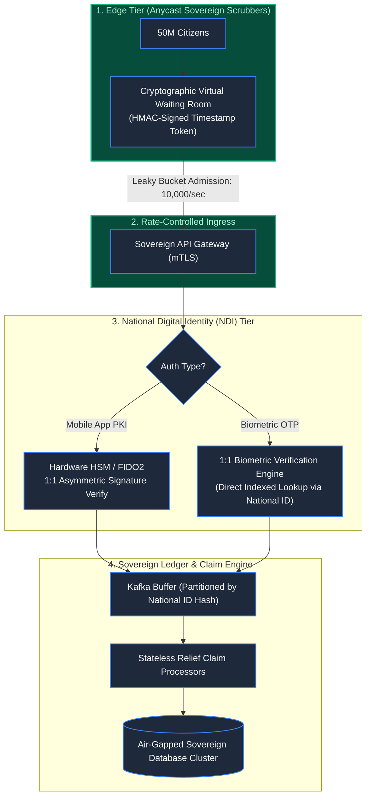
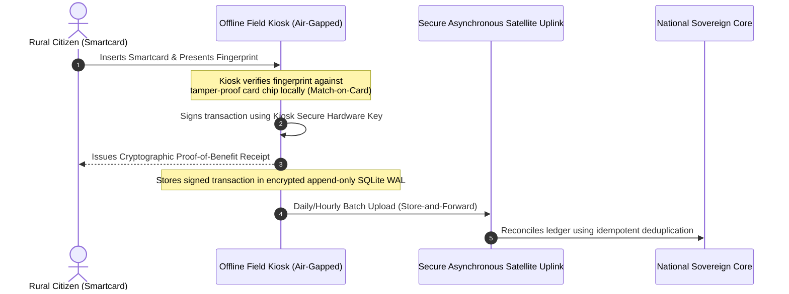

# Chapter 30: When 50 Million Citizens Log In: Government & Identity Platforms

> *"Public infrastructure cannot choose its users, nor can it fire unprofitable customers. When a nation logs in, your system must withstand civic hysteria without leaking sovereign secrets or failing the most vulnerable."*

---

## 1. The Mystery: The Monday Morning National Relief Crash

At 09:00 AM on a Monday following an economic emergency declaration, a national government opened its Citizen Emergency Relief portal, offering direct financial aid to citizens.

Within the first 90 minutes:
- **52,000,000 concurrent citizen sessions** bombarded the ingress gateways.
- **National Identity Provider (IdP) collapsed**: The database locked up attempting synchronous 1:N biometric matching (matching incoming facial/fingerprint scans against 100M citizen records).
- **Civil unrest ensued**: Citizens refreshing crashed pages spawned a 40x self-inflicted DDoS attack.
- **Sovereignty impasse**: Cloud auto-scaling to commercial global hyperscalers was legally blocked by sovereign data acts mandating all citizen biometric payloads remain within state-owned, air-gapped data centers.



---

## 2. The Fallacy of 1:N Identification at Ingress

The primary fatal flaw was treating authentication as an **Identification (1:N search)** problem instead of a **Verification (1:1 match)** problem:
1. **1:N Search ($O(N)$)**: Taking a user's biometric sample and searching an entire population table of 100,000,000 vectors requires gigabytes of vector indexing and hundreds of GPU milliseconds per request. At 50,000 requests/sec, the server farm melts in seconds.
2. **1:1 Verification ($O(1)$)**: The citizen provides their National ID Number ($K$) and an encrypted biometric hash or signed mobile cryptographic assertion. The server performs a direct primary-key lookup for $K$ and validates the signature or compares the template.

---

## 3. Production Architecture: Sovereign Admission & Verifiable Credentials

To survive national-scale load under sovereign air-gapped constraints, resilient public systems employ **Deterministic Cryptographic Queueing** and **Decoupled 1:1 Verifiable Identity Gateways**:



### The Architectural Invariants:
1. **Cryptographic Virtual Waiting Room**: When incoming concurrency exceeds system capacity, edge scrubbers issue an HMAC-signed cookie containing `(issued_at, queue_slot)`. The client executes a lightweight polling script; no database connection is touched until their cryptographic admission ticket matures.
2. **Asymmetric PKI over Biometrics**: Identity verification is shifted to citizen devices via sovereign mobile identity apps (e.g., Singapore Singpass, Estonia e-Residency). The citizen unlocks a private key stored in their smartphone Secure Enclave via local biometrics. The server merely verifies a standard ECDSA signature—requiring zero biometric processing on the central servers.
3. **Partitioned Ingestion**: All claim submissions are queued in Kafka partitioned by `hash(national_id) % partitions`, guaranteeing strict per-citizen ordering and preventing duplicate claims without locking database tables.

---

## 4. Disaster Resilience: Offline & Intermittent Kiosks

In rural areas, military zones, or post-disaster territories, internet connectivity is non-existent. Sovereign public infrastructure must function **offline-first**:



---

## 5. Architect-Level Trade-Offs

| Decision | Approach A: Synchronous Biometric Hub | Approach B: Mobile PKI & Match-on-Card | Winner / Rationale |
|---|---|---|---|
| **Server Computation** | High (Massive GPU clusters for biometric vector comparison) | Low ($O(1)$ ECDSA public key verification) | **Approach B**: Scales elastically to 100M+ citizens without server compute collapse. |
| **Data Privacy & Leak Risk** | Extreme (Centralized biometric database is high-value target) | Zero Centralization (Biometrics never leave personal chip/enclave) | **Approach B**: Satisfies constitutional and sovereign privacy regulations. |
| **Admission Strategy** | Uncontrolled HTTP 500/504 crash cascades | Cryptographic Virtual Waiting Room with predictable drain | **Approach B**: Preserves dignity and eliminates civil panic during crises. |
| **Network Dependency** | 100% real-time synchronous connectivity required | Offline Store-and-Forward with signed audit proofs | **Approach B**: Essential for disaster zones, rural outreach, and wartime resilience. |

---

## 6. Mental-Model Summary

```
National systems do not fail because of algorithms; they fail because of synchrony.
Never perform 1:N biometric searches on ingress; authenticate via 1:1 local PKI proofs.
When civic traffic surges, buffer human demand with cryptographic waiting rooms, 
and process societal claims through decoupled, append-only sovereign queues.
```

---

## 7. The Next Battlefield

*National identity platforms protect sovereign borders and citizen rights at rest.*

*Now shrink the temporal window from a national relief rollout to a **single 180-minute high-stakes event**: **Education & High-Stakes Examination Systems**.*

*At 10:00 AM, 500,000 university students sit down for a standardized medical licensing exam.*

*At minute 119, an undersea fiber cable snaps. Half the nation loses internet connectivity.*

*If a single student's exam state is lost, the academic year is ruined and legal lawsuits erupt. If answers are cached insecurely on local laptops, fraudulent memory manipulation invalidates the integrity of the entire profession.*

*How do you engineer high-stakes offline-capable clients with cryptographic tamper-evident anti-cheat telemetry and lock-step state synchronization?*

👉 **Next: [Chapter 31 — The High-Stakes Exam: Education & Examination Systems](file:///Users/lspl487/Desktop/software-book/book/part-05-trust-multitenancy/chapter-31-education-online-examinations.md)**
