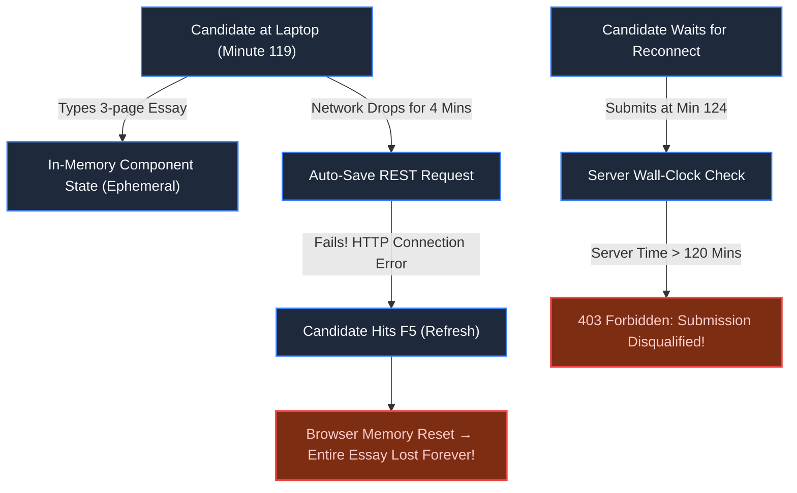
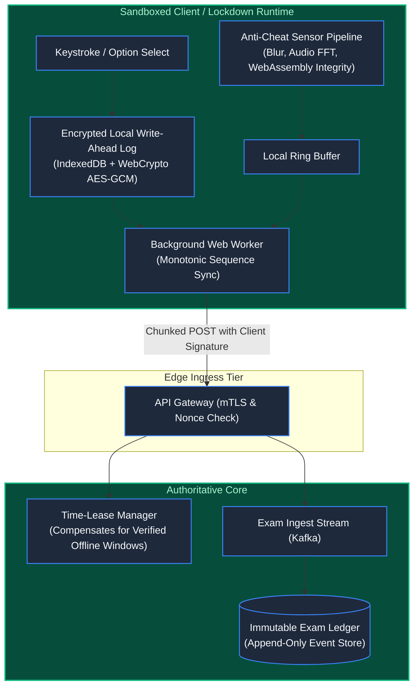

# Chapter 31: The High-Stakes Exam: Education & Examination Systems

> *"An exam is an irreversible distributed transaction between a distrusted client and an authoritative server across a hostile network. If a network blip can destroy a candidate's future, your architecture has committed malpractice."*

---

## 1. The Mystery: The Minute 119 Bar Exam Disaster

On a Tuesday afternoon, 45,000 law graduates took a nationwide digital bar examination. The exam software was built as a modern Single-Page Application communicating via REST with a cloud backend.

At minute 119 of the 180-minute exam, an internet service provider outage caused a 4-minute network blip:
- **Client Disconnection**: The web application's auto-save requests failed with `net::ERR_INTERNET_DISCONNECTED`.
- **The Ephemeral State Trap**: Answers were held in component React state. When panicking students refreshed the page, their browser memory cleared, resetting 120 minutes of essays to blank fields.
- **Server Timer Lockout**: For students who did not refresh, their submissions arrived at minute 124. The server rejected them with `HTTP 403 Forbidden: Exam Window Expired`, because the server's wall-clock timer ignored client-side connectivity gaps.
- **Cheating Scandals**: Other students discovered they could pause their network tab, alter DOM elements and local JavaScript variables in DevTools, and inject forged answers before reconnecting.

Lawsuits forced the bar association to nullify the exam at a cost of $28,000,000.



---

## 2. Core Invariants of High-Stakes Exam Architecture

High-stakes examination systems operate under adversarial constraints:
1. **Hostile Client Environment**: You cannot trust client clock time, DOM state, or client-side validation.
2. **Unreliable Physical Network**: Disconnections are not edge cases; they are guaranteed mathematical certainties.
3. **Absolute Non-Repudiation**: Every keystroke, question selection, and telemetry event must be cryptographically provable.

---

## 3. Production Architecture: Offline-First Tamper-Proof Engine



### The Architectural Mechanisms:

1. **Client-Side Encrypted Write-Ahead Log (WAL)**:
   - Every keystroke and answer change is immediately appended to an `IndexedDB` transaction before being rendered on screen.
   - The local log is encrypted with an ephemeral symmetric key negotiated via ECDH during session bootstrap. Even if the laptop loses power or crashes, rebooting restores exact state down to the last character.

2. **Monotonic Sequence Numbers & Gap Detection**:
   - Each state change increments a strict sequence number ($S_1, S_2, \dots, S_n$).
   - The server acknowledges received sequences. If the client experiences packet loss, it resends only the delta starting from $S_{last\_ack}$.

3. **Time-Lease Protocol (Neutralizing Clock Tampering)**:
   - Never rely on the client’s system clock. Instead, the server issues short-lived **cryptographic time leases** (e.g., 30-second tokens signed by server HMAC).
   - When the client goes offline, an internal monotonic timer measures elapsed offline duration. Upon reconnection, the client presents the sealed offline token accompanied by encrypted sensor telemetry proving the machine was not tampered with.

4. **Multi-Modal Anti-Cheat Telemetry**:
   - Web Workers stream periodic SHA-256 integrity hashes of the running WebAssembly binary to detect debugger attachment or code injection.
   - Focus loss events, OS window switches, dual-monitor plug-ins, and audio spectrogram spikes are streamed asynchronously as telemetry events, decoupled from the core answer pipeline.

---

## 4. Architect-Level Trade-Offs

| Dimension | Real-Time Synchronous Auto-Save | Offline-First Encrypted WAL & Sync |
|---|---|---|
| **Data Loss on Drop** | High (Unsaved inputs lost if connection drops mid-answer) | Zero (Saved to disk in $< 5\text{ms}$ before network dispatch) |
| **Network Overhead** | Low (Small JSON deltas on interval) | Moderate (Batched answer deltas + telemetry streams) |
| **Adversarial Resilience** | Poor (Client can forge payload or alter DOM) | High (Client signatures, Wasm integrity, monotonic sequences) |
| **Server Load Pattern** | Giant synchronous spikes on exam completion | Smooth background streaming and idempotent replay |

---

## 5. Mental-Model Summary

```
Treat an online exam like an airplane flight recorder (black box):
Never trust in-memory state; commit every action to durable local storage first.
Never trust the client's clock; arbitrate time using server-issued cryptographic leases.
Stream answers as an append-only event log; network recovery is simply an event replay.
```

---

## 6. The Next Battlefield

*We have secured healthcare records, multi-tenant databases, government identity grids, and high-stakes exams.*

*Notice a repeating, dangerous pattern across all these chapters: **Every microservice was forced to re-implement authentication, rate limiting, token validation, and TLS certificates independently**.*

*When 50 microservices manage their own authentication and traffic policies, security is only as strong as the sloppiest team's implementation.*

*To defend the distributed enterprise, we must lift security, routing, and resilience out of individual application code and unify them into a high-performance **Edge Infrastructure**.*

*How do you build a zero-latency, highly resilient reverse proxy that validates millions of JWTs, terminates mTLS, enforces rate limits, and breaks cascading circuit failures?*

👉 **Next: [Chapter 32 — Standalone System: Enterprise API Gateway & Edge Router](/book/part-05-trust-multitenancy/chapter-32-system-enterprise-api-gateway.md)**
