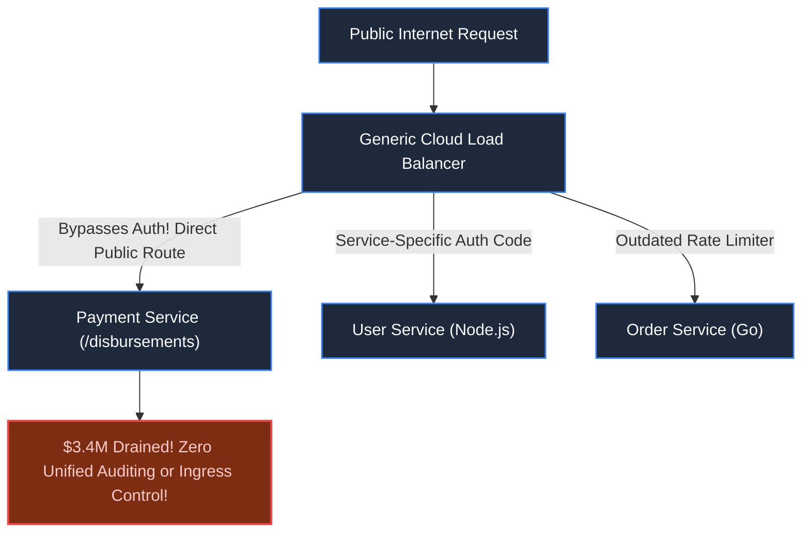
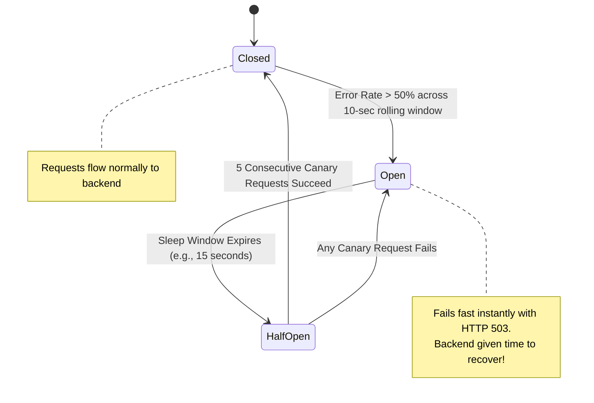

# Chapter 32: Standalone System: Enterprise API Gateway & Edge Router

> *"Never let your backend microservices talk directly to the outside world. The edge router is the fortress gate: it authenticates, rate-limits, transforms, and circuit-breaks before a single untrusted packet can touch your core."*

---

## 1. The Disaster: The Exposed Internal Service

A hyper-growth fintech company operated 65 microservices. Each team managed their own ingress routing, auth checks, and rate-limiting library.

During a routine feature deployment, the Payment Service team pushed a new endpoint: `/api/v2/disbursements`.
- **The Auth Flaw**: The developers assumed authentication was handled by an upstream reverse proxy. However, their internal ingress was directly routable from the public load balancer.
- **The Exploit**: Attackers discovered the endpoint required no authorization header, draining $3,400,000 in promotional payout credits in 40 minutes.
- **Cascading Collapse**: When the database team attempted to restart their overloaded cluster, dependent billing services flooded it with unthrottled retries, inducing a fatal thundering herd.



---

## 2. System Blueprint: The Edge Ingress Filter Chain

A unified **Enterprise API Gateway** sits as the single point of entry between the public internet and private VPC networks. It implements an asynchronous, non-blocking **Filter Pipeline**:

```mermaid
flowchart TD
    Req["Incoming HTTP/2 Request"] --> TLS["1. TLS Termination & IP Reputation Scrubbing"]
    
    TLS --> RateLimit["2. Distributed Rate Limiter\n(Local Token Bucket + Redis Cluster Sync)"]
    
    RateLimit -->|Within Limit| AuthFilter["3. JWT / OAuth2 Edge Verifier\n(Local Cryptographic Signature Check via JWKS)"]
    RateLimit -->|Exceeded| Reject429["HTTP 429 Too Many Requests"]
    
    AuthFilter -->|Valid Token| Router["4. Dynamic Path Router & Header Enricher\n(Injects x-user-id, x-tenant-id)"]
    AuthFilter -->|Invalid| Reject401["HTTP 401 Unauthorized"]
    
    Router --> CircuitBreaker{"5. Circuit Breaker\n(Downstream Health Check)"}
    
    CircuitBreaker -->|Closed (Healthy)| Upstream["6. Protocol Translation (gRPC) & Forward to Microservice"]
    CircuitBreaker -->|Open (Failing)| Fallback["HTTP 503 Service Unavailable / Cached Fallback"]

    classDef default fill:#1e293b,stroke:#3b82f6,stroke-width:1.5px,color:#f8fafc;
    classDef alert fill:#7c2d12,stroke:#ef4444,stroke-width:2px,color:#fecaca;
    classDef success fill:#064e3b,stroke:#10b981,stroke-width:2px,color:#a7f3d0;
    class Reject429,Reject401,Fallback alert;
    class Upstream success;
```

---

## 3. Core Engine Mechanics

### A. Zero-Network Edge JWT Verification (JWKS Cache)
Calling an identity service over the network to validate tokens on every request destroys latency ($+30\text{ms}$).
- **The Fix**: The gateway fetches the Identity Provider's public keys (`JWKS` endpoint) once and caches them in memory.
- Token validation executes via local cryptographic math (RSA-256 or Ed25519) in $< 50\mu\text{s}$.
- The gateway strips untrusted user headers and injects verified internal headers: `x-authenticated-user: 8841` and `x-tenant-id: org_alpha`.

### B. The Three-State Circuit Breaker Pattern

To protect downstream services from dying under cascaded load, the gateway wraps all upstream connections in an automated state machine:



### C. Protocol Translation: HTTP/JSON to Internal gRPC
Clients communicate via ubiquitous HTTP/JSON. Internal microservices communicate over high-performance binary **gRPC over HTTP/2 with Protobuf**.
- The gateway terminates the JSON payload, translates it into typed binary Protobuf frames in memory, and dispatches them across persistent internal connection pools, slashing serialization overhead by up to 60%.

---

## 4. Architect-Level Trade-Offs

| Decision | Decentralized Service-Level Auth | Centralized Edge API Gateway |
|---|---|---|
| **Security Surface** | Broad: Vulnerable to developer error in individual services. | Narrow: Standardized security perimeter enforced at entrance. |
| **Edge Latency** | Baseline (no hop overhead). | $+2\text{ms}$ (negligible compared to TLS/crypto savings). |
| **Operational Blast Radius** | Isolated to individual broken service. | Single point of failure: Gateway bug disrupts all services. |
| **Protocol Evolution** | Upstream clients must know internal gRPC semantics. | Clean decoupling: Gateway shields client from internal refactoring. |

---

## 5. Mental-Model Summary

```
The API Gateway is not a glorified reverse proxy; it is the boundary of trust.
Authenticate at the edge in microseconds using cached public keys.
Enrich requests with verified claims, strip untrusted headers,
and sever connections via circuit breakers before failing downstreams take down your fleet.
```

---

## 6. The Next Battlefield

*Our API Gateway successfully routes and secures millions of requests.*

*Now imagine you have deployed a new checkout engine behind the gateway.*

*At 10:00 PM, an unhandled null-pointer exception begins crashing 10% of checkout requests. In a traditional architecture, rolling back the binary requires a 30-minute CI/CD redeploy.*

*During those 30 minutes, you lose $2,000,000.*

*Modern high-velocity organizations decouple **Code Deployment** from **Feature Release** using **Dynamic Feature Flags & Rollout Engines**.*

*How do you evaluate boolean and multivariate flag rules locally in nanoseconds without network round-trips, while instantly propagating runtime changes to 10,000 servers?*

👉 **Next: [Chapter 33 — Standalone System: Dynamic Feature Flags & Rollout Engine](file:///Users/lspl487/Desktop/software-book/book/part-05-trust-multitenancy/chapter-33-system-dynamic-feature-flags.md)**
