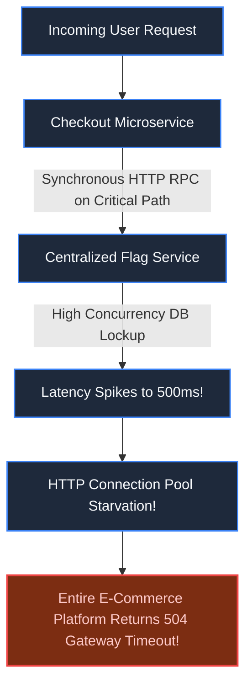
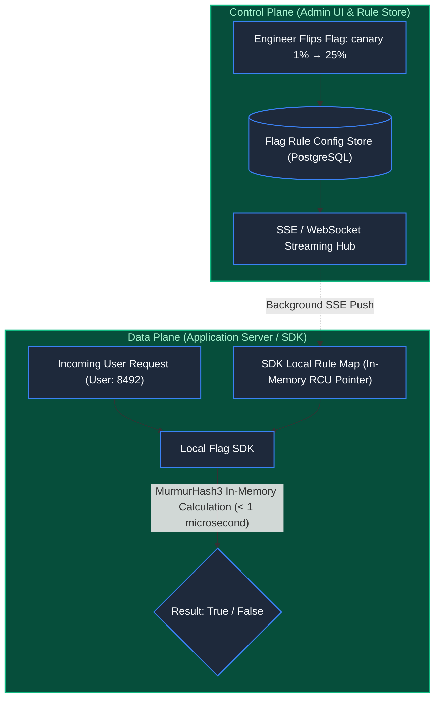
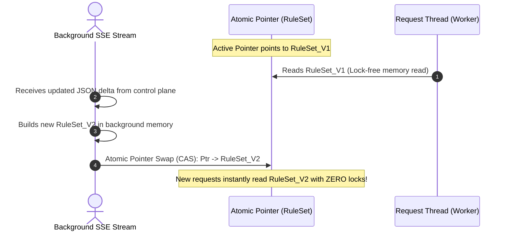
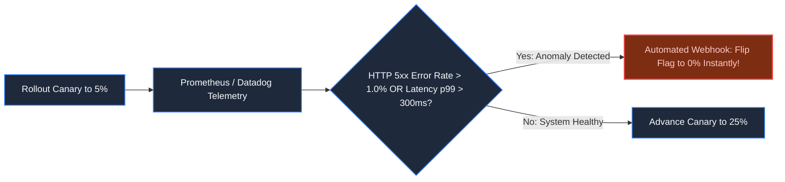

# Chapter 33: Standalone System: Dynamic Feature Flags & Rollout Engine

> *"Decouple deployment from release. Code deployment is a technical operation managed by engineering; feature release is a business decision executed at runtime with a single flag evaluation."*

---

## 1. The Disaster: The Synchronous Flag Service Outage

An e-commerce platform built an internal "Centralized Feature Flag Service" to control dark launches and A/B tests.

The architecture was simple: every microservice made an HTTP REST call to `http://flag-service/api/v1/eval?flag=new_checkout&user=123`.

On Black Friday at 12:00 PM:
- **Traffic Doubled**: The Flag Service faced 450,000 requests/second.
- **Connection Exhaustion**: Flag Service latency climbed from $2\text{ms}$ to $450\text{ms}$.
- **Cascading Failure**: All backend microservices exhausted their outbound HTTP connection pools waiting for flag evaluations. The entire platform collapsed—not because the checkout code failed, but because the *flag checking mechanism* dragged the system into a deadlock.



---

## 2. Invariant #1: Zero-Network In-Memory Evaluation

Never make a network call to evaluate a feature flag on the request critical path.

A production-grade feature flag engine operates on **Server-Sent Events (SSE) / WebSocket Rule Push** coupled with **In-Memory Hash Evaluation**:



---

## 3. Mathematical Mechanics: Consistent Canary Hashing

To roll out a feature to $P\%$ of users (e.g., $10\%$), the evaluation must be:
1. **Deterministic**: User #8492 must consistently see the new feature across all visits and servers.
2. **Uniformly Distributed**: The hashing algorithm must distribute user IDs evenly across the $[0, 99]$ range without clustering.
3. **Independent Across Flags**: A user in the $10\%$ cohort for Feature A should not automatically be in the $10\%$ cohort for Feature B.

The standard industry implementation utilizes **MurmurHash3**:

$$\text{bucket} = \text{MurmurHash3}(\text{flag\_key} + \text{":"} + \text{user\_id}) \pmod{100}$$

```
If bucket < RolloutPercentage:
    Return TRUE (Enable Feature)
Else:
    Return FALSE (Default Behavior)
```

Because evaluation requires only string concatenation and CPU bit-shifts, the decision executes in **$< 400\text{ nanoseconds}$** with zero network I/O.

---

## 4. Atomic Pointer Swapping: Read-Copy-Update (RCU)

When an engineer modifies flag rules in the control plane, the application must update its in-memory rules without blocking reader threads:



---

## 5. Automated Telemetry Kill-Switches

Modern rollouts do not wait for human intervention. The flag engine connects directly to real-time observability streams:



---

## 6. Architect-Level Trade-Offs

| Decision | Synchronous Remote Flag Service | Client-Side In-Memory SDK Evaluation |
|---|---|---|
| **Evaluation Latency** | High ($5\text{ms} - 50\text{ms}$) | Nanoseconds ($< 1\mu\text{s}$) |
| **Availability Risk** | Critical: Flag service outage crashes application fleet. | Zero: Fleet continues running on cached rules if control plane fails. |
| **Targeting Complexity** | Server has access to complete relational DB records. | Complex attributes must be passed into SDK context by caller. |
| **Rule Update Propagation** | Immediate on next HTTP request. | Sub-second via Server-Sent Events (SSE). |

---

## 7. Mental-Model Summary

```
Feature flags belong in memory, not over HTTP.
Push rules via streaming connections; evaluate flags via deterministic MurmurHash3.
Decouple deployment risk from business release,
and guard every progressive rollout with automated metric kill-switches.
```

---

## 8. The Next Battlefield

*We have completed Part 5: Trust, Isolation & Compliance.*

*We now enter the most unforgiving domain in software engineering: **Part 6 — High Velocity & Extreme Constraints**.*

*At 09:30:00.000 AM, the opening bell rings on Wall Street.*

*A sudden surge in market volatility floods a financial exchange with 2,000,000 quote updates per second.*

*In this domain, standard software conventions become lethal liabilities: Garbage collection pauses freeze threads for 15 milliseconds, causing an algorithmic market maker to misquote prices and lose $4,000,000 in seconds.*

*How do you build financial order books and matching engines that process millions of limit orders in sub-microsecond time using lock-free ring buffers, zero-allocation memory pools, and kernel-bypass networking?*

👉 **Next: [Chapter 34 — The Physics of Microseconds: Trading & Matching Engines](/book/part-06-extreme-constraints/chapter-34-trading-matching-engines.md)**
