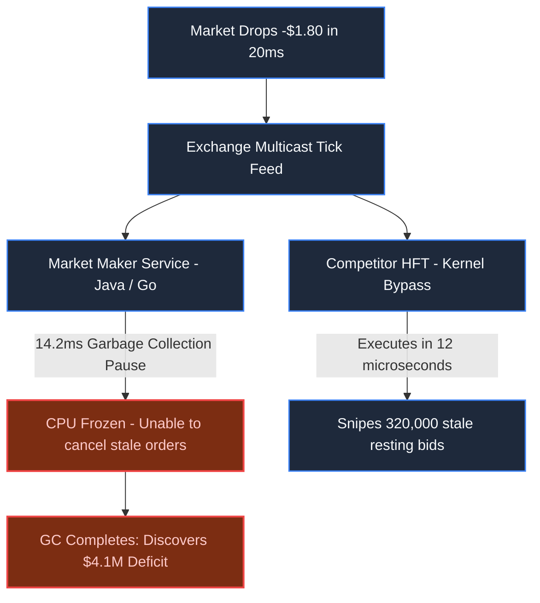
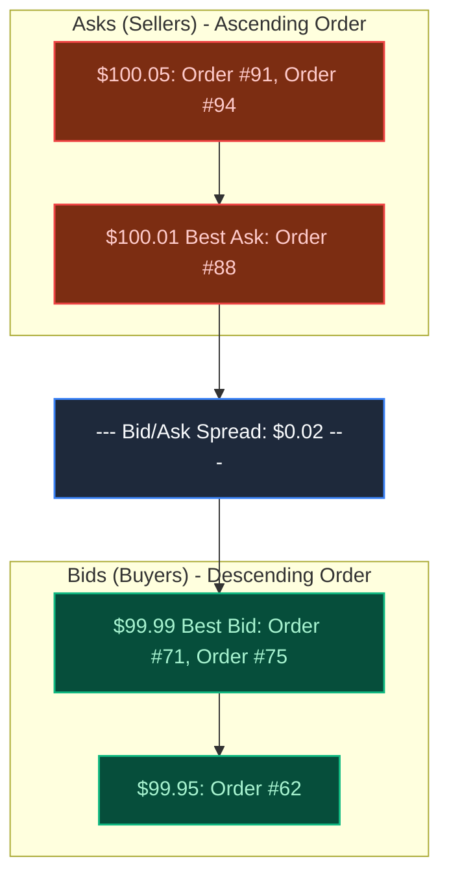
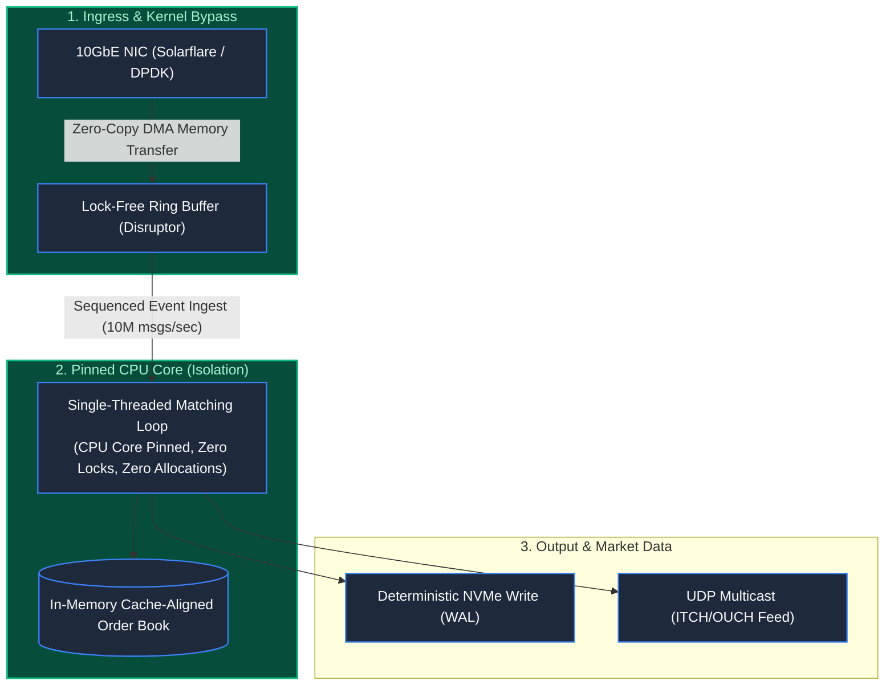

# Chapter 34: The Physics of Microseconds: Trading & Matching Engines

> *"In financial markets, speed is not a performance metric; it is the currency of survival. If your system pauses for 10 milliseconds to collect garbage, the market will liquidate your firm before your CPU executes the next instruction."*

---

## 1. The Mystery: The $4,000,000 Garbage Collection Pause

At 09:30:02 AM, the opening bell triggered extreme volatility in semiconductor equities.

A proprietary trading firm was running an algorithmic market-making service written in a modern garbage-collected language. The service continuously quoted buy (bid) and sell (ask) prices to capture the spread.

Suddenly, the NASDAQ price dropped by $1.80 in 20 milliseconds:
- **The Stoppage**: The trading engine triggered a "Stop-The-World" minor garbage collection pause lasting **14.2 milliseconds** to reclaim millions of short-lived JSON quote objects.
- **The Sniping**: While the firm's CPU was frozen, competing High-Frequency Trading (HFT) firms received the price drop via UDP multicast.
- **The Slaughter**: Because the firm was frozen, it could not cancel its stale resting bids. HFT algorithms aggressively filled 320,000 stale buy orders at the old high price.
- When the GC pause cleared, the firm held an unhedged long position in a crashing asset, incurring a catastrophic **$4,120,000 loss in 14 milliseconds**.



---

## 2. In-Memory Order Book Data Structures: Price-Time Priority

A matching engine matches orders according to **Price-Time Priority (FIFO)**: best price executes first; ties are broken by order arrival timestamp.



To execute an order in $< 500\text{ nanoseconds}$, the data structure must provide:
1. **$O(1)$ Best Bid / Best Ask Retrieval**: Pointers to the head of the bid/ask structures.
2. **$O(1)$ Insertion & Cancellation**: Doubly-linked lists for individual orders at each price tick, indexed by a dense hash map or flat price array.
3. **$O(\log P)$ New Price Insertion**: A contiguous B-Tree or Radix Tree of populated price levels.

---

## 3. Production Architecture: The Single-Threaded Ring

Multi-threaded locking (mutexes) causes CPU core context switches, cache line invalidations, and kernel transitions ($1,500\text{ns}$ penalty).

Ultra-low-latency matching engines eliminate locks entirely via the **Single-Threaded Disruptor Pattern**:



### The Architectural Invariants:
1. **Kernel Bypass (Solarflare Onload / DPDK)**: Packets bypass the Linux kernel TCP/IP stack via Direct Memory Access (DMA) straight into user-space memory, eliminating OS interrupts.
2. **Zero Dynamic Allocation**: All order objects, price levels, and ring buffers are **pre-allocated at startup**. The engine allocates zero bytes of memory during market hours, completely eliminating GC pauses.
3. **Cache Line Alignment (64-byte padding)**: Variables modified by different threads are padded with empty bytes to ensure they never share the same CPU L1/L2 cache line (**False Sharing Mitigation**).
4. **Single-Threaded Determinism**: A single pinned CPU core matches all orders sequentially. Without lock contention, modern CPUs process **over 5,000,000 matches per second** on a single thread.

---

## 4. Architect-Level Trade-Offs

| Decision | Multi-Threaded Locking Engine | Single-Threaded Disruptor Core | FPGA Hardware Matching |
|---|---|---|---|
| **Latency (p99)** | $50\mu\text{s} - 2\text{ms}$ (unpredictable due to mutexes) | $800\text{ns} - 2\mu\text{s}$ (deterministic) | $150\text{ns} - 350\text{ns}$ (hardware gates) |
| **Throughput** | High aggregate across symbols | Extreme on single symbol ($5\text{M}+/\text{sec}$) | Wire-speed |
| **Development Cost** | Standard software engineering | Advanced systems programming (C/C++/Rust) | Immense (Verilog/VHDL, custom ASIC) |
| **Audit & Replay** | Complex race condition debugging | Perfectly deterministic replay from tick log | Hard to inspect internal pipeline registers |

---

## 5. Mental-Model Summary

```
Microsecond systems respect hardware physics:
Locks are an admission of architectural failure; use single-threaded sequenced ring buffers.
Allocations during runtime are bugs; pre-allocate all memory pools at startup.
Bypass the OS kernel, pad memory against false sharing,
and let a single CPU core match trades at the speed of the L1 cache.
```

---

## 6. The Next Battlefield

*In high-frequency trading, systems operate in sub-microsecond colocation cages with unlimited power and pristine fiber connections.*

*Now invert every single environmental condition: **IoT & Connected Edge Devices**.*

*Instead of liquid-cooled Intel Xeon CPUs, you have an 8-bit microcontroller powered by a solar battery in the middle of the Sahara Desert.*

*Instead of 10-gigabit fiber, you have a noisy 2G cellular link that drops for three weeks at a time.*

*When 50,000 remote oil pipeline sensors disconnect for a month and suddenly reconnect simultaneously, how do you prevent an out-of-order data deluge from annihilating your cloud ingest clusters?*

👉 **Next: [Chapter 35 — The Disconnected Sensor: IoT & Connected Devices](/book/part-06-extreme-constraints/chapter-35-iot-edge-constrained-devices.md)**
