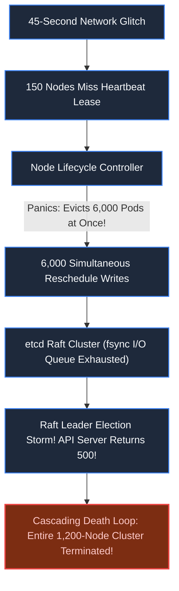
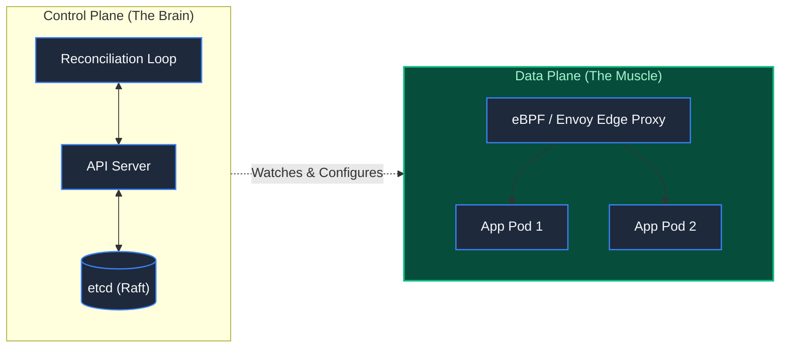

# Chapter 37: The Control Plane That Never Sleeps: Cloud Platforms

> *"Never let the control plane's panic become the data plane's death sentence. If your orchestrator crashes, running customer traffic must continue flowing without missing a single byte."*

---

## 1. The Mystery: The Cascading Cluster Suicide

A major cloud provider managed a Kubernetes cluster of 1,200 worker nodes running 40,000 production microservice containers.

At 14:15 on a Thursday, a top-of-rack network switch suffered intermittent packet drops for 45 seconds:
- **Missed Heartbeats**: 150 worker nodes temporarily missed their 10-second `NodeStatus` heartbeat updates to the central API server.
- **The Panicked Controller**: The Node LifeCycle Controller assumed all 150 nodes were dead and immediately evicted 6,000 pods, scheduling them onto the remaining nodes.
- **The Raft Collapse**: 6,000 simultaneous pod reschedule mutations flooded `etcd` (the Raft consensus store). Disk `fsync` queues backed up, causing `etcd` leader heartbeats to fail.
- **The Death Spiral**: The API server began returning HTTP 500 to health checks. The orchestrator concluded *all 1,200 nodes had died simultaneously*, issuing automated commands to terminate the entire cluster.



---

## 2. Invariant #1: Control Plane vs Data Plane Decoupling

The cardinal rule of infrastructure design is absolute separation between **The Brain (Control Plane)** and **The Muscle (Data Plane)**:



Even if the Control Plane (`API Server`, `etcd`, `Scheduler`) burns to the ground, **existing running containers and network routing rules in the Data Plane must continue serving customer traffic indefinitely**.

---

## 3. Production Architecture: Declarative State Reconciliation

Modern platforms do not execute imperative commands (`start_pod()`, `kill_pod()`). They operate on **Declarative Level-Triggered Reconciliation Loops**:

```mermaid
flowchart TD
    User["DevOps / GitOps CD"] -->|Applies Manifest: Replicas=3| API["API Server"]
    API --> etcd[("etcd (Desired State: 3)")]
    
    subgraph Loop ["The Operator Reconciliation Loop"]
        Informer["SharedInformer (Delta FIFO Queue)"] --> Reconcile{"Compare:\nDesired State vs Actual State"}
        
        Reconcile -->|Desired == Actual (3 == 3)| Idle["No Operation (Sleep)"]
        Reconcile -->|Desired > Actual (3 > 2)| ScaleUp["Call Cloud Provider: Provision 1 Pod"]
        Reconcile -->|Desired < Actual (3 < 4)| ScaleDown["Graceful Eviction: Terminate 1 Pod"]
    end

    etcd -.-> Informer
    ActualEnv["Worker Nodes (Kubelet / Pods)"] -.->|Actual State: 2| Informer

    classDef default fill:#1e293b,stroke:#3b82f6,stroke-width:1.5px,color:#f8fafc;
    classDef highlight fill:#064e3b,stroke:#10b981,stroke-width:2px,color:#a7f3d0;
    class Loop highlight;
```

### The Architectural Invariants:
1. **Level-Triggered over Edge-Triggered**: Edge-triggered systems react to events (`OnPodDied`). If an event packet drops, the system desynchronizes forever. Level-triggered systems evaluate the *current state of the world* on every cycle, self-healing regardless of missed notifications.
2. **Rate-Limiting Eviction Circuit Breakers**: The controller enforces safety ceilings. It is forbidden from evicting more than $5\%$ of nodes per minute. When mass failures occur, the controller freezes automated destruction and sounds alarms for human operators.
3. **Optimistic Concurrency Control via Resource Versions**: Every mutation in `etcd` requires a `resourceVersion`. If two controllers update the same pod concurrently, the second write is rejected with an HTTP 409 conflict, eliminating race conditions without distributed locks.

---

## 4. Architect-Level Trade-Offs

| Decision | Imperative Scripting (Ansible/SSH) | Declarative Reconciliation (Kubernetes Operator) |
|---|---|---|
| **Drift Management** | Poor: Configuration drift accumulates silently over time. | Autonomous: Automatically converges reality back to desired specification. |
| **Recovery from Loss** | High risk: Unclear how to resume interrupted deployment. | Deterministic: Reads state from disk and resumes reconciliation loop. |
| **Failure Blast Radius** | Isolated to target server. | Systemic: A bug in the controller loop can destroy the entire fleet. |
| **Storage Bottleneck** | Centralized relational DB query storms. | Requires ultra-fast NVMe disks for Raft consensus log `fsync`. |

---

## 5. Mental-Model Summary

```
In cloud platforms, state is never static; entropy is constant.
Never manage infrastructure through imperative scripts;
declare desired state and reconcile continuously via level-triggered loops.
Isolate control plane failures from data plane forwarding,
and gate all automated self-healing with strict velocity circuit breakers.
```

---

## 6. The Next Battlefield

*Our cloud platform reliably manages thousands of nodes and applications.*

*Now look at the flood of telemetry, financial events, and IoT signals produced by these applications: **Millions of events pouring in every second**.*

*Business executives and automated risk systems cannot wait 3 hours for batch ETL jobs to run.*

*When fraud occurs, when an algorithmic trading anomaly strikes, or when an e-commerce checkout fails, you have **under 500 milliseconds** to detect, correlate, and react.*

*How do you build a real-time stream analytics engine that ingests 500,000 events per second, computes tumbling and sliding time windows with millisecond accuracy, and provides instant OLAP queryability?*

👉 **Next: [Chapter 38 — Standalone System: Real-Time Stream Analytics Engine](file:///Users/lspl487/Desktop/software-book/book/part-06-extreme-constraints/chapter-38-system-realtime-stream-analytics.md)**
