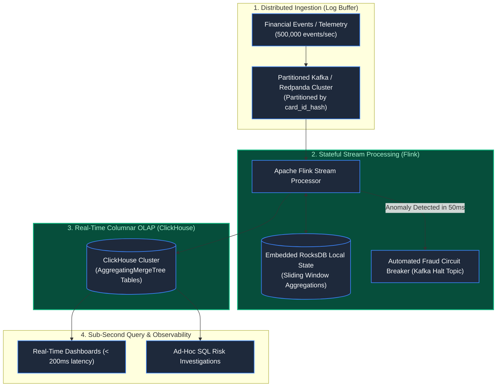

# Chapter 38: Standalone System: Real-Time Stream Analytics Engine

> *"Batch processing tells you what happened yesterday; stream processing tells you what is happening right now; real-time OLAP allows you to stop the disaster before it drains your business."*

---

## 1. The Disaster: The Three-Hour Blindspot

A global digital payment platform processed 12,000 transactions per second. Its fraud detection and business intelligence relied on standard corporate architecture: an hourly batch ETL pipeline extracting PostgreSQL replicas into a Snowflake data warehouse.

At 11:15 AM on a Saturday, a criminal syndicate launched a coordinated credential-stuffing attack across 45,000 compromised debit card numbers:
- **The Micro-Charge Pattern**: Each transaction was structured for small amounts ($4.50 to $9.90) to avoid legacy per-transaction single-rule fraud limits.
- **The Blindspot**: The analytics dashboard reported zero anomalies because the ETL cron job was scheduled to run at 14:00.
- **The Loss**: For nearly three hours, the platform was completely blind. By the time the batch tables refreshed at 14:18, **$6,800,000 had been drained into offshore cryptocurrency exchanges**.

```mermaid
flowchart TD
    Attack["Fraud Syndicate Injects 45,000 Micro-Transactions"] --> Ingress["Payment Gateway"]
    Ingress --> DB[("PostgreSQL Transaction DB")]
    
    DB -->|Hourly Batch ETL Cron (Scheduled for 14:00)| ETL["Batch Airflow / Data Warehouse"]
    
    ETL -->|3-Hour Processing Delay!| Dash["BI Dashboard (Shows 'Normal' at 12:00)"]
    
    DB --> Loss["$6.8M Drained to Offshore Wallets Before ETL Finishes!"]

    classDef default fill:#1e293b,stroke:#3b82f6,stroke-width:1.5px,color:#f8fafc;
    classDef alert fill:#7c2d12,stroke:#ef4444,stroke-width:2px,color:#fecaca;
    class Loss,Dash alert;
```

---

## 2. Invariant #1: Event Time vs Processing Time & Watermarks

Never group streaming events by the clock time of the server that received them (**Processing Time**). Network lag and cellular disconnections mean events arrive out of order.

Stream engines group events by when the event actually occurred (**Event Time**) using **Watermarks**:

```
Watermark(t) = max(event_time_seen) - AllowedLateness
```

A watermark of `12:00:00` with an allowed lateness of 10 seconds guarantees that the engine will wait until it sees an event from `12:00:10` before finalizing the 12:00:00 window calculations.

---

## 3. System Blueprint: The End-to-End Real-Time Pipeline



---

## 4. Windowing Primitives & Columnar Physics

### A. Windowing Types in Stateful Streams:
1. **Tumbling Windows**: Fixed, non-overlapping intervals (e.g., total spend in exact 5-minute blocks: `[12:00-12:05]`, `[12:05-12:10]`).
2. **Sliding / Hopping Windows**: Overlapping intervals (e.g., count transactions in the *last 10 minutes, updated every 10 seconds*). Crucial for velocity fraud detection.
3. **Session Windows**: Dynamically bounded by periods of user inactivity (e.g., active user checkout session ending after 15 minutes of silence).

```mermaid
gantt
    title Stream Windowing Comparison
    dateFormat X
    axisFormat %s

    section Tumbling (5s)
    Window 1 [0s-5s]   :a1, 0, 5
    Window 2 [5s-10s]  :a2, 5, 10
    Window 3 [10s-15s] :a3, 10, 15

    section Sliding (10s slide 5s)
    Window A [0s-10s]  :b1, 0, 10
    Window B [5s-15s]  :b2, 5, 15

    section Session (Gap 3s)
    User 1 Active [0s-7s] :c1, 0, 7
    User 2 Active [11s-16s] :c2, 11, 16
```



### B. Why Columnar Storage (ClickHouse) Destroys Row-Oriented DBs:
Row-oriented databases (PostgreSQL/MySQL) read all 40 columns off disk to compute an aggregation. 
- **Columnar Engines** read *only* the `amount` and `timestamp` columns off disk into CPU SIMD registers, scanning **50,000,000 rows per second per CPU core** with zero pre-computed indexes.

---

## 5. Architect-Level Trade-Offs

| Decision | Hourly Batch ETL (Snowflake / BigQuery) | Streaming + Columnar OLAP (Flink + ClickHouse) |
|---|---|---|
| **Data Freshness** | 1 to 3 hours | Sub-second ($< 500\text{ms}$) |
| **Operational Complexity** | Low (simple SQL scripts scheduled by orchestrator) | High (managing Kafka partitions, state backends, checkpoints) |
| **Compute Cost** | High periodic spikes during heavy batch queries | Predictable, continuous, flat-line resource consumption |
| **Real-Time Automated Action** | Impossible | Native: Streams trigger webhooks and circuit breakers in flight |

---

## 6. Mental-Model Summary

```
Data does not enter the world in batches; life is an infinite stream of events.
Do not force continuous streams into batch databases only to struggle reading them back.
Ingest continuously via partitioned logs, calculate sliding window velocity in stream memory,
and persist to columnar stores for instant analytical clarity.
```

---

## 7. The Final Threshold

*We have completed Part 6: High Velocity & Extreme Constraints.*

*Across 38 chapters, we have dismantled every layer of the modern computing stack: from physical electron propagation in cables, to browser rendering lifecycles, distributed locks, database B-trees, video streaming chunks, zero-trust cryptographic tokens, matching engines in microseconds, and real-time event analytics.*

*Now comes the ultimate transition: **From Senior Engineer to Principal Software Architect**.*

*You will no longer be judged on whether you can write an algorithm. You will be judged on whether you can make **existential architectural decisions under profound uncertainty, defend them before executive boards, and synthesize conflicting domain trade-offs into unified planetary platforms**.*

*Welcome to the final summit: **Part 7 — The Master Architect: Trade-Offs, Chaos & The Grand Capstone Blueprint**.*

👉 **Next: [Chapter 39 — The Architecture Decision Matrix: Trade-Offs Under Pressure](file:///Users/lspl487/Desktop/software-book/book/part-07-synthesis-architecture/chapter-39-architecture-decision-matrix.md)**
