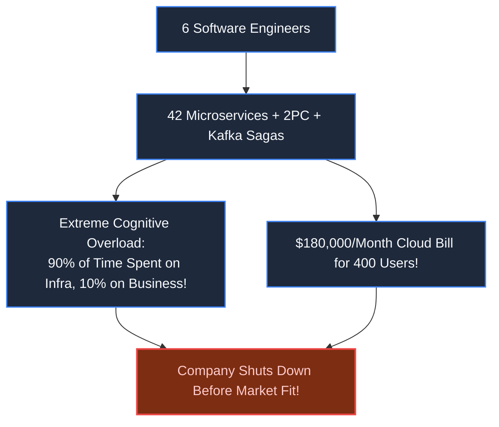
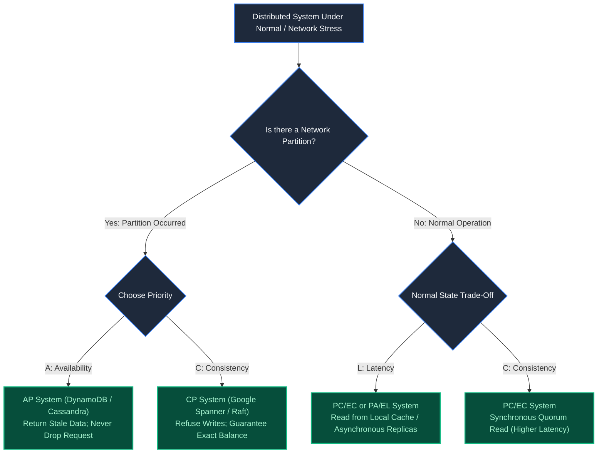
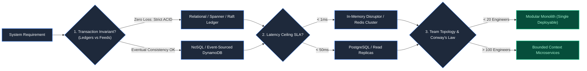

# Chapter 39: The Architecture Decision Matrix: Trade-Offs Under Pressure

> *"There are no solutions in software architecture; there are only trade-offs. An engineer who claims their design has no downsides simply has not yet discovered how it will fail."*

---

## 1. The Mystery: The $10M Resume-Driven Architecture

A fintech startup secured $12,000,000 in seed capital to build an invoice financing app for small businesses.

The newly hired Chief Architect, eager to implement cutting-edge patterns, mandated:
- **42 Microservices** in Rust, Go, and TypeScript.
- **Distributed Sagas & Two-Phase Commit (2PC)** across three cloud regions.
- **Service Mesh (Istio)** with custom mTLS sidecars.
- **Event-Driven CQRS** with Kafka for every internal domain event.

The team consisted of **six software engineers**.

Within 14 months:
- A simple user profile update required coordinating 5 pull requests across 4 repositories.
- Debugging a failed invoice required 12 engineers tracing asynchronous Kafka dead letters.
- Cloud infrastructure bills reached **$180,000/month** while serving only **400 active users**.
- Runway ran out. The company shuttered without shipping its second release.



---

## 2. Theoretical Foundations: Beyond Simplistic CAP

Every junior engineer knows **CAP** (Consistency, Availability, Partition Tolerance). A Principal Architect understands that networks *always* partition, meaning **"CA" does not exist in distributed computing**.

The true law of modern systems is the **PACELC Theorem**:

$$\text{If } \mathbf{Partition} \to \text{Choose } (\mathbf{Availability} \lor \mathbf{Consistency}) \quad \mathbf{Else} \to \text{Choose } (\mathbf{Latency} \lor \mathbf{Consistency})$$



---

## 3. The Principal Architect Decision Matrix

When choosing technology, apply the **Four Invariant Filters**:



### The Architectural Selection Heuristics:
1. **Conway's Law Alignment**: System architecture mirrors organizational communication structures. If 4 engineers try to maintain 30 microservices, communication overhead exceeds CPU overhead.
2. **The Innovation Token Budget**: A startup or new project has **three innovation tokens**. Spend them only on core business differentiators (e.g., proprietary matching algorithm or AI model). Use boring, mature technology (PostgreSQL, Linux, Redis) for everything else.
3. **Architecture Decision Records (ADRs)**: Every non-trivial decision must be committed to git as an immutable ADR containing: *Context, Options Considered, Decision, and Explicit Consequences (Downsides)*.

---

## 4. Architect-Level Trade-Offs

| Architecture Archetype | Cognitive Load | Failure Blast Radius | Evolutionary Flexibility |
|---|---|---|---|
| **Modular Monolith** | Minimal: Single repo, simple transactional refactoring | High: Memory leak or bug affects entire binary | High in early stages; degrades if boundaries erode |
| **Microservices Mesh** | Extreme: Distributed tracing, schema drift, network splits | Isolated: Broken service degrades only its bounded domain | High for large independent organizations |
| **Event-Driven CQRS** | High: Asynchronous eventual consistency & event versioning | Low: Decoupled producers and consumers | Ideal for high-scale asynchronous workflows |
| **Serverless Functions** | Low operational maintenance; high vendor lock-in | Minimal per execution | Constrained by cold starts and execution timeouts |

---

## 5. Mental-Model Summary

```
Architecture is the art of choosing which problems you want to suffer from.
Match system complexity to team capacity, not your personal ambitions.
Under partitions, choose between stale reads or rejected writes (PACELC).
Start with a well-factored modular monolith,
and only decompose into microservices when organizational scale demands it.
```

---

## 6. The Next Battlefield

*You have chosen your architecture with intellectual honesty and rigorous trade-off matrices.*

*On paper, your system is mathematically sound, elegant, and perfectly budgeted.*

*Then reality strikes: A power surge resets a switch; an S3 bucket permissions error trips a background worker; a third-party SMS vendor starts returning HTTP 500.*

*In production, things do not fail neatly. They fail violently, unpredictably, and in cascading waves.*

*If you do not proactively destroy your own systems in staging and production, the universe will do it for you at 03:00 AM on Christmas morning.*

*How do you build self-stabilizing systems using Chaos Engineering, bulkhead isolation, and automated blast-radius containment?*

👉 **Next: [Chapter 40 — Chaos Engineering & The Failure Taxonomy](file:///Users/lspl487/Desktop/software-book/book/part-07-synthesis-architecture/chapter-40-chaos-engineering-failure-taxonomy.md)**
