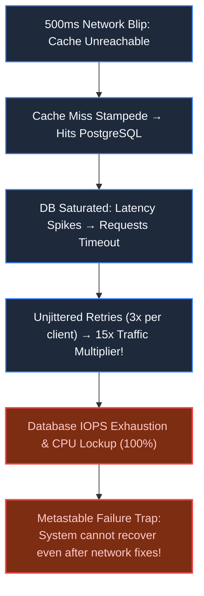
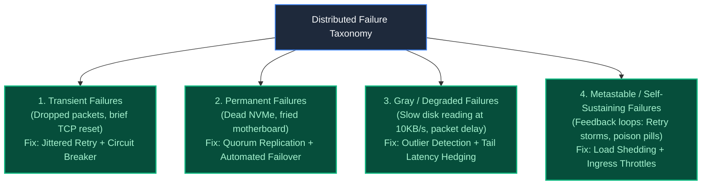
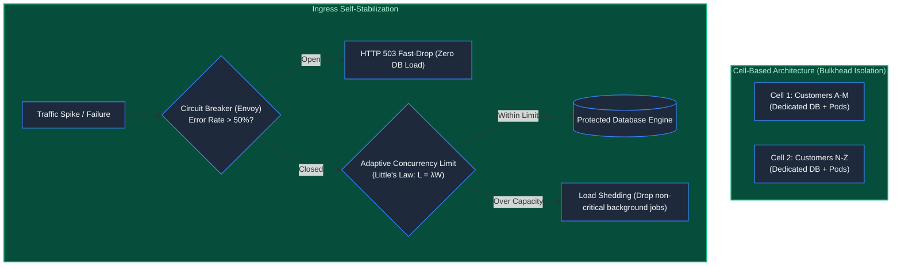

# Chapter 40: Chaos Engineering & The Failure Taxonomy

> *"Complex systems are intrinsically hazardous. You cannot prevent failures from happening in distributed architectures; you can only build systems that gracefully absorb blast damage without collapsing into a burning heap."*

---

## 1. The Mystery: The Single Cache Miss That Melted a Cloud Region

At 10:14 AM on Cyber Monday, a 500-millisecond network switch blip dropped connectivity between a cluster of API web servers and their Redis caching tier.

What followed was a textbook **Metastable Failure Cascade**:
- **The Stampede**: With the cache temporarily unreachable, 10,000 application threads simultaneously bypassed the cache and hit the primary PostgreSQL cluster with unindexed queries.
- **The Retry Storm**: Database connection pools saturated within 4 seconds. Application requests began timing out. The client SDKs, programmed with a naive `retry_attempts = 3` loop, immediately resubmitted every failed query.
- **The Traffic Multiplier**: The retry storm amplified database traffic by **1500%**. CPU utilization locked at 100%. Disk I/O queues exceeded 10,000 requests.
- **The Metastable State**: Even after the network switch recovered, the database could not restart. Every time it booted, the waiting backlog of 400,000 retrying clients instantly crushed it back into an unresponsive coma.

The region remained dark for **9 hours**.



---

## 2. The Taxonomy of Distributed Failures

To engineer resilience, an architect must categorize failures by their behavioral mechanics:



---

## 3. Production Architecture: Bulkheads & Self-Stabilization

Resilient architectures employ **Cell-Based Bulkheads** and **Adaptive Load Shedding** to prevent local failures from propagating globally:



### The Architectural Invariants:
1. **The Bulkhead Pattern**: Borrowed from naval architecture, ships have watertight compartments so a puncture in one bulkhead does not sink the vessel. Partition your user base into independent, self-contained **Cells** (e.g., 20 independent mini-clusters); a catastrophic failure in Cell 1 leaves the other 19 running untouched.
2. **Exponential Backoff with Full Jitter**:
   $$\text{Sleep} = \text{random}(0, \min(\text{Cap}, \text{Base} \times 2^{\text{attempt}}))$$
   Randomizing the retry interval disperses thundering herds evenly across the timeline instead of pulsing the database in destructive synchronized waves.
3. **Adaptive Load Shedding (Little's Law)**: When downstream latency increases, total concurrent requests in-flight explode ($L = \lambda W$). Systems must shed lower-priority traffic (e.g., recommendation algorithms, notifications) to prioritize core transactional revenue flows (e.g., checkout commitments).

---

## 4. Architect-Level Trade-Offs

| Resilience Strategy | Implementation Complexity | Protection Scope | Downside |
|---|---|---|---|
| **Immediate Retries** | Zero | Handles micro-second glitches | Destroys downstream systems via retry storms. |
| **Circuit Breakers** | Low | Stops cascading dependency failures | Requires fallback paths and alert monitoring. |
| **Full-Jitter Backoff** | Minimal (client SDK change) | Completely diffuses thundering herds | Slightly increases mean completion time for retried calls. |
| **Cell-Based Bulkheading**| High (routing & data sharding) | Confines failure blast radius to single cell | Increases infrastructure management overhead. |

---

## 5. Mental-Model Summary

```
Hope is not an architectural strategy; chaos is inevitable.
Never execute unjittered retries; randomize backoff to dismantle thundering herds.
Wrap every network boundary in circuit breakers,
segment your infrastructure into watertight bulkheads,
and proactively inject failure in production before reality tests you in the dark.
```

---

## 6. The Next Battlefield

*Our architecture is engineered with circuit breakers, bulkheads, and chaos-tested resilience.*

*Now imagine you are on call at 02:40 AM.*

*Your pager shrieks: `P0: Global Checkout Conversion Dropped 40%`.*

*You open your logging dashboard: 1,400,000 lines of unformatted text per second. You open your metrics dashboard: 40 graphs showing red spikes with zero explanation of root cause.*

*A system you cannot observe is a system you cannot operate.*

*How do you construct **Full-Spectrum Observability** using OpenTelemetry, distributed W3C trace propagation, high-cardinality metrics, and tail-based sampling to isolate root causes in seconds?*

👉 **Next: [Chapter 41 — Full-Spectrum Observability & Production Readiness](/book/part-07-synthesis-architecture/chapter-41-observability-production-readiness.md)**
