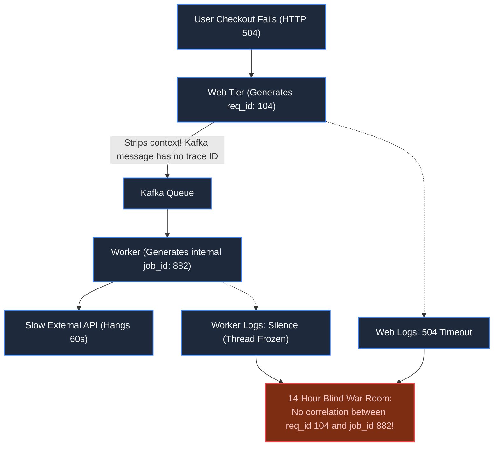

# Chapter 41: Full-Spectrum Observability & Production Readiness

> *"Monitoring tells you when a system is broken; observability allows you to understand why a system you have never seen before is behaving in a way you never anticipated. If you cannot trace a single transaction across 50 microservices in 5 seconds, you are operating in the dark."*

---

## 1. The Mystery: The 14-Hour War Room

At 02:15 AM on a Sunday, an enterprise SaaS platform suffered a degradation: 12% of checkout transactions were hanging indefinitely and timing out.

The Incident Command war room convened with 24 engineers:
- **Logging Deluge**: ElasticSearch ingested 400,000 log lines per second. Searching for `"error"` returned 85,000 hits across 40 different microservices, mostly noise.
- **Finger-Pointing**: The Database team insisted their CPU was fine (30%). The Network team swore latency was normal. The Payment team claimed their third-party gateway had no downtime.
- **The Missing Link**: Each service generated its own internal request ID, stripping headers on asynchronous Kafka hops. There was no way to correlate a failed frontend checkout with an upstream backend transaction.

It took **14 hours and 40 minutes** of manual code inspection to discover that an asynchronous fraud evaluation worker had exhausted its thread pool due to a missing HTTP timeout on a geolocation lookup.



---

## 2. Invariant #1: W3C Distributed Context Propagation

In microservices, every request must carry an immutable **Distributed Trace Context** injected across every network hop, HTTP call, gRPC stream, and Kafka header.

The industry standard is the **W3C `traceparent` header**:

$$\texttt{traceparent: 00-4bf92f3577b34da6a3ce929d0e0e4736-00f067aa0ba902b7-01}$$

- `00`: Protocol version.
- `4bf92f3577b34da6a3ce929d0e0e4736`: **Global Trace ID** (shared across the entire end-to-end user transaction).
- `00f067aa0ba902b7`: **Parent Span ID** (identifies the specific caller service).
- `01`: Trace Flags (`01` indicates sampled for persistence).

---

## 3. Production Architecture: OpenTelemetry & Tail-Based Sampling

Recording 100% of traces at 200,000 requests/second will bankrupt an organization on storage costs. Naively dropping 99% of requests at ingress (**Head-Based Sampling**) drops the rare 500 errors you desperately need to debug.

The solution is **Tail-Based Sampling**:

```mermaid
flowchart TD
    subgraph Services ["Application Fleet (OpenTelemetry SDKs)"]
        Edge["Edge API Gateway"] -->|Injects W3C TraceContext| SvcA["Order Service"]
        SvcA -->|Propagates TraceContext| Kafka["Kafka Bus"]
        Kafka -->|Extracts TraceContext| SvcB["Payment Service"]
    end

    subgraph OTelCollectorCluster ["OpenTelemetry Collector Pool (In-Memory Ring Buffers)"]
        Edge & SvcA & SvcB -.->|Streams Spans via gRPC| RingBuffer["In-Memory Span Buffer\n(Holds all spans for 30 seconds)"]
        
        RingBuffer --> Sampler{"Tail-Based Sampler Decision"}
        
        Sampler -->|Error Detected (HTTP 5xx) OR Latency p99 > 1s| Keep["Persist 100% of Failed Trace Spans!"]
        Sampler -->|Boring Fast 200 OK (< 50ms)| Drop["Retain only 0.1% baseline sample"]
    end

    Keep --> APM[("Trace & Metric Store (Tempo / Jaeger / ClickHouse)")]

    classDef default fill:#1e293b,stroke:#3b82f6,stroke-width:1.5px,color:#f8fafc;
    classDef highlight fill:#064e3b,stroke:#10b981,stroke-width:2px,color:#a7f3d0;
    class OTelCollectorCluster,Keep highlight;
```

---

## 4. Operational Invariants: The RED Method & Error Budgets

### A. The RED Method for Request Services:
Never write dashboard alerts on raw CPU or RAM utilization (a busy server is often just an efficient server). Monitor the **RED Metrics**:
1. **Rate**: Requests processed per second.
2. **Errors**: Number of failing requests per second.
3. **Duration**: Distribution of latency (focus on **p95, p99, and p99.9**, never averages).

### B. High-Cardinality Exemplars:
Modern telemetry pairs Prometheus metrics with **Exemplars**: clicking on a spike in your p99 latency chart immediately reveals the exact `trace_id` of the slowest request, connecting high-level metrics directly to deep call stacks.

### C. Alert on SLO Burn Rates, Not Noise:
Alert engineers only when customer-facing **Service Level Objectives (SLOs)** are depleting their monthly error budget at an unsustainable velocity (e.g., *14.4x burn rate: 2% of budget consumed in 1 hour*).

---

## 5. Architect-Level Trade-Offs

| Decision | Unstructured Text Logs (stdout) | OpenTelemetry Distributed Tracing + Tail Sampling |
|---|---|---|
| **Storage Cost** | Explodes linearly with log verbosity ($$$) | Controlled: Retains 100% of errors, discards routine noise |
| **Mean Time to Detect (MTTD)** | Hours: Grepping through disconnected text files | Minutes: Single visual trace graph reveals exact failing line |
| **Network Overhead** | Low (fire-and-forget syslog) | Minor ($< 1\%$ CPU/memory overhead for OTel agent) |
| **Standardization** | Proprietary logging formats across languages | Unified vendor-neutral W3C & OpenTelemetry semantic standards |

---

## 6. Mental-Model Summary

```
Logging without trace context is just expensive fiction.
Inject W3C traceparents at the edge and propagate them across every hop.
Discard routine successes at the collector tier; capture 100% of errors via tail sampling.
Alert on SLO burn rate, not server CPU,
and turn the 14-hour outage war room into a 30-second trace inspection.
```

---

## 7. The Final Summit

*Every fundamental has been mastered.*
*Every failure mode has been analyzed.*
*Every domain has been conquered.*

*Now, we assemble everything.*

*Not a toy demo. Not a fragmented microservice.*

*In our final chapter, you will step into the shoes of a **Chief Systems Architect** commissioned to engineer the ultimate planetary platform: an **Omnichannel Commerce & Financial Ecosystem**.*

*It unifies sub-millisecond trading order books, double-entry banking ledgers, ticket reservations, ride-hailing geospatial dispatch, streaming media, AI guardrails, and multi-region disaster recovery into a single, breathtaking architectural blueprint.*

👉 **Next: [Chapter 42 — Grand Capstone: The Complete Planetary System Architecture Blueprint](file:///Users/lspl487/Desktop/software-book/book/part-07-synthesis-architecture/chapter-42-grand-capstone-planetary-blueprint.md)**
