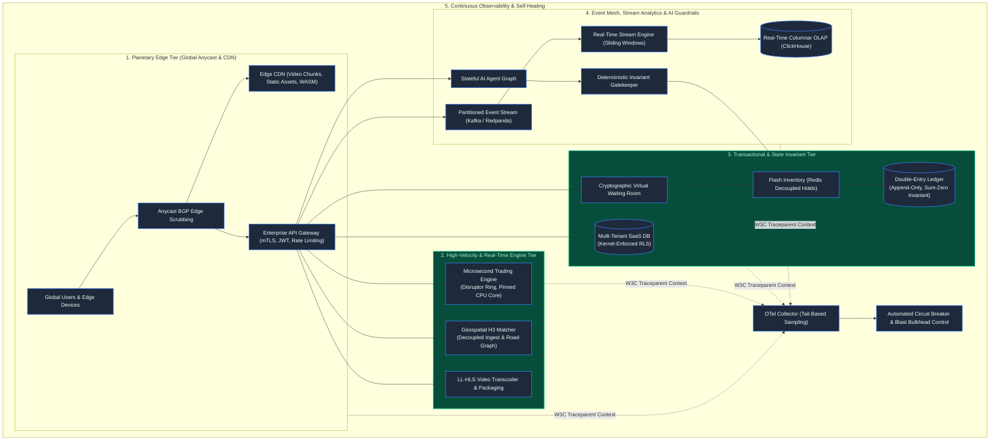
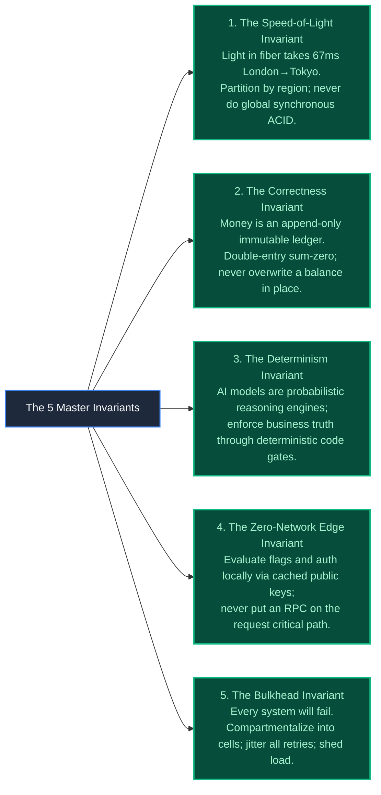

# Chapter 42: Grand Capstone: The Complete Planetary System Architecture Blueprint

> *"A software architect does not build monuments; they carve riverbeds. You cannot command the flow of millions of concurrent humans; you can only shape the terrain so that when the flood arrives, the water powers the mill rather than drowning the city."*

---

## 1. The Ultimate Test: The Black Friday World Cup Confluence

At 20:00:00 UTC on a Black Friday evening, the World Cup Final enters extra time:
- **120 Million Concurrent Viewers** stream low-latency 4K video (HLS/DASH) across global edge CDNs.
- **8 Million In-Play Bets/Sec** bombard single-threaded microsecond matching engines as a penalty is awarded.
- **Flash Sale Drops**: 500,000 limited-edition championship jerseys unlock, draining inventory in seconds.
- **Geospatial Swarm**: 400,000 ride-hailing drivers converge on the stadium, updating H3 hexagonal coordinates every 3 seconds.
- **Autonomous AI Agents**: 150,000 fans ask support agents for flight refunds and stadium rerouting.

A single uncontrolled cascading error in any domain will trigger global disaster.

---

## 2. The Master Planetary Architecture Blueprint

Below is the complete, synthesized architectural blueprint unifying all 42 chapters:



---

## 3. The Five Planetary Architectural Invariants

Across every domain in this book, five universal physical laws govern systems at scale:



---

## 4. The 18-Domain Master Convergence Matrix

| Domain | Primary Architectural Challenge | The Catastrophic Failure Mode | The Definite Production Invariant |
|---|---|---|---|
| **E-Commerce & Flash Sales** | Massive hot-row contention | Race conditions oversell stock ($< 0$) | Redis token bucket + CAS atomic holds |
| **Banking & Fintech** | Data corruption & rounding drift | Silent money creation or ledger imbalance | Immutable double-entry sum-zero ledger |
| **Ticketing & Reservations** | Temporary seat holding & expiration | Phantom bookings & deadlock lockups | Two-tier state machine + Redis TTL leases |
| **Chat & Collaboration** | Multi-device causal message ordering | Clock skew displays answers before questions | Monotonic sequence counters + Vector clocks |
| **Ride-Hailing & Logistics** | Dynamic driver-rider spatial matching | Earth curvature distortion & lock contention | Uber H3 hexagonal discrete spatial index |
| **Video Streaming** | Multi-gigabit video delivery at scale | Video player buffer stalls & churn | Immutable chunked HLS/DASH + CDN caching |
| **Multiplayer Gaming** | 60-tick physics synchronization | TCP head-of-line blocking stalls action | UDP packets + client prediction & lag rewind |
| **Zero-Trust Security** | Boundary perimeter breach | Stolen IP permits lateral lateral pivoting | SPIFFE/SPIRE mTLS + short-lived edge JWTs |
| **Healthcare & EHR** | Cross-patient record contamination | PII/PHI leak triggers criminal penalty | Field-level envelope encryption + FHIR graphs |
| **Multi-Tenant SaaS** | Noisy neighbor resource starvation | Single client query crashes all 4,000 tenants | PostgreSQL kernel-enforced Row-Level Security |
| **Government Identity** | 50M concurrent citizen logins | 1:N biometric search collapses CPU clusters | 1:1 PKI verifiable credentials + Virtual Waiting Room |
| **High-Stakes Exams** | Mid-exam student connection drops | Answers lost, student disqualified | Offline encrypted WAL + Cryptographic time leases |
| **Financial Trading** | Sub-microsecond price discovery | 15ms GC pause causes $4M arbitrage loss | Disruptor lock-free ring + kernel bypass (DPDK) |
| **IoT & Connected Devices** | Intermittent remote sensor outages | Reconnection storm crashes cloud brokers | Truncated full-jitter backoff + Device Shadows |
| **Autonomous AI Agents** | Non-deterministic hallucination | LLM executes illegal $1 flight checkout | Deterministic invariant guardrails + Schema gates |
| **Cloud Control Planes** | Cascading node reconciliation loops | API server loss triggers mass pod eviction | Decoupled Data Plane + level-triggered loops |
| **Stream Analytics** | Sub-second anomaly & fraud detection | 3-hour batch ETL delays fraud reaction | Event-time watermarks + ClickHouse columnar OLAP |
| **Global Edge Routing** | Uncoordinated microservice ingress | Exposed raw endpoint permits unauthorized exploit | Centralized API Gateway + JWKS edge verification |

---

## 5. The Principal Architect's Creed

You have arrived at the end of the manuscript.

You now possess the foundational blueprints, failure mechanics, and mathematical invariants that govern planet-scale computing.

When you walk into an architecture review or design a system that underpins a business, remember the golden rule:

```
Code does not fail because developers are incompetent.
Systems fail because architectures make impossible promises to physical hardware.
Respect the speed of light.
Isolate your blast radiuses.
Never trust synchronous networks.
And build systems worthy of the people whose lives depend on them.
```

---

*Congratulations. You are now ready to design the future.*
