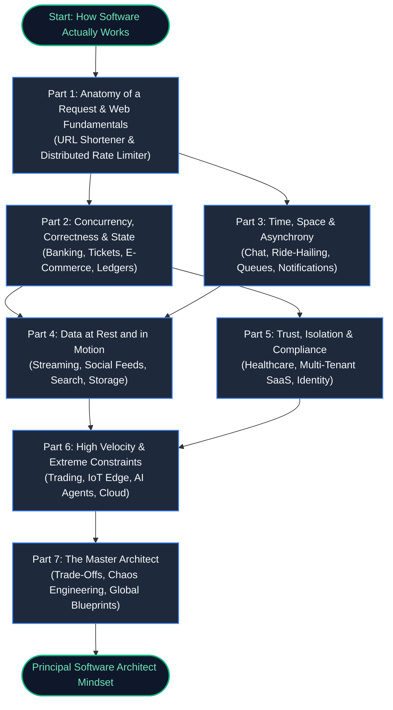

## Architectural Learning Journey

---

## The 7-Part Master Curriculum

### [Part 1: Anatomy of a Request & Web Fundamentals](/roadmap/01-part-1-request-anatomy)
Understand the physics of the wire, network round trips, and non-blocking ingress before code executes.
- **Ch 01**: [The Anatomy of a Single Keystroke](/book/part-01-request-anatomy/chapter-01-anatomy-of-a-keystroke)
- **Ch 02**: [Browser Lifecycle & Rendering Cost](/book/part-01-request-anatomy/chapter-02-browser-execution-cycle)
- **Ch 03**: [When Request Meets Backend](/book/part-01-request-anatomy/chapter-03-request-meets-backend)
- **Ch 04**: [Database Indexing & The Illusion of Speed](/book/part-01-request-anatomy/chapter-04-database-indexing-mechanics)
- **Ch 05**: [Caching Tiers & The Cache Stampede](/book/part-01-request-anatomy/chapter-05-caching-tiers-and-stampedes)
- **Ch 06**: [Case Study: Planetary URL Shortener](/book/part-01-request-anatomy/chapter-06-case-study-planetary-url-shortener) *(System Blueprint 1)*
- **Ch 07**: [Standalone System: Distributed Rate Limiter](/book/part-01-request-anatomy/chapter-07-system-distributed-rate-limiter) *(System Blueprint 2)*

### [Part 2: Concurrency, Correctness & State](/roadmap/02-part-2-concurrency-correctness)
Maintain invariants under extreme concurrency, financial ledgers, and network partitions.
- **Ch 08**: [Race Conditions & Critical Sections](/book/part-02-concurrency-correctness/chapter-08-race-conditions-critical-sections)
- **Ch 09**: [Ticket Booking Architecture](/book/part-02-concurrency-correctness/chapter-09-ticket-booking-architecture)
- **Ch 10**: [Banking Ledgers & Correctness](/book/part-02-concurrency-correctness/chapter-10-banking-ledgers-correctness)
- **Ch 11**: [Idempotency & Partial Failures](/book/part-02-concurrency-correctness/chapter-11-idempotency-partial-failures)
- **Ch 12**: [Flash Sales & Inventory Depletion](/book/part-02-concurrency-correctness/chapter-12-flash-sales-inventory-depletion)
- **Ch 13**: [Standalone System: Tamper-Evident Audit Logging](/book/part-02-concurrency-correctness/chapter-13-system-tamper-evident-audit-log) *(System Blueprint 3)*
- **Ch 14**: [Distributed Job Queue & Worker Pool](/book/part-02-concurrency-correctness/chapter-14-system-distributed-job-queue) *(System Blueprint 4)*

### [Part 3: Time, Space & Asynchrony](/roadmap/03-part-3-time-space-asynchrony)
Distributed consensus, ordering, geospatial indices, and realtime streaming.
- **Ch 15**: [The Illusion of Global Clock Time](/book/part-03-time-space-asynchrony/chapter-15-illusion-of-global-clock-time)
- **Ch 16**: [Chat & Collaboration: Ordering & Sync](/book/part-03-time-space-asynchrony/chapter-16-chat-collaboration-ordering)
- **Ch 17**: [Geospatial Indexing & Ride-Hailing](/book/part-03-time-space-asynchrony/chapter-17-geospatial-indexing-ride-hailing)
- **Ch 18**: [Logistics, Supply Chains & Event Sourcing](/book/part-03-time-space-asynchrony/chapter-18-logistics-event-sourcing)
- **Ch 19**: [Travel & Hospitality Systems: Multi-Leg Sagas](/book/part-03-time-space-asynchrony/chapter-19-travel-hospitality-systems)
- **Ch 20**: [Planetary Notification Engine](/book/part-03-time-space-asynchrony/chapter-20-system-planetary-notification-engine) *(System Blueprint 5)*
- **Ch 21**: [Distributed Search & Autocomplete](/book/part-03-time-space-asynchrony/chapter-21-system-distributed-search-autocomplete) *(System Blueprint 6)*

### [Part 4: Data at Rest and in Motion](/roadmap/04-part-4-media-search-edge)
Managing petabyte-scale media, content-addressable storage, adaptive bitrate, and tick loops.
- **Ch 22**: [The Anatomy of Large Data: Chunks & Checksums](/book/part-04-media-search-edge/chapter-22-anatomy-of-large-data-chunks-checksums)
- **Ch 23**: [Video & Audio Streaming Architecture](/book/part-04-media-search-edge/chapter-23-video-audio-streaming-architecture)
- **Ch 24**: [Social Media & Dynamic Feeds: The Celebrity Problem](/book/part-04-media-search-edge/chapter-24-social-media-dynamic-feeds)
- **Ch 25**: [Gaming & Multiplayer: 60-Tick Loops & Lag Compensation](/book/part-04-media-search-edge/chapter-25-gaming-multiplayer-systems)
- **Ch 26**: [Resilient File Upload Platform](/book/part-04-media-search-edge/chapter-26-system-resilient-file-upload) *(System Blueprint 7)*

### [Part 5: Trust, Isolation & Compliance](/roadmap/05-part-5-trust-multitenancy)
Zero-trust perimeters, Row-Level Security, multi-tenant isolation, and privacy regulations.
- **Ch 27**: [The Zero-Trust Perimeter & mTLS](/book/part-05-trust-multitenancy/chapter-27-zero-trust-perimeters)
- **Ch 28**: [Healthcare & Medical Architecture: HIPAA & FHIR](/book/part-05-trust-multitenancy/chapter-28-healthcare-medical-systems)
- **Ch 29**: [Enterprise Multi-Tenant SaaS: The Noisy Neighbor](/book/part-05-trust-multitenancy/chapter-29-enterprise-saas-multitenancy)
- **Ch 30**: [Government & Identity Platforms: 50M Citizens](/book/part-05-trust-multitenancy/chapter-30-government-identity-platforms)
- **Ch 31**: [High-Stakes Examination Systems: Anti-Cheat & Offline Proofs](/book/part-05-trust-multitenancy/chapter-31-education-online-examinations)
- **Ch 32**: [Enterprise API Gateway & Edge Router](/book/part-05-trust-multitenancy/chapter-32-system-enterprise-api-gateway) *(System Blueprint 8)*
- **Ch 33**: [Dynamic Feature Flags & Rollout Engine](/book/part-05-trust-multitenancy/chapter-33-system-dynamic-feature-flags) *(System Blueprint 9)*

### [Part 6: High Velocity & Extreme Constraints](/roadmap/06-part-6-extreme-constraints)
Sub-millisecond matching engines, intermittent IoT telemetry, deterministic AI guardrails, and cloud control planes.
- **Ch 34**: [The Physics of Microseconds: Trading & Matching Engines](/book/part-06-extreme-constraints/chapter-34-trading-matching-engines)
- **Ch 35**: [The Disconnected Sensor: IoT & Constrained Devices](/book/part-06-extreme-constraints/chapter-35-iot-edge-constrained-devices)
- **Ch 36**: [The Non-Deterministic Machine: AI Applications & Agents](/book/part-06-extreme-constraints/chapter-36-ai-agents-deterministic-guardrails)
- **Ch 37**: [The Control Plane That Never Sleeps: Cloud Platforms](/book/part-06-extreme-constraints/chapter-37-cloud-control-planes-reconciliation)
- **Ch 38**: [Real-Time Stream Analytics Engine](/book/part-06-extreme-constraints/chapter-38-system-realtime-stream-analytics) *(System Blueprint 10)*

### [Part 7: The Master Architect](/roadmap/07-part-7-synthesis-architecture)
Trade-off synthesis, chaos injection, production readiness, and planetary architecture.
- **Ch 39**: [The Architecture Decision Matrix: Trade-Offs Under Pressure](/book/part-07-synthesis-architecture/chapter-39-architecture-decision-matrix)
- **Ch 40**: [Chaos Engineering & The Failure Taxonomy](/book/part-07-synthesis-architecture/chapter-40-chaos-engineering-failure-taxonomy)
- **Ch 41**: [Full-Spectrum Observability & Production Readiness](/book/part-07-synthesis-architecture/chapter-41-observability-production-readiness)
- **Ch 42**: [Grand Capstone: Planetary Omnichannel Architecture Blueprint](/book/part-07-synthesis-architecture/chapter-42-grand-capstone-planetary-blueprint)

---

## Quick Reference
- [Master Architectural Roadmap](/ROADMAP)
- [Cross-Domain Architecture Matrix](/roadmap/08-cross-domain-matrix)
- [Manuscript Progress Ledger](/PROGRESS)

