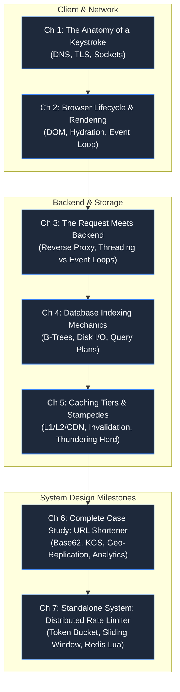

# Part 1: The Anatomy of a Request & Web Fundamentals

> **Theme**: Tracing software end-to-end from browser keystroke to persistent storage.
> **Opening Incident**: *The viral URL redirect that brought down a retailer's Black Friday launch.*

---

---

## Chapters & Core Subtopics

### Chapter 1: The Anatomy of a Single Keystroke
- **The Story**: 500ms delay causing 30% drop-off in flash checkout.
- **Fundamentals**: Recursive DNS, Anycast routing, TCP 3-way handshake, TLS 1.3 key exchange, HTTP/2 & HTTP/3 QUIC.
- **Outcome**: Mental model of physical network latency and socket handshakes.

### Chapter 2: The Browser Execution Cycle & Rendering Cost
- **The Story**: The "frozen" mobile checkout button that cost $2M during a flash sale.
- **Fundamentals**: Critical Rendering Path (CRP), layout thrashing, V8 JavaScript heap, Single-Page App hydration, memory leaks.
- **Outcome**: Ability to trace client-side bottlenecks before requests leave the browser.

### Chapter 3: When the Request Meets the Backend
- **The Story**: 50,000 concurrent socket connections crashing a monolith with 200 threads.
- **Fundamentals**: Reverse proxies (Nginx/Envoy), connection pooling, thread-per-request vs non-blocking event loops (epoll/kqueue), backpressure.
- **Outcome**: Designing ingress pipelines capable of surviving connection exhaustion.

### Chapter 4: Database Indexing & The Illusion of Speed
- **The Story**: The database that was lightning fast in staging but stopped responding under 100,000 rows.
- **Fundamentals**: B-Tree vs LSM-Tree mechanics, clustered vs secondary indexes, disk page reads, table scans, query execution plans.
- **Outcome**: Predicting and eliminating full table scans and lock contention.

### Chapter 5: Caching Tiers & The Cache Stampede
- **The Story**: Cache expires at midnight; 100,000 requests hit the primary database simultaneously.
- **Fundamentals**: Cache-aside, write-through, write-behind, cache invalidation, dogpiling/thundering herd, probabilistic early expiration (XFetch).
- **Outcome**: Building multi-tier caching architectures that protect persistent databases.

### Chapter 6: Deep Dive Case Study: Designing a Planetary URL Shortener
- **Progression**:
  1. Functional & Non-Functional requirements (100:1 read-to-write ratio).
  2. Short-code generation: MD5/SHA256 truncation vs Base62 counter vs Key Generation Service (KGS).
  3. HTTP 301 (Permanent) vs 302/307 (Temporary) caching trade-offs.
  4. Real-time click analytics without slowing down redirect latency.
  5. Anti-phishing, malicious redirect scanning, and regional CDN edges.
- **Outcome**: Complete end-to-end production architecture of a Tier-1 system.

### Chapter 7: Standalone System Design: The Distributed Rate Limiter
- **The Story**: A bad actor scripting 10,000 requests/sec brings down the URL shortener API.
- **Fundamentals**: Token bucket, Leaky bucket, Fixed window, Sliding window log, Sliding window counter.
- **Implementation**: Atomic Redis Lua scripts, distributed clock skew, cluster synchronization, 429 Retry-After headers.
- **Outcome**: Deployable rate limiter protecting edge APIs.
