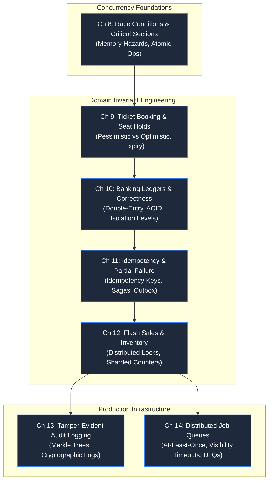

# Part 2: Concurrency, Correctness & State

> **Theme**: Guarding business invariants when thousands of requests collide.
> **Opening Incident**: *Two fans buy seat 14B at the exact same millisecond; a bank transfer creates $10M from thin air.*

---

---

## Chapters & Core Subtopics

### Chapter 8: The Ghost in the Machine: Race Conditions & Critical Sections
- **The Story**: A count of items in a database decreases below zero despite `if (count > 0)` checks in code.
- **Fundamentals**: Memory visibility, CPU cache coherency, check-then-act hazards, atomic operations, CAS (Compare-And-Swap).
- **Outcome**: Intuitive detection of race conditions at compile time and runtime.

### Chapter 9: The Last Seat: Ticket Booking Architecture
- **Domain**: Ticket Booking & Reservations.
- **The Story**: 50,000 fans rush the stadium seat map; two users receive boarding passes for the same seat.
- **Mechanisms**: Pessimistic row locking (`SELECT FOR UPDATE`), Optimistic locking (version numbers), Redis TTL holds, two-stage booking state machines.
- **Outcome**: Designing zero-overselling reservation engines under peak load.

### Chapter 10: Where Did the Money Go? Banking Ledgers & Correctness
- **Domain**: Banking & Fintech.
- **The Story**: A customer executes rapid transfers during high latency; their balance never drops below zero, but the bank loses $500,000.
- **Mechanisms**: Double-entry bookkeeping (credits must equal debits), isolation levels (Read Committed to Serializable), write-skew, phantom reads, Write-Ahead Logs (WAL).
- **Outcome**: Building mathematically verifiable ledgers that survive hardware crashes.

### Chapter 11: The Phantom Order: Idempotency & Partial Failures
- **Domain**: E-Commerce & Payment Gateways.
- **The Story**: Payment gateway timeout causes user to tap "Submit" 4 times, charging card 4 times for one cart.
- **Mechanisms**: Idempotency key lifecycles, database uniqueness constraints, distributed Two-Phase Commit (2PC) vs Saga pattern (orchestration vs choreography), Outbox pattern.
- **Outcome**: Designing payment systems that guarantee exactly-once business outcomes over unreliable networks.

### Chapter 12: Flash Sales & Inventory Depletion: High-Concurrency Retail
- **Domain**: E-Commerce & Retail.
- **The Story**: 1,000,000 requests per minute targeting 100 discounted gaming consoles.
- **Mechanisms**: Hot row contention, sharded inventory counters, Redis atomic decrements (`DECRBY`), pre-warmed queues, graceful cart degradation.
- **Outcome**: Handling extreme hot-spot write traffic without database lockups.

### Chapter 13: Standalone System: Tamper-Evident Audit Logging Engine
- **The Story**: An insider modifies database records to hide fraud; regulators demand mathematical proof of audit trail integrity.
- **Mechanisms**: Append-only log design, SHA-256 hash chaining, Merkle trees for efficient verification, immutable storage (WORM).
- **Outcome**: Building compliant, cryptographically verifiable audit infrastructure.

### Chapter 14: Standalone System: Distributed Job Queue & Worker Pool
- **The Story**: A batch invoicing worker crashes mid-run; thousands of invoices are sent repeatedly to customers.
- **Mechanisms**: Producer-consumer architecture, message visibility timeouts, heartbeat mechanisms, dead-letter queues (DLQs), poison pill handling, delayed retries with exponential backoff.
- **Outcome**: Production-grade async job orchestration handling mission-critical tasks.
