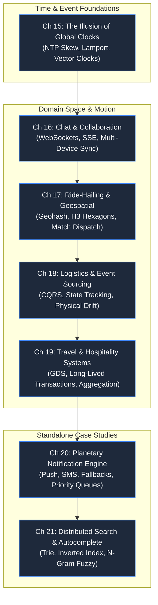

# Part 3: Time, Space & Asynchrony

> **Theme**: Coordinating distributed events across imperfect clocks, physical geography, and async queues.
> **Opening Incident**: *A chat reply appears before the question was sent; a rider and driver circle each other across town.*

---

---

## Chapters & Core Subtopics

### Chapter 15: The Illusion of Global Clock Time
- **The Story**: A distributed database overwrites modern updates with stale data because server clocks drifted by 80ms.
- **Fundamentals**: Wall-clock vs monotonic clock, NTP synchronization failures, TrueTime/GPS clocks, Lamport timestamps, Vector clocks.
- **Outcome**: Reasoning about causality and event ordering without relying on physical server timestamps.

### Chapter 16: The Message That Arrived Yesterday: Chat & Collaboration
- **Domain**: Chat & Real-Time Collaboration.
- **The Story**: A message shows up on a phone 2 hours later than on a desktop, out of conversational sequence.
- **Mechanisms**: Connection state management (WebSockets vs SSE vs Long-polling), message acknowledgments, offline message storage, client sync protocols, group fanout.
- **Outcome**: Designing low-latency, reliable messaging architectures supporting millions of concurrent connections.

### Chapter 17: Where Is My Driver? Geospatial Indexing & Ride-Hailing
- **Domain**: Ride-Hailing & Dynamic Delivery.
- **The Story**: Rider matches with a driver 5 miles away while another driver sits empty across the street.
- **Mechanisms**: Spatial partitioning, Geohashing, R-Trees, Google S2 cells, Uber H3 hexagonal spatial indexing, driver location ping pipelines, real-time dispatch algorithms under dynamic surge pricing.
- **Outcome**: Building location-based matching engines capable of millions of dynamic GPS updates per second.

### Chapter 18: The Lost Container: Logistics & Event Sourcing
- **Domain**: Logistics, Supply Chain & Global Inventory.
- **The Story**: A cargo shipment is marked delivered in the warehouse database while physically stuck in customs.
- **Mechanisms**: Event Sourcing (events as the single source of truth), CQRS (Command Query Responsibility Segregation), reconciliation workers, managing physical vs digital state divergence.
- **Outcome**: Architecting event-driven tracking systems with complete state reconstructibility.

### Chapter 19: The Multi-Leg Journey: Travel & Hospitality Systems
- **Domain**: Travel & Hospitality.
- **The Story**: A user books a flight, hotel, and rental car; the car booking fails, leaving the user with non-refundable flights.
- **Mechanisms**: Third-party legacy system integration (GDS/Amadeus/Sabre), long-running orchestrations, compensation transactions, multi-provider availability aggregation.
- **Outcome**: Handling complex multi-party workflows with external dependencies and unpredictable latency.

### Chapter 20: Standalone System: Planetary Notification Engine
- **The Story**: A critical emergency alert takes 45 minutes to reach users because promotional emails clogged the queue.
- **Mechanisms**: Notification prioritization tiers, multi-channel dispatch (Apple APNs, Google FCM, Twilio SMS, SendGrid email), user notification preferences, rate-limiting & anti-fatigue algorithms, webhook fallbacks.
- **Outcome**: Deploying multi-tenant, resilient notification infrastructure.

### Chapter 21: Standalone System: Distributed Search & Real-Time Autocomplete
- **The Story**: E-commerce users abandon searches due to 400ms search latency and lack of typo tolerance.
- **Mechanisms**: Inverted indexes, tokenization & stemmers, Trie data structures, prefix trees, N-gram fuzzy searching, caching popular search prefixes, low-latency read pipelines.
- **Outcome**: Building autocomplete engines returning rich suggestions under 15ms.
