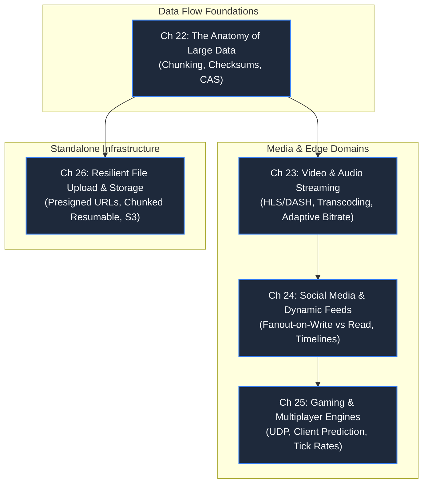

# Part 4: Data at Rest and in Motion

> **Theme**: Moving, transforming, and delivering gigabytes of media and real-time feeds at the planetary edge.
> **Opening Incident**: *The championship game buffers for 10 million viewers; a celebrity post freezes social media timelines.*

---

---

## Chapters & Core Subtopics

### Chapter 22: The Anatomy of Large Data: Chunks, Checksums & Object Storage
- **The Story**: A 2GB video upload fails at 98% due to a WiFi glitch; the entire file must restart from byte 0.
- **Fundamentals**: Content-Addressable Storage (CAS), cryptographic checksums (MD5, SHA-256), chunking algorithms, blob storage replication (block vs file vs object).
- **Outcome**: Understanding how distributed object stores (S3, GCS) guarantee durability across hardware failures.

### Chapter 23: The Spinning Wheel: Video & Audio Streaming Architecture
- **Domain**: Video & Audio Streaming.
- **The Story**: A streaming platform experiences massive user churn during live sports because startup latency exceeds 12 seconds.
- **Mechanisms**: Transcoding pipelines, video codecs (H.264, AV1), packaging into HLS and MPEG-DASH, manifest files (`.m3u8`), Adaptive Bitrate (ABR) switching, CDN edge caching of chunk segments.
- **Outcome**: Designing video delivery pipelines that achieve sub-2s startup latency under variable mobile bandwidth.

### Chapter 24: The Celebrity Problem: Social Media & Dynamic Feeds
- **Domain**: Social Media & Content Platforms.
- **The Story**: A creator with 80 million followers posts an update; database writes spike 10,000x, stalling the database for ordinary users.
- **Mechanisms**: Fanout-on-write (push) vs Fanout-on-read (pull), hybrid fanout architectures, Redis Sorted Sets for fast timeline materialization, graph databases for follower relationships.
- **Outcome**: Architecting social feed systems that balance write amplification against query latency.

### Chapter 25: 60 Ticks per Second: Gaming & Real-Time Multiplayer
- **Domain**: Gaming & Real-Time Multiplayer Systems.
- **The Story**: A player fires a shot that misses on their screen, but hits on the server; high ping players experience "rubber-banding."
- **Mechanisms**: Why TCP is unsuitable for high-speed games (head-of-line blocking); UDP and WebTransport; authoritative server models; client-side prediction; server reconciliation; dead reckoning and lag compensation.
- **Outcome**: Designing sub-50ms state synchronization systems for multiplayer simulation.

### Chapter 26: Standalone System: Resilient File Upload & Object Storage
- **The Story**: Users uploading 4K smartphone videos overwhelm the web application servers with memory exhaustion and timeouts.
- **Mechanisms**: Direct-to-storage uploads via presigned URLs, resumable uploads (Tus protocol), parallel chunked multipart uploads, asynchronous background virus scanning and thumbnail generation pipelines.
- **Outcome**: Production-ready, serverless media ingestion pipeline handling petabytes reliably.
