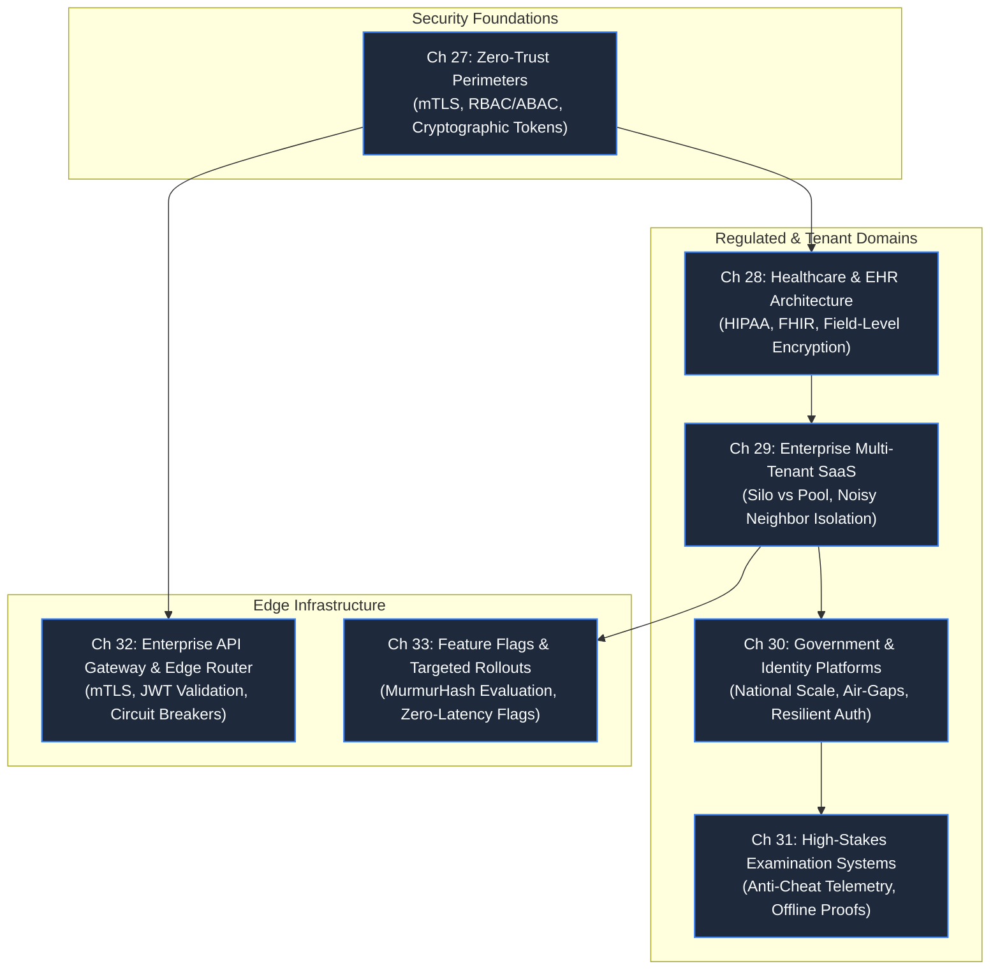

# Part 5: Trust, Isolation & Compliance

> **Theme**: Preserving security, tenancy boundaries, and compliance when stakes are existential.
> **Opening Incident**: *A clinic query leaks pediatric records to another hospital; a single SaaS tenant crashes an entire cloud region.*

---

---

## Chapters & Core Subtopics

### Chapter 27: The Zero-Trust Perimeter: Auth & Boundaries
- **The Story**: An internal service micro-service trust assumption allows an attacker with a stolen internal IP to access private customer records.
- **Fundamentals**: Defense-in-depth, mTLS service-to-service authentication, JWT validation pitfalls, RBAC vs ABAC (Attribute-Based Access Control), cryptographic token revocation.
- **Outcome**: Designing security architectures where every request is authenticated and authorized regardless of origin network.

### Chapter 28: The Leaked Health Record: Healthcare & Medical Architecture
- **Domain**: Healthcare & Medical Systems.
- **The Story**: A pediatric patient's record is displayed in an adult patient portal due to shared cache keys across family accounts.
- **Mechanisms**: FHIR healthcare data interchange, HIPAA/GDPR regulatory controls, patient consent graphs, field-level encryption with customer-managed keys (envelope encryption), immutable access audit trails.
- **Outcome**: Architecting life-critical health platforms with zero-data-leakage guarantees.

### Chapter 29: The Noisy Neighbor: Enterprise SaaS & Multi-Tenancy
- **Domain**: Enterprise SaaS & Multi-Tenant Systems.
- **The Story**: A single enterprise customer runs a massive export script, consuming 95% of database I/O and crashing all other 4,000 tenants.
- **Mechanisms**: Tenancy isolation models (Pool vs Silo vs Bridge), tenant routing, row-level security (RLS) vs schema-per-tenant, tenant-aware rate limiters, noisy-neighbor mitigation.
- **Outcome**: Building multi-tenant B2B systems that balance resource efficiency with strict tenant isolation.

### Chapter 30: 50 Million Citizens: Government & Identity Platforms
- **Domain**: Government & Public Services.
- **The Story**: A nationwide benefits portal opens at 9:00 AM; authentication crashes under 50 million citizen logins, halting public services.
- **Mechanisms**: Massive-scale public authentication, national identity verification, biometric indexing, graceful queueing, air-gapped sovereign cloud deployments, disaster-proof offline capabilities.
- **Outcome**: Designing public infrastructure resilient against catastrophic civic overload.

### Chapter 31: The High-Stakes Exam: Education & Examination Systems
- **Domain**: Education & Online Examination Systems.
- **The Story**: A student taking a bar exam loses internet connection at minute 119; their answers are discarded, sparking legal action.
- **Mechanisms**: Deterministic local state recording, client-side cryptographic submission proofs, intermittent connectivity synchronization, anti-cheat telemetry pipelines, tamper-evident lockdown protocols.
- **Outcome**: Building bulletproof client-server workflows for unrepeatable high-stakes events.

### Chapter 32: Standalone System: Enterprise API Gateway & Edge Router
- **The Story**: Inconsistent auth and rate-limiting across 50 microservices creates critical security holes and operational chaos.
- **Mechanisms**: Dynamic path routing, edge JWT validation, protocol translation (gRPC to HTTP/JSON), rate limiting integration, circuit breaking, SSL offloading.
- **Outcome**: Building a centralized, high-performance API Gateway protecting backend microservices.

### Chapter 33: Standalone System: Dynamic Feature Flags & Rollouts
- **The Story**: A buggy release triggers an immediate crash loop; redeploying takes 40 minutes, causing a catastrophic outage.
- **Mechanisms**: Zero-network local evaluation using consistent hashing (MurmurHash3), real-time rule propagation via SSE, progressive canary rollouts (1% -> 5% -> 50% -> 100%), automated kill-switches.
- **Outcome**: Implementing a resilient continuous deployment and risk-mitigation system.
