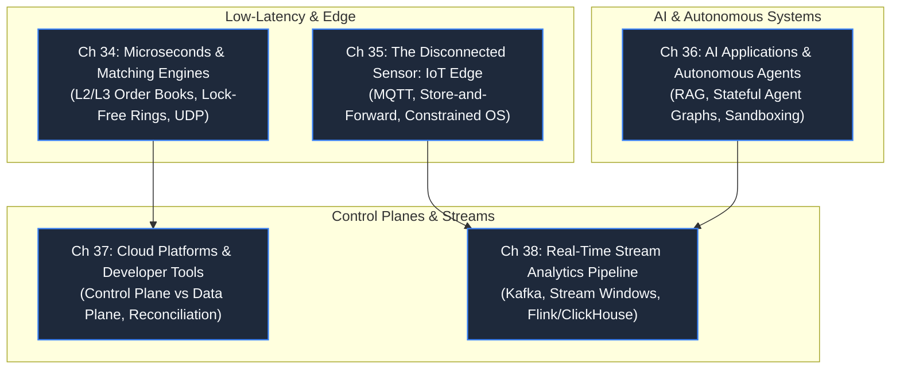

# Part 6: High Velocity & Extreme Constraints

> **Theme**: Architecting systems under radical constraints: nanosecond latencies, intermittent edge connectivity, non-deterministic AI agents, and planet-scale cloud control planes.
> **Opening Incident**: *A 2-microsecond delay wipes out $4M in arbitrage; an AI agent enters an infinite refund loop.*

---

---

## Chapters & Core Subtopics

### Chapter 34: The Physics of Microseconds: Trading & Matching Engines
- **Domain**: Trading & Financial Markets.
- **The Story**: A market maker suffers catastrophic losses because a garbage collector pause introduced a 15ms latency spike during market volatility.
- **Mechanisms**: Price-time priority matching algorithms, Level 2 / Level 3 order books, lock-free ring buffers (Disruptor pattern), zero-copy networking, kernel bypass, UDP multicast for market feeds, deterministic tick replay.
- **Outcome**: Designing ultra-low latency, deterministic financial engines where microseconds decide survival.

### Chapter 35: The Disconnected Sensor: IoT & Connected Devices
- **Domain**: IoT & Connected Edge Devices.
- **The Story**: An oil pipeline sensor loses cell connectivity for 3 days; when it reconnects, an out-of-order data deluge crashes the central ingest cluster.
- **Mechanisms**: MQTT broker architectures, QoS 0/1/2 delivery levels, edge store-and-forward buffers, edge aggregation and downsampling, device shadow states, battery and memory constraints.
- **Outcome**: Building IoT architectures capable of surviving weeks of offline operation and mass reconnection storms.

### Chapter 36: The Non-Deterministic Machine: AI Applications & Agents
- **Domain**: AI-Powered Applications & Autonomous Agent Systems.
- **The Story**: An e-commerce customer support AI agent hallucinates a coupon code offering 100% off, resulting in $3M in uncollectible orders.
- **Mechanisms**: Deterministic wrappers around non-deterministic LLMs, Vector database indexing (HNSW, IVFFlat), Retrieval-Augmented Generation (RAG) pipelines, stateful agent graph orchestration (LangGraph/DAGs), tool sandboxing, deterministic invariant guardrails, human-in-the-loop checkpoints.
- **Outcome**: Designing production systems that reliably integrate probabilistic AI models into mission-critical business workflows.

### Chapter 37: The Control Plane That Never Sleeps: Cloud Platforms
- **Domain**: Cloud Platforms & Developer Tools.
- **The Story**: An orchestrator attempts to auto-heal 500 pods simultaneously, triggering a cascading API server collapse.
- **Mechanisms**: Control plane vs Data plane separation, declarative desired-state reconciliation loops (Kubernetes operator pattern), etcd consistency, raft consensus, self-healing boundaries, progressive rollouts.
- **Outcome**: Designing platform infrastructure that survives control plane failures without interrupting running customer traffic.

### Chapter 38: Standalone System: Real-Time Stream Analytics Engine
- **The Story**: Business dashboards lag 3 hours behind reality, blinding operators during a major product launch failure.
- **Mechanisms**: Distributed event log ingestion (Kafka), stream processing windowing (tumbling, sliding, session windows), stateful stream joins, columnar analytics storage (ClickHouse), real-time OLAP queries.
- **Outcome**: Deploying end-to-end streaming analytics pipelines processing 500,000 events/sec with sub-second query freshness.
