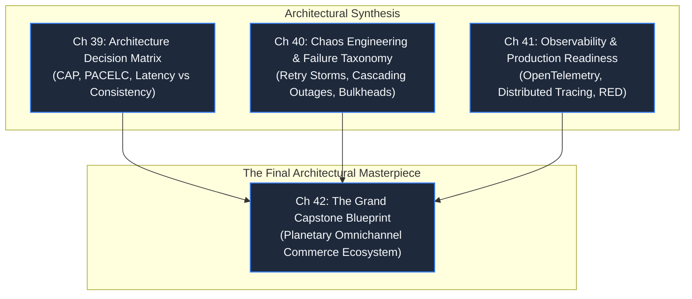

# Part 7: The Master Architect: Trade-Offs & Blueprints

> **Theme**: Synthesizing all fundamentals, domains, and systems into the mindset and execution of a Principal Software Architect.
> **Opening Incident**: *A cascading multi-region cloud failure takes down 40 global brands simultaneously.*

---

---

## Chapters & Core Subtopics

### Chapter 39: The Architecture Decision Matrix: Trade-Offs Under Pressure
- **The Story**: An architect insists on a microservices mesh with distributed transactions for a 5-person team, causing company bankruptcy before launch.
- **Fundamentals**: CAP theorem in practical reality; PACELC theorem; latency vs consistency trade-offs; operational complexity cost; build vs buy analysis; evolutionary architecture.
- **Outcome**: A structured, battle-tested rubric to evaluate and defend architectural decisions in front of executives and engineering teams.

### Chapter 40: Chaos Engineering & The Failure Taxonomy
- **The Story**: A minor cache misconfiguration causes downstream retries that trigger a global cascading power failure across data centers.
- **Mechanisms**: Failure classification (transient vs permanent vs Byzantine); retry storms and thundering herds; jitter and exponential backoff; circuit breakers; bulkhead patterns; chaos experiments (injecting packet loss, killing master nodes).
- **Outcome**: Designing self-stabilizing distributed systems that degrade gracefully rather than collapsing catastrophically.

### Chapter 41: Full-Spectrum Observability & Production Readiness
- **The Story**: A production outage takes 14 hours to diagnose because logs contained 500,000 generic error messages with no request trace context.
- **Mechanisms**: The three pillars vs actionable observability; OpenTelemetry standards; distributed trace context propagation (W3C traceparent headers); tail-based sampling; RED (Rate, Errors, Duration) and USE methods; actionable alerting vs alert fatigue.
- **Outcome**: Implementing deep observability that identifies root causes within minutes.

### Chapter 42: The Grand Capstone: Planetary Omnichannel Blueprint
- **The Grand Challenge**: Design a unified, planetary-scale platform integrating:
  1. High-throughput flash sales & inventory reservation.
  2. Double-entry banking ledgers & payment settlement.
  3. Real-time driver geospatial tracking & dynamic route dispatch.
  4. Global video live-streaming & social timeline feeds.
  5. Multi-channel notification dispatch & distributed search autocomplete.
  6. Autonomous AI support agents with deterministic guardrails.
  7. Multi-region active-active deployment and zero-downtime disaster recovery.
- **Outcome**: A complete, publication-grade architectural blueprint integrating all 42 chapters into a coherent, production-ready system design.
