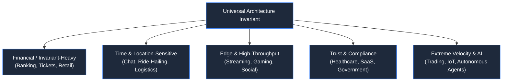

# Cross-Domain Architecture Matrix

> **Cross-Reference Guide**: How fundamental architectural patterns adapt across all 18 domains and 10 standalone systems in the manuscript.

---

---

## 1. Matrix: Common Fundamentals Across All 18 Domains

| Fundamental | Primary Chapter Reference | Cross-Domain Reuse & Variant |
|---|---|---|
| **Caching & Invalidation** | [Ch 05: Caching](/book/part-01-request-anatomy/chapter-05-caching-tiers-and-stampedes.md) & [Ch 06](/book/part-01-request-anatomy/chapter-06-case-study-planetary-url-shortener.md) | Video manifests ([Ch 23](/book/part-04-media-search-edge/chapter-23-video-audio-streaming-architecture.md)), Flight search ([Ch 19](/book/part-03-time-space-asynchrony/chapter-19-travel-hospitality-systems.md)), Flash catalog ([Ch 12](/book/part-02-concurrency-correctness/chapter-12-flash-sales-inventory-depletion.md)) |
| **Idempotency & Retries** | [Ch 10: Banking](/book/part-02-concurrency-correctness/chapter-10-banking-ledgers-correctness.md) & [Ch 11](/book/part-02-concurrency-correctness/chapter-11-idempotency-partial-failures.md) | E-commerce orders ([Ch 12](/book/part-02-concurrency-correctness/chapter-12-flash-sales-inventory-depletion.md)), Exam submissions ([Ch 31](/book/part-05-trust-multitenancy/chapter-31-education-online-examinations.md)), Ride requests ([Ch 17](/book/part-03-time-space-asynchrony/chapter-17-geospatial-indexing-ride-hailing.md)) |
| **Concurrency Control** | [Ch 08: Race Conditions](/book/part-02-concurrency-correctness/chapter-08-race-conditions-critical-sections.md) & [Ch 09](/book/part-02-concurrency-correctness/chapter-09-ticket-booking-architecture.md) | Flash sales ([Ch 12](/book/part-02-concurrency-correctness/chapter-12-flash-sales-inventory-depletion.md)), Order book matching ([Ch 34](/book/part-06-extreme-constraints/chapter-34-trading-matching-engines.md)), Warehouse holds ([Ch 18](/book/part-03-time-space-asynchrony/chapter-18-logistics-event-sourcing.md)) |
| **Real-Time Push / Sync** | [Ch 16: Chat & Collab](/book/part-03-time-space-asynchrony/chapter-16-chat-collaboration-ordering.md) | Ride-hailing GPS ([Ch 17](/book/part-03-time-space-asynchrony/chapter-17-geospatial-indexing-ride-hailing.md)), Multiplayer gaming ([Ch 25](/book/part-04-media-search-edge/chapter-25-gaming-multiplayer-systems.md)), Order ticker ([Ch 34](/book/part-06-extreme-constraints/chapter-34-trading-matching-engines.md)) |
| **Event Sourcing & CQRS** | [Ch 18: Logistics](/book/part-03-time-space-asynchrony/chapter-18-logistics-event-sourcing.md) | Banking audit trail ([Ch 10](/book/part-02-concurrency-correctness/chapter-10-banking-ledgers-correctness.md)), Multi-leg travel ([Ch 19](/book/part-03-time-space-asynchrony/chapter-19-travel-hospitality-systems.md)), Healthcare audit ([Ch 28](/book/part-05-trust-multitenancy/chapter-28-healthcare-medical-systems.md)) |
| **Geospatial Partitioning**| [Ch 17: Ride-Hailing](/book/part-03-time-space-asynchrony/chapter-17-geospatial-indexing-ride-hailing.md) | Supply chain routing ([Ch 18](/book/part-03-time-space-asynchrony/chapter-18-logistics-event-sourcing.md)), IoT device clustering ([Ch 35](/book/part-06-extreme-constraints/chapter-35-iot-edge-constrained-devices.md)) |
| **High-Volume Fanout** | [Ch 24: Social Feeds](/book/part-04-media-search-edge/chapter-24-social-media-dynamic-feeds.md) | Emergency notifications ([Ch 20](/book/part-03-time-space-asynchrony/chapter-20-system-planetary-notification-engine.md)), Market data ticker ([Ch 34](/book/part-06-extreme-constraints/chapter-34-trading-matching-engines.md)) |
| **Sub-Millisecond Speed** | [Ch 34: Trading Engines](/book/part-06-extreme-constraints/chapter-34-trading-matching-engines.md) | Real-time gaming physics ([Ch 25](/book/part-04-media-search-edge/chapter-25-gaming-multiplayer-systems.md)), Search prefix matching ([Ch 21](/book/part-03-time-space-asynchrony/chapter-21-system-distributed-search-autocomplete.md)) |
| **Data Isolation / RLS** | [Ch 29: Multi-Tenant SaaS](/book/part-05-trust-multitenancy/chapter-29-enterprise-saas-multitenancy.md) | Healthcare patient silos ([Ch 28](/book/part-05-trust-multitenancy/chapter-28-healthcare-medical-systems.md)), Government citizen security ([Ch 30](/book/part-05-trust-multitenancy/chapter-30-government-identity-platforms.md)) |
| **Offline Synchronization**| [Ch 35: IoT Sensors](/book/part-06-extreme-constraints/chapter-35-iot-edge-constrained-devices.md) | Offline exam delivery ([Ch 31](/book/part-05-trust-multitenancy/chapter-31-education-online-examinations.md)), Mobile chat recovery ([Ch 16](/book/part-03-time-space-asynchrony/chapter-16-chat-collaboration-ordering.md)) |
| **Non-Deterministic Guards**| [Ch 36: AI Agents](/book/part-06-extreme-constraints/chapter-36-ai-agents-deterministic-guardrails.md) | Automated underwriting ([Ch 10](/book/part-02-concurrency-correctness/chapter-10-banking-ledgers-correctness.md)), Content moderation ([Ch 24](/book/part-04-media-search-edge/chapter-24-social-media-dynamic-feeds.md)) |

---

## 2. All 10 Standalone Case Studies

| Case Study | Chapter Link | Core Production Invariants |
|---|---|---|
| **1. Planetary URL Shortener** | [Chapter 06](/book/part-01-request-anatomy/chapter-06-case-study-planetary-url-shortener.md) | KGS pre-generation, Base62 encoding, HTTP 302 caching, async Kafka click analytics. |
| **2. Distributed Rate Limiter** | [Chapter 07](/book/part-01-request-anatomy/chapter-07-system-distributed-rate-limiter.md) | Redis Lua token bucket, race-free local memory tiers, HTTP 429 Retry-After. |
| **3. Tamper-Evident Audit Log** | [Chapter 13](/book/part-02-concurrency-correctness/chapter-13-system-tamper-evident-audit-log.md) | SHA-256 hash chaining, Merkle tree root anchoring, S3 Object Lock (WORM). |
| **4. Distributed Job Queue** | [Chapter 14](/book/part-02-concurrency-correctness/chapter-14-system-distributed-job-queue.md) | Visibility timeout heartbeat leases, at-least-once delivery, poison pill DLQ. |
| **5. Planetary Notification Engine** | [Chapter 20](/book/part-03-time-space-asynchrony/chapter-20-system-planetary-notification-engine.md) | P0/P1/P2 priority queues, multi-channel failover, token-bucket user anti-fatigue. |
| **6. Distributed Search / Autocomplete** | [Chapter 21](/book/part-03-time-space-asynchrony/chapter-21-system-distributed-search-autocomplete.md) | In-memory Trie with pre-computed Top-K, N-gram typo tolerance, edge debouncing. |
| **7. Resilient File Upload Platform** | [Chapter 26](/book/part-04-media-search-edge/chapter-26-system-resilient-file-upload.md) | Tus resumable upload protocol, direct S3 presigned multipart, CAS deduplication. |
| **8. Enterprise API Gateway** | [Chapter 32](/book/part-05-trust-multitenancy/chapter-32-system-enterprise-api-gateway.md) | JWKS public key edge verification, gRPC translation, three-state circuit breakers. |
| **9. Dynamic Feature-Flag System** | [Chapter 33](/book/part-05-trust-multitenancy/chapter-33-system-dynamic-feature-flags.md) | MurmurHash3 consistent canary hashing, SSE rule push, lock-free RCU memory swap. |
| **10. Real-Time Stream Analytics** | [Chapter 38](/book/part-06-extreme-constraints/chapter-38-system-realtime-stream-analytics.md) | Event-time watermarking, sliding windows, ClickHouse vectorized columnar OLAP. |

---

## 3. Grand Synthesis Across the 7 Parts

| Part | Core Architectural Theme | Definitive Principle |
|---|---|---|
| **Part 1** | Request Anatomy & Latency Physics | Physical distance dictates minimum latency; buffer early, cache smartly. |
| **Part 2** | Concurrency, Correctness & Contention | Protect critical sections; ledgers are immutable, append-only, and sum-zero. |
| **Part 3** | Time, Space & Asynchrony | Clocks drift; order distributed events through causal monotonic sequence numbers. |
| **Part 4** | Media, Search & The Edge | Decouple control plane metadata from binary data; push immutables to edge CDNs. |
| **Part 5** | Trust, Isolation & Multi-Tenancy | Never trust client or developers; enforce boundaries at the DB kernel and edge proxy. |
| **Part 6** | High Velocity & Extreme Constraints | Hardware physics rule low latency; wrap probabilistic models in deterministic code. |
| **Part 7** | Master Synthesis & Capstone | Systems fail; partition into cell bulkheads, observe via traces, and design for chaos. |
